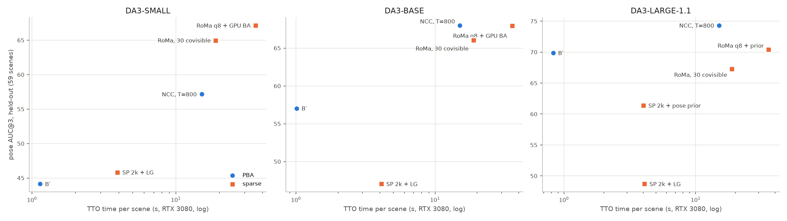
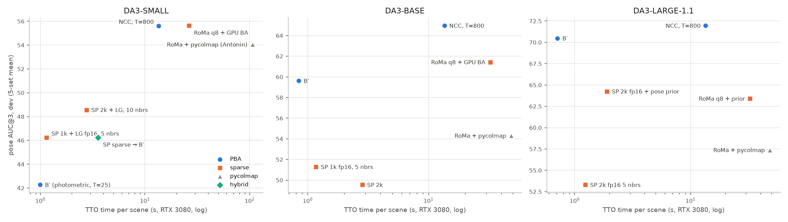

# How fast can track-based BA be, and is skipping tracks worth it?

2026-11-24 · RTX 3080 (tum1) · DA3-SMALL / BASE / LARGE-1.1 predictions of the benchmark · new code
`scripts/sba_fast.py` (summaries `sba_sum.py`, `sba_f1.py`, figures `sba_plot.py`) · every run and number:
`knowledge/ideas/fast-sparse-ba.md`

## The answer in five lines

1. **Bundle adjustment itself is cheap if done on the GPU.** Our new GPU BA takes 0.1-0.2 s on keypoint tracks and
   0.5-4 s on dense RoMa tracks (150k-1.7M observations). pycolmap needs 15-125 s for the same problems, at the same
   accuracy.
2. **Building the tracks is what costs time, and it also decides the accuracy.**
   - *Keypoint tracks* (SuperPoint + LightGlue): 1-4 s per scene, but too few matches in textureless rooms.
   - *Dense tracks* (RoMa v2): 19-36 s per scene (~70 ms per image pair), and very accurate.
3. **Dense tracks + BA reach ~67-70 AUC@3 on held-out for every model size** (SMALL 67.1, BASE 67.9, LARGE 70.4).
   The tracks decide the result, not DA3's initial cameras. PBA instead scales with the model:
   - B′: 44 / 57 / 70 (SMALL / BASE / LARGE)
   - NCC: 57 / 68 / 74
4. **So against accurate tracks, skipping tracks buys ~20-35x speed.** On SMALL it currently costs 10 AUC (NCC 57 vs
   67) and 23 AUC for B′. On BASE, NCC at 15 s equals dense-track BA at 36 s. On LARGE, B′ at 0.8 s equals it, and NCC beats it (74.3 vs 70.4).
5. **Against cheap keypoint tracks, PBA's speed advantage is only 2-4x.** Keypoint BA beats B′ only on SMALL, by
   1.7 AUC on held-out, and loses badly on BASE and LARGE. "BA is 50x slower than PBA" came from RoMa + pycolmap
   on the CPU, not from BA as such.

*Held-out (59 scenes): pose AUC@3 (5-set mean) against TTO time per scene on the RTX 3080, log scale. Blue: PBA. Orange:
track-based BA with the new GPU pipeline. BASE/LARGE reuse SMALL's RoMa tracks, so their RoMa times are SMALL's matching
time plus their own BA.*

## Results

### Held-out (59 scenes), pose AUC@3

| model | B′ (PBA) | NCC (PBA) | SuperPoint + LG + BA | RoMa + BA | RoMa, 30 covisible frames |
|---|---|---|---|---|---|
| SMALL | 44.1 · 1.1 s | 57.2 · 15 s | 45.8 · 3.9 s | **67.1** · 36 s | 65.0 · 19 s |
| BASE | 57.0 · 1.0 s | **68.0** · 15 s | 47.0 · 4.1 s | **67.9** · 36 s | 66.1 · 19 s |
| LARGE-1.1 | 69.9 · 0.8 s | **74.3** · 15 s | 48.7 (+ pose prior 61.4) · 4 s | 68.5 (+ prior **70.4**) · 36 s | 67.3 · 19 s |

**Per dataset, SMALL held-out** (HiRoom / 7-Scenes / ScanNet++ / DTU / ETH3D):

| method | HiRoom | 7-Scenes | ScanNet++ | DTU | ETH3D |
|---|---|---|---|---|---|
| B′ | 54.1 | 22.4 | 34.6 | 77.9 | 31.7 |
| NCC | **76.6** | **24.6** | 49.8 | 83.9 | 50.9 |
| SuperPoint + BA | 51.0 | 20.6 | 38.0 | 89.5 | 30.0 |
| RoMa + BA | 73.2 | 23.5 | **79.1** | **99.9** | **60.0** |

Dense tracks win ScanNet++, DTU and ETH3D. PBA wins HiRoom; 7-Scenes is flat for every method.

**Recon F1, SMALL held-out (4 sets):** RoMa + BA 57.0, NCC 53.2, B′ 51.1. Better poses outweigh PBA's depth refinement,
even though sparse BA only rescales DA3's depth per frame. On dev, PBA has the higher F1:

| model (dev) | B′ | NCC | RoMa + BA | SuperPoint + BA |
|---|---|---|---|---|
| SMALL | 47.8 | 51.6 | 46.8 | 43.2 |
| BASE | 61.9 | – | 55.7 | 50.3 |
| LARGE | 70.2 | – | 61.0 | 55.6 |

### Dev (22 scenes), pose AUC@3: the same picture, with more variants

| | SMALL | BASE | LARGE-1.1 |
|---|---|---|---|
| B′ | 42.3 · 1.0 s | 59.6 · 0.8 s | **70.5** · 0.7 s |
| NCC | 55.6 · 13.5 s | **65.0** · 13.5 s | 72.0 · 13.5 s |
| SuperPoint 1k + LG fp16, 5 neighbours (fastest) | 46.2 · 1.2 s | 51.3 · 1.2 s | 50.6 · 1.2 s |
| SuperPoint 2k + LG, 10 neighbours | 48.6 · 2.8 s | 49.5 · 2.8 s | 51.5 (prior: 64.2) · 2.9 s |
| RoMa q8 + GPU BA | 55.6 · 26 s | 61.4 · 32 s | 62.2 (prior 63.4) · 32 s |
| RoMa q8, 30 covisible frames per query | 64.6 · 20 s | 66.8 | 68.1 |
| RoMa q8 + pycolmap (Antonin) | 54.1 · 106 s | 54.3 · 48 s | 57.4 · 48 s |

Dev understates dense tracks: its 3 ETH3D scenes are hard and chaotic. On dev the RoMa variant restricted to 30
covisible frames looked +9 better; on held-out it is 2 AUC worse than all pairs, at half the time.

## Where the time goes

Median per scene on the 3080, DA3-SMALL dev. "≤ 30 frames" is HiRoom; "> 30 frames" is 7-Scenes and ScanNet++ (100
frames), DTU (64) and ETH3D.

| pipeline | ≤ 30 frames | > 30 frames | stages (> 30 frames) |
|---|---|---|---|
| RoMa q8 + pycolmap (Antonin) | 18.7 s | 158 s | RoMa 24, pycolmap BA 125 |
| RoMa q8 + GPU BA (new) | 5.6 s | 36 s | RoMa 33, tracks 0.1, BA 3.0 |
| SuperPoint 2k + LightGlue + GPU BA | 0.49 s | 4.2 s | SuperPoint 0.3, LightGlue 3.7, tracks 0.3, BA 0.19 |
| same, LightGlue fp16 | 0.35 s | 2.6 s | LightGlue 2.1 |
| PBA B′ (T = 25) | 0.38 s | 1.15 s | – |
| PBA NCC (T = 800, 40 LM on NCC) | 8.7 s | 15.6 s | – |

B′ runs ~3-4x faster on the 5090 than on the 3080 (0.2-0.3 s). The sparse pipeline is GPU-bound too, apart from
~0.1-0.3 s of Python track building, so it should speed up similarly. RoMa matching is pairwise: query frames × frames ×
~70 ms.

## What it took to make BA fast and correct

- **Track building.** The obvious vectorised version (connected components of the match graph, dropping components
  that contain two keypoints of one frame) keeps only 1.5 % of the observations. A greedy union-find that refuses a
  merge that would create such a conflict (COLMAP style) keeps all of them and takes 0.03 s.
- **Point depth.** Clamping a point's camera depth to ≥ 1e-6 is a silent killer. A point behind a camera produces ~1e6
  Jacobians, its camera's LM damping explodes and that camera freezes (one ScanNet++ scene: AUC@3 0.07 instead of
  0.47 on identical tracks).
- **GeForce hardware.** fp64 runs at 1/64 of the fp32 rate, and cuBLAS is slow on millions of 2x8 matrices (27 ms per
  call). The fix:
  - per-observation products as broadcast multiply-adds in fp32;
  - block sums in fp64 (`segment_reduce`);
  - the Schur product as three fp32 GEMMs with a hi/lo split.

  Result: 0.07-0.1 s per LM iteration at 615k observations, with the same cost trajectory as Antonin's fp64 `ba_lm.py`.

## What didn't help

- **PBA started from the sparse cameras** ends where it ends from DA3's cameras:
  - sparse → B′ 46.2, below sparse alone (48.6);
  - sparse → NCC 55.4, the same as NCC alone (55.6);
  - RoMa → B′ 52.0, below RoMa alone (56.0).

  PBA's optimum is set by the depth (`knowledge/ideas/depth-bottleneck.md`), not by where it starts.
- **Keypoint-pipeline variants** were all worse: 4k keypoints, all pairs, every match as its own 2-view point, no radial
  coefficient, Cauchy scale 0.25 or 1 px.
- **A pose prior** helps sparse BA only for LARGE (dev 51.5 → 64.2; RoMa held-out 68.5 → 70.4) and hurts SMALL and BASE.

## State of the art (2025-2026)

**The field's answer to "tracks are slow" is cheaper tracks, not no tracks:**

- **Glob3R** (07/26) trains a dense matching head on frozen Pi3X tokens: faster *and* more accurate tracks than RoMa v2
  or VGGT's tracker, followed by motion averaging and BA. On ETH3D it reaches RRA@1 / RTA@1 of 92 / 73.
- **BLASt3R** (NAVER, 09/26) uses a fast multi-view matcher plus GPU LM BA that also optimises "adjustable depth maps",
  i.e. linear combinations of predicted depth channels.
- **GGPT and Refin3R** (11/26) run RoMa v2 + sparse BA on top of DA3, then densify the depth with a network.
- **InstantSfM and BA-in-eager-mode** are PyTorch GPU BAs: the same speed-up we got here.

**Trackless refinement exists, and EPO is the closest competitor to a PBA paper:**

- **EPO** (Graz/Sony, 07/26) aligns Canny edges through the predicted depth (distance transforms, Adam, ~15 s on a
  4090) and beats VGGT+BA on ScanNet++, TerraSky3D and MipNeRF360.
- **VGGT-X** aligns XFeat matches with a Sampson loss, without building tracks.
- **DeepBA** (TUM, 11/26) learns a track-free GNN bundle adjuster.

None of these is dense photometric or feature-metric, and none studies matched compute across model sizes.

## What this means for the no-track direction

- **The speed argument holds only against dense tracks.** Against a GPU keypoint pipeline the gain is 2-4x and nothing
  on small scenes. A paper has to compare to a GPU sparse pipeline, not to pycolmap.
- **The accuracy bar is dense-track BA:** ~67-70 held-out for any model at ~20-36 s. A no-track method is clearly worth
  it if it reaches that at a few seconds, especially from a small model, where the gap is largest (SMALL: NCC 57 vs 67).
  The gap sits in ScanNet++ (50 vs 79), ETH3D (51 vs 60) and DTU (84 vs 100). PBA already wins HiRoom (77 vs 73).
- **For BASE and LARGE, PBA is already the better trade:** BASE NCC 68.0 at 15 s = dense tracks at 36 s; LARGE B′ equals
  dense-track BA at 1/40 of the time, and NCC (74.3) beats it.
- **An open question in that light:** why do dense tracks fix ScanNet++ while PBA can't? It fits the depth-bottleneck
  diagnosis. Tracks give every point a free depth, while PBA's grid cannot represent DA3's 8-16-cell depth error.
  BLASt3R-style adjustable depth maps, or a finer learned depth basis, are the natural next step.

## Caveats

- All times are from the RTX 3080, measured with nothing else on the GPU, except the held-out runs, which shared the
  CPU with recon scoring.
- The seed was fixed and LightGlue / RoMa run deterministically, but GPU atomics make BA runs not bit-identical.
- BASE/LARGE RoMa runs reuse SMALL's cached tracks; only the query pixels depend on the model's confidence.
- Recon scoring of the held-out SuperPoint run was OOM-killed during TSDF fusion of a HiRoom scene, so that F1 is missing.
- VGG + Huber PBA does not fit the 100-frame scenes on the 3080, so it is missing from the comparison.
