# How DA3-Small fails: failure modes of poses and depth (2026-11-07)

## Questions and short answers

1. **Are the pose and depth errors small noise or jitter, or random outliers?** Neither, mostly.
   - **Poses:** pose error is shared between nearby cameras and drifts slowly along the trajectory. Real outliers exist mainly on ScanNet++ and ETH3D. There they come in runs of frames placed in the wrong part of the scene, not as isolated random frames.
   - **Depth:** depth error has very little pixel noise (σ 0.3–1.4%). It consists of smooth, low-frequency error plus large errors clustered at object edges and on whole surfaces.
2. **What causes the large pose outliers?** The choice of reference view. The benchmark always takes the first frame as the reference view. Changing only that frame decides which frames fail, while the images themselves are fine.
3. **Does reconstruction quality suffer more from depth errors or pose errors?** From the cameras. Fixing intrinsics and poses gains more F1 than fixing the depth maps on all five datasets (by 2–29 points; on 7-Scenes the two are close), and in 67 of 90 scenes.
   - **HiRoom:** the camera error is mostly the focal length, which DA3 predicts a median 19% too long.
   - **Within depth:** the smooth error is what costs F1, and the depth outliers barely matter.

## What was built

All files are untracked (nothing committed).

| File | What |
|---|---|
| `scripts/analyse_failure_modes.py` | Per scene: aligns predicted to GT poses and splits each camera's error into smooth part, jitter and outliers along the frame order. Splits the log-depth error into scene scale, per-frame offset, smooth part, fine noise and outliers. Also computes oracle counterfactual AUCs. Writes `workspace/failure_modes/<model>/<dataset>/<scene>.npz`. |
| `scripts/plot_failure_modes.py` | All 2D figures and `summary.json` in this folder. |
| `scripts/reconstruction_errors.py` | Back-projects every valid pixel with parts swapped between prediction and GT and scores F1 and per-pixel error. Renders the 3D figures (`3d_*.png`) and writes `reconstruction.json` and `reconstruction_parts.png`. |

The reference-view reruns, the frame-property comparison and the 7-Scenes registration check used one-off scripts in the session's scratchpad. They are not in the repo; their results are reported below.

To reproduce, starting from unposed predictions (`run_bench.py ... "eval.modes=[pose]"` is enough):

```sh
uv run scripts/analyse_failure_modes.py DA3-SMALL           # ~1 min, CPU
uv run scripts/plot_failure_modes.py DA3-SMALL              # ~1 min
uv run scripts/reconstruction_errors.py DA3-SMALL --render auto   # ~30 min, CPU
uv run scripts/reconstruction_errors.py DA3-SMALL --render scannetpp/5f99900f09 --no-metrics
```

All three scripts take the model name, so other model sizes only need their predictions first.

## Data

DA3-Small, unposed predictions of the DA3 benchmark: 90 scenes in total.

| Dataset | Scenes | Views per scene | GT depth |
|---|---|---|---|
| HiRoom | 30 | 10–23 | synthetic |
| 7-Scenes | 7 | 100 | Kinect |
| ScanNet++ | 20 | 100 | rendered laser mesh |
| DTU | 22 (DTU-49, not DTU-64) | 49 | MVS mesh |
| ETH3D | 11 | 14–76 | sparse laser samples |

## Method

**Pose alignment.**
- **Rotation:** the rotation gauge is the geodesic median of `R_gt R_predᵀ`.
- **Scale and translation:** with that rotation fixed, these are fitted by LMedS over 2-point samples and refined on the inliers. One gauge for rotations and centres matters: with separate ones, relative translation directions and the AUC change.
- **Outliers stand out:** the robust fit keeps a bad camera from being smeared over all cameras, as least squares would.
- **Units:** translation errors are in units of the scene's median GT depth.

**Pose decomposition.** Per camera, the residual rotation (rotation vector, degrees) and centre offset are split along the sorted frame order:
- **Smooth part:** a rolling median over 5–11 frames.
- **Jitter:** the rest.
- **Outliers:** jitter beyond the 99.9% quantile of 3D Gaussian noise (4.03σ, σ from the median) and larger than the scene's median error.
- **Gross errors:** a separate absolute label for over 15° or over 25% of scene depth.
- **Smooth vs white:** the von Neumann ratio measures this (1 for white noise, towards 0 for smooth error).

**Depth decomposition.** The error is `e = log(pred) − log(gt)` minus the scene's median, so it is relative.
- **Frame offset:** the per-frame median.
- **Smooth part:** a mask-aware Gaussian blur with σ = 1/24 of the image width (21 px at 504 px).
- **Fine noise and outliers:** the remainder, split at 5σ of its MAD.
- **Comparison grid:** GT is resampled to the prediction grid. ETH3D's sparse laser samples are block-averaged; blocks with under 3% samples or over 5% spread are dropped, so no values are mixed across depth edges.

**Oracle counterfactuals.**
- **Method:** one error type is removed using GT, as a correction to the prediction, and the pose is re-scored with the benchmark's own `compute_pose`.
- **Check:** the unmodified baseline reproduces the committed AUC exactly on all five datasets.
- **Gauge-invariant AUC:** a second AUC is computed from camera-to-camera relative poses (see the evaluation findings below).

**Reconstruction attribution.**
- **Configurations:** every pixel with valid GT is back-projected once per configuration. Each of depth map, intrinsics, rotation and camera centre comes from DA3 or the GT.
- **Scoring:** F1 is nearest-neighbour precision and recall against the GT back-projection at 5 cm (indoor), 5 mm (DTU) or 25 cm (ETH3D, as in DA3's benchmark). The per-pixel error is the distance between the two back-projections of the same pixel.
- **Depth scale:** depth uses the pose alignment's scale when cameras are predicted. When the cameras are GT, it uses its own median scale, so the scale mismatch isn't counted as depth error.

**Checks.**
- **Synthetic tests:** errors injected on purpose (scale, white jitter, smooth drift, 6 outlier cameras, depth offset, smooth warp, outlier pixels) were recovered. All 6 of 6 outlier cameras were found, and the depth offset and noise σ were recovered within 2%.
- **Bug found:** the pure-drift case first flagged 32 of 100 frames as outliers, which led to the second outlier condition above.

## Results: poses

| Dataset | Median rotation | Median translation (% depth) | Grossly wrong frames | Their share of rotation error² | Von Neumann ratio (rot) | Best AUC@3 gain among jitter / smooth / outliers |
|---|---|---|---|---|---|---|
| HiRoom | 1.35° | 3.8% | 1.2% (4 of 30 scenes) | 54% | 1.02 | no jitter: 9.5 → 24.1 |
| 7-Scenes | 1.85° | 3.1% | 0% | 0% | 0.08 | no smooth part: 14.5 → 52.6 |
| ScanNet++ | 2.47° | 8.2% | 13.6% (19 of 20 scenes) | 94% | 0.52 | no smooth part: 9.0 → 19.5 |
| DTU | 1.56° | 2.2% | 0% | 0% | 0.34 | no smooth part: 23.4 → 59.9 |
| ETH3D | 1.68° | 7.4% | 17.8% (7 of 11 scenes) | 96% | 0.60 | no smooth part: 8.6 → 21.7 |

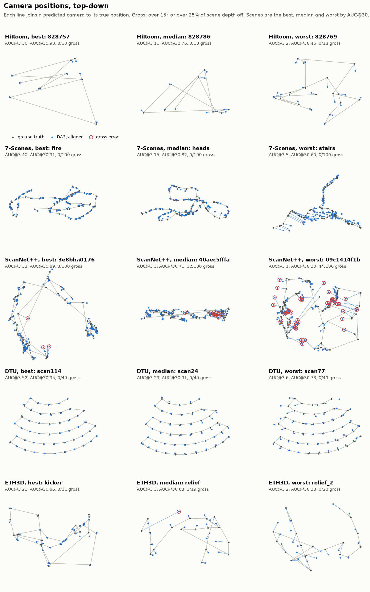
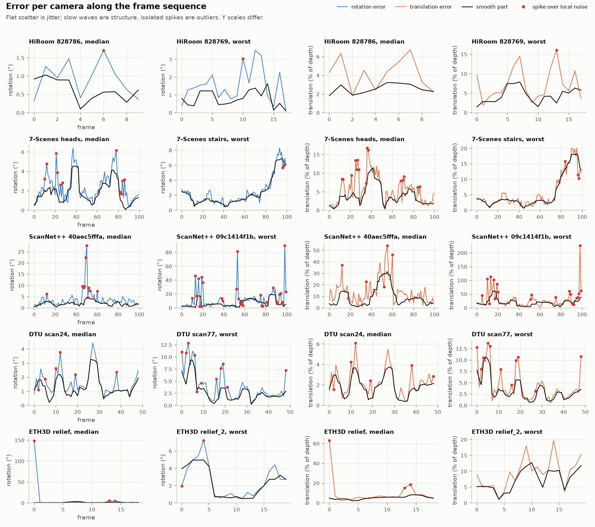

**Nearby cameras share their error.**
- **What the plot shows:** `pose_correlation_range.png` compares the residuals of camera pairs at equal true distance. Error similarity is about 0.9 for cameras 0.01–0.02 scene depths apart, about 0.45 at 0.1, and 0–0.2 at 0.2 (7-Scenes, ScanNet++). DTU stays correlated longer. ETH3D's closest pairs are an exception.
- **HiRoom:** it first looked like white jitter (von Neumann ratio 1.0). Its cameras are about 0.2 scene depths apart or more, where the other datasets' errors are also nearly independent. So its "jitter" is mostly a sampling effect, not a separate failure mode.

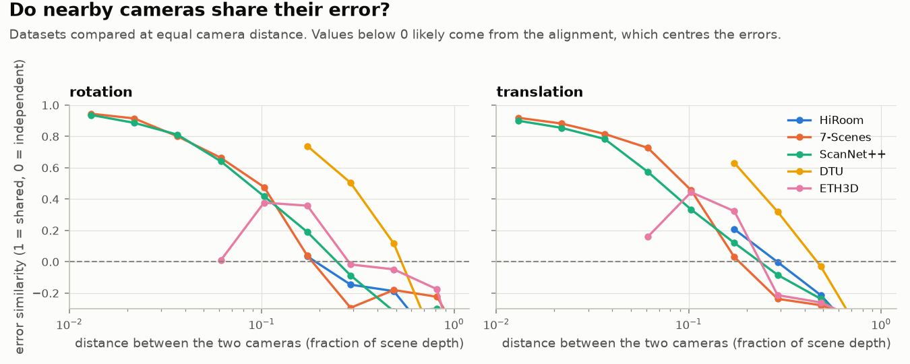

**Heavy tails, by very different amounts.** Relative to the scene median, errors reach 4–6× on 7-Scenes and DTU, about 45× on ScanNet++ and 22× on HiRoom (`pose_qq.png`). On 7-Scenes and DTU, the frames flagged as outliers are small spikes in absolute terms, such as 2° → 4°. Only ScanNet++, ETH3D and 4 HiRoom scenes have gross errors.

**What limits the AUC (oracle).**
- **Correlated error:** removing the smooth part gives the largest AUC@3 gain everywhere except HiRoom (`pose_counterfactuals.png`).
- **Outliers:** removing them adds only 1–3 points of AUC@3, but 5–7 points of AUC@30 on ScanNet++ and ETH3D.
- **Why AUC@3 is low overall:** at most camera distances the median pair is already near or above 3°. Translation direction gets worse for close cameras: for pairs under 0.1 scene depths, the median is 20° on 7-Scenes and 34° on ScanNet++ (`pose_baseline.png`).

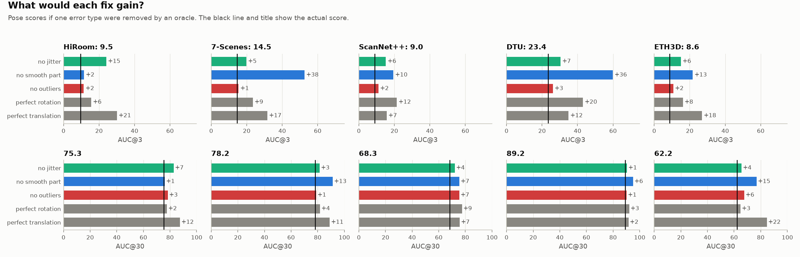

Other figures: `pose_pairs.png` (pairwise error matrices: a bad camera is a dark cross), `pose_failure_map.png`, `pose_qq.png`, `pose_baseline.png` and `pose_concentration.png`. The last shows that on ScanNet++ the worst 1% of frames hold 59% of the squared rotation error, against about 5% for Gaussian noise.

## Results: what causes the large pose errors

On all 20 ScanNet++ scenes, I reran DA3-Small with controlled changes (`ref_view_strategy=first` unless stated otherwise):

| Test | Result | Conclusion |
|---|---|---|
| Same reference view, all other frames shuffled (4 scenes) | Same failing frames, overlap 0.97–1.00 | Order beyond the reference doesn't matter |
| Only the reference view changed, 12 choices (4 scenes) | `5f99900f09`: 43 failing frames → 2 to 20; AUC@3 2.3–26.1, AUC@30 27.8–83.4 | The reference view decides which frames fail |
| Fully shuffled order, two seeds | Overlap with the original failures 0.15–0.16; gauge-invariant AUC 8.5 / 65.3 → 13.0–14.0 / 72.6–73.6 | Same as above |
| `saddle_balanced` reference | Gauge-invariant AUC 14.7 / 70.8; failure set overlap 0.19 | `first` is a poor default here |
| Ray-based poses (`use_ray_pose=True`) | Mostly the same frames fail (overlap 0.81) | Not just the camera head |
| Each failing frame run with only its 9 true neighbours | Median relative rotation to them 9.2° → 0.84°; normal frames 2.5° → 0.62° | The images aren't hard |
| Image sharpness, gradient, GT depth range | AUROC 0.37–0.56 (0.5 = no signal) | Not image quality |
| Image vs mesh rendered at the GT pose (NCC) | 0.77 failing vs 0.74 other (26% of frames have a rendering) | Not wrong ground truth |

Other properties of the failing frames:
- **Runs:** P(next frame fails | this one fails) is 0.46, against a 13.6% base rate.
- **Fewer similar views:** a median of 4 similar views (8 for other frames).
- **Scene size:** failure rate vs scene extent has Spearman 0.72 across scenes.
- **Vertical axis:** large errors (> 45°) are almost pure rotations about the vertical axis (median |axis · up| = 0.999), so the camera faces the wrong way.
- **Size:** most failing frames are only about 11° off; 5% exceed 90°, and 156 of 271 fail on translation only.
- **Confidence:** DA3's depth confidence is low on them (frame median 1.5 vs 3.7, AUROC ≈ 0.90).
- **Depth:** their depth is as good as other frames' (median RMS 1.05× the scene median). Example: `5f99900f09` frame 16 is 145° off with 4.5% depth RMS.

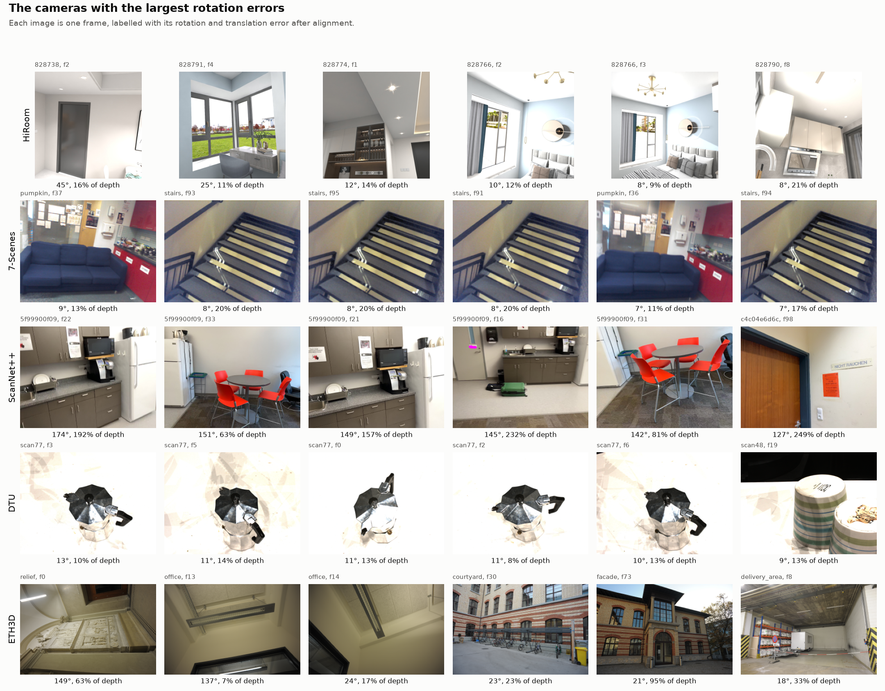

## Results: depth

| Dataset | Median abs. error | Pixels > 10% off | Fine-noise σ | Outlier pixels | Squared error in outliers | Outliers in regions ≥ 20 px (random scatter) | Pixels within 3%: scene scale → + offset → + smooth → + outliers removed |
|---|---|---|---|---|---|---|---|
| HiRoom | 2.7% | 8.8% | 0.55% | 8.7% | 54% | 97.4% (0.1%) | 53 → 65 → 91 → 98 |
| 7-Scenes | 3.3% | 15.9% | 1.38% | 12.0% | 82% | 99.2% (0.0%) | 47 → 52 → 76 → 88 |
| ScanNet++ | 3.4% | 14.9% | 0.90% | 10.4% | 68% | 97.8% (0.0%) | 46 → 58 → 83 → 93 |
| DTU | 1.1% | 2.0% | 0.30% | 6.4% | 69% | 96.4% (0.0%) | 86 → 90 → 97 → 100 |
| ETH3D | 3.7% | 16.1% | 0.91% | 6.9% | 34% | 92.3% (0.0%) | 43 → 54 → 86 → 93 |

- **Two counts, two answers:** squared error is dominated by the outliers, while the pixel count within 3% is dominated by the smooth part. The pixel count is what matters for F1 (see below).
- **Where the outliers are:** they're clustered, not random. Pixels within 1 px of a GT depth edge are outliers 46–61% of the time, against 1–2% beyond 64 px (`depth_where.png`). About half of them (47–61%) still lie more than 8 px from an edge on HiRoom, 7-Scenes and DTU, on failed surfaces. ETH3D's edge statistics are biased low by the block filter.
- **Confidence:** DA3's confidence ranks outliers with AUROC 0.66–0.73.
- **Spectrum:** the radially averaged error spectrum falls steadily, with no flat noise floor and no peak at the 14 px ViT patch (`depth_spectrum.png`, checked on the four non-ETH3D datasets).
- **Pose and depth scales:** they agree on average (median ratio 0.99–1.01 per dataset), but vary per scene (p10–p90 0.91–1.04 on HiRoom, 0.91–1.15 on ETH3D).
- **Pose vs depth per frame:** errors are barely correlated (Spearman ≤ 0.21).

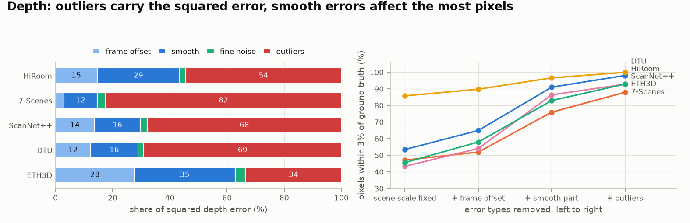
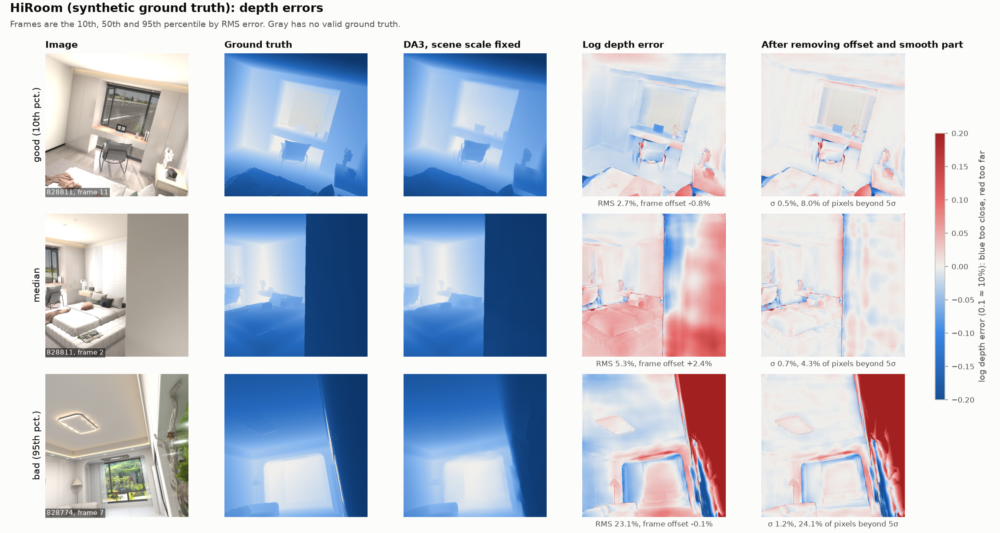
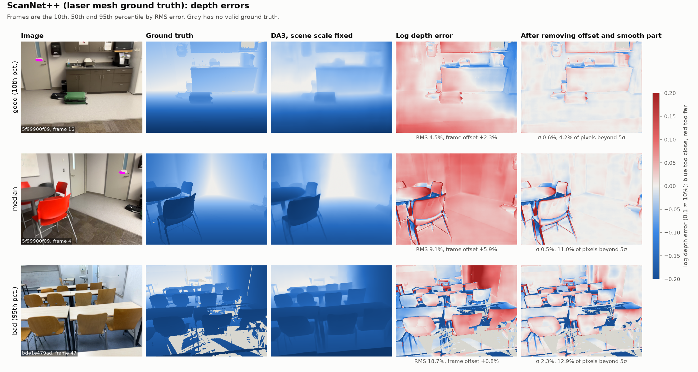

Other figures: `depth_gallery_{7scenes,dtu,eth3d}.png`, `depth_hist.png` (narrow Gaussian core, tails orders of magnitude above it), `depth_where.png` and `depth_spectrum.png`.

## Results: depth maps or cameras for reconstruction?

Mean F1 in % over scenes (own back-projection metric, see Method; **not** comparable with the benchmark's TSDF F1):

| Configuration | HiRoom | 7-Scenes | ScanNet++ | DTU | ETH3D |
|---|---|---|---|---|---|
| DA3-Small (all predicted) | 20.6 | 74.8 | 53.1 | 33.5 | 57.2 |
| Depth error only | 63.7 | 84.5 | 73.7 | 67.9 | 84.0 |
| Camera error only (intrinsics + poses) | 35.0 | 82.5 | 64.3 | 60.1 | 71.0 |
| Pose error only | 65.4 | 91.2 | 64.4 | 61.8 | 81.8 |
| Intrinsics error only | 51.6 | 92.5 | 99.9 | 81.2 | 88.0 |
| Rotation error only | 87.0 | 94.9 | 82.5 | 62.4 | 94.6 |
| Camera centre error only | 69.5 | 92.5 | 63.8 | 60.6 | 84.5 |
| Fix depth-pose scale mismatch | 28.6 | 75.6 | 58.5 | 55.0 | 64.4 |
| Fix intrinsics | 38.8 | 78.2 | 53.0 | 35.6 | 59.9 |
| Fix poses | 39.2 | 82.5 | 73.5 | 57.5 | 73.7 |
| Fix gross pose errors | 20.9 | 74.8 | 58.0 | 33.5 | 57.9 |
| Depth only: no offset or smooth error | 93.6 | 94.0 | 93.0 | 96.0 | 96.3 |
| Depth only: no outliers | 66.5 | 87.8 | 76.3 | 69.7 | 85.2 |
| Poses only: no smooth error | 72.1 | 99.7 | 76.7 | 86.3 | 93.9 |
| Poses only: no jitter | 80.0 | 91.4 | 70.4 | 65.0 | 83.8 |
| Poses only: gross errors fixed | 66.5 | 91.2 | 75.7 | 61.8 | 90.8 |

"Fix depth" equals "camera error only", and "fix intrinsics and poses" equals "depth error only".

| Dataset | Gain from fixing cameras | Gain from fixing depth | Scenes where fixing cameras gains more | Largest camera part |
|---|---|---|---|---|
| HiRoom | +43.1 | +14.4 | 26 / 30 | intrinsics |
| 7-Scenes | +9.8 | +7.7 | 3 / 7 | none clearly |
| ScanNet++ | +20.6 | +11.2 | 14 / 20 | camera centres |
| DTU | +34.4 | +26.6 | 17 / 22 | rotation and centres |
| ETH3D | +26.8 | +13.8 | 7 / 11 | camera centres |

- **Intrinsics:** the predicted/GT focal ratio has median 1.19 on HiRoom (p10–p90 1.02–1.27), 0.90 on 7-Scenes, 1.07 on ETH3D (up to 1.32), and 0.99–1.00 on ScanNet++ and DTU.
- **Scale mismatch:** fixing only the depth-pose scale mismatch adds 22 F1 on DTU. DTU's 5 mm threshold is 0.8% of its depth, so a few percent of scale error is fatal there. DTU scan9 (F1 0.5%) has a pose scale 8% below the depth scale, and it's also the benchmark's worst DTU scene (Chamfer distance 13.7 mm).
- **Inside depth:** removing the smooth error gives 93–96%, while removing outliers adds only 1–3 points.
- **Inside poses:** the smooth, correlated error matters most. Fixing gross errors matters as much on ScanNet++ and ETH3D.
- **Interactions:** errors compound. HiRoom 828769: depth alone 79%, poses alone 52%, intrinsics alone 43%, all together 2%. Swapping one true part into a self-consistent prediction can even lower F1, which is why both "error only" and "fix" views are reported.

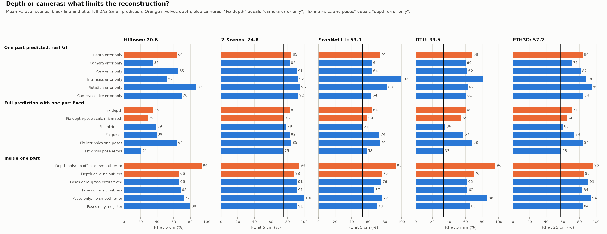
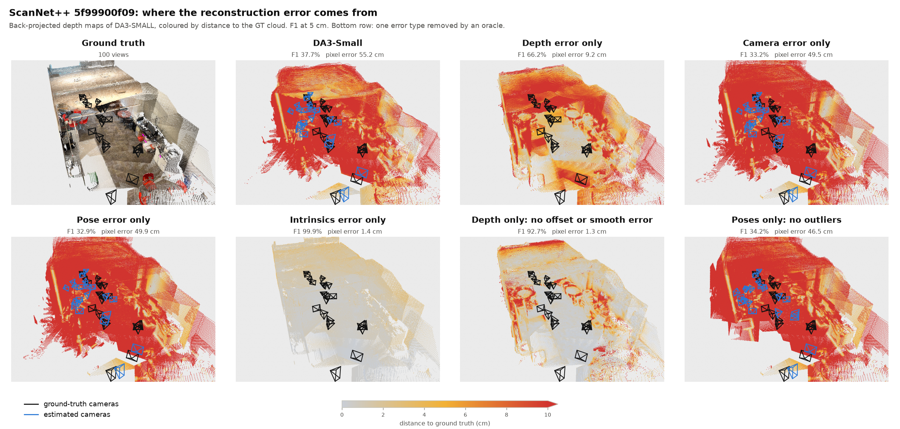
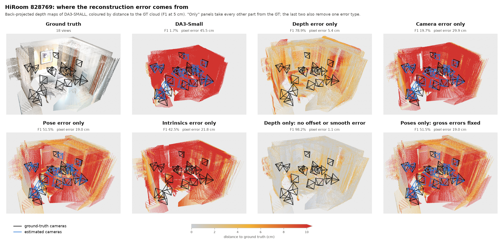
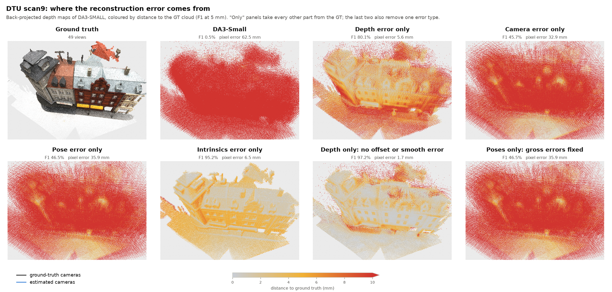

More renders (median and worst scene per dataset): `3d_*.png` in this folder.

## Findings that affect our evaluation

1. **The benchmark's pose AUC depends on frame order.** `compute_pose` receives world-to-camera matrices, so `inv(T_i) @ T_j` isn't the relative camera pose. Its translation part depends on which camera is first.
   - **Effect:** sorting DTU scan1's frames moves AUC@3 from 27.1 to 33.9 with identical predictions.
   - **Gauge-invariant AUC@3 / AUC@30 vs benchmark:** 7-Scenes 8.4 / 73.4 vs 14.5 / 78.2; HiRoom 12.0 / 78.7 vs 9.5 / 75.3; ScanNet++ 8.5 / 65.3 vs 9.0 / 68.3; DTU 24.6 / 89.7 vs 23.4 / 89.2.
   - **Consequence:** TTO comparisons must keep the frame order, and reporting both scores would be safest.
2. **The reference view is a hidden variable.** On ScanNet++ one scene's AUC@3 ranges from 2.3 to 26.1 with the reference view alone. Keep it fixed when comparing methods, or average over several.
3. **7-Scenes GT depth appears shifted against the RGB images.** Searching for the shift that best matches the prediction gives 4–12 px horizontally in the 4 scenes tested (one at the 12 px search limit), against within 1 px for 6 control scenes from the other datasets. Mean error drops only 0.1–0.4 points, so it mainly affects edges. The 7-Scenes GT rotations are also slightly non-orthonormal (up to 3e-4).

## What this suggests for TTO (hypotheses)

- **Cameras first, including intrinsics:** they cost more F1 than depth on every dataset. On HiRoom, fixing the focal length alone adds 18 F1 (oracle).
- **Try several reference views before optimizing:** the reference view decides the gross pose failures, and depth confidence flags the affected frames (AUROC ≈ 0.9). Running a few reference views and choosing or merging by confidence costs a few forward passes, and depth stays good on those frames for relocalization.
- **Per-frame low-dimensional depth correction:** a scale plus a smooth correction per view reaches 93–96% depth-only F1 by oracle. Depth outliers barely matter for F1, but they should be downweighted so they don't corrupt the fit.
- **Align the depth and pose scales:** this is worth 22 F1 on DTU by oracle.
- **Local refinement:** the typical pose error (1–3°, a few % of depth, smooth along the trajectory) is within reach of bundle adjustment or dense alignment.

## Limitations

- **One model:** DA3-Small only; comparing model sizes is the next step.
- **Thresholds are choices,** and I didn't run a sensitivity sweep: gross pose errors at 15° / 25% of depth, depth outliers at 5σ (the median outlier is only 3.5% on DTU and 20% on 7-Scenes), and F1 at 5 cm / 5 mm / 25 cm.
- **Oracle gains are upper bounds,** and they don't add up across parts.
- **The F1 is my own:** back-projected pixels against back-projected GT depth, without TSDF fusion. It ranks error sources within a dataset but isn't comparable with the benchmark's numbers.
- **The sequence split assumes frame order means something,** which is weakest on HiRoom's sparse views. Runs of failing frames count as "smooth", which is why the absolute gross-error label exists.
- **The reference-view experiments cover ScanNet++ only,** and the 12-reference sweep only 4 scenes.
- **Ground truth has its own errors:** 7-Scenes registration, the 7-Scenes and ScanNet++ reference poses, and ETH3D's sparse, block-averaged laser samples. Only HiRoom is synthetic.
