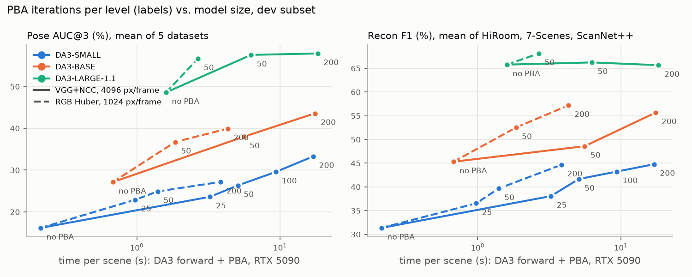

# Photometric bundle adjustment on DA3 predictions: first report (2026-10-30/31)

## What was built

All new files are untracked (nothing committed):

| File | What |
|---|---|
| `scripts/run_tto_pba.py` | the photometric BA (PBA). Reads saved DA3 predictions (`model_results/.../unposed/exports/mini_npz/results.npz`), refines them, writes the same format plus `gt_meta.npz` so that the DA3 evaluator scores them unchanged. Same CLI style as `run_tto_ba.py` on `vggt-ba` (`key=value` overrides, resumable, per-scene stats in `metric_results/<dataset>_pba.json`). |
| `scripts/eval_tto.py` | scores a TTO output dir with the DA3 evaluator (pose and recon_unposed) on only the scenes it contains, and prints mean before -> after over the same scenes. |
| `scripts/compare_tto.py` | one table over many run dirs (means over the scenes all runs share). |
| `scripts/vis_pba.py` | before/after figure: a neighbour frame warped into a reference frame with each run's depth/poses/intrinsics, plus the error map. |

Job scripts (not in the repo): `$SCRATCH/jobs/pba_run.sh` (one config on the dev subset or the full benchmark, then scoring), `$SCRATCH/jobs/sweep.sh` (several configs, pose only), `$SCRATCH/jobs/submit.sh` (snapshots the script so queued jobs aren't affected by later edits).

## Method
Per scene, starting from DA3's depth `D_i`, confidence, world-to-camera poses `T_i` and intrinsics `K_i` (at the model resolution, e.g. 504×378), and the input images resized to that resolution:

- **Unknowns.** A pose update per frame (`so3` axis-angle + translation, left-multiplied; frame 0 fixed for the gauge). A focal scale (one shared log-scale by default; `focal=per_frame|none`). A log-depth correction per frame on a coarse grid (8 cells along the long side, bilinearly upsampled; `D_i <- D_i * exp(grid_i)`). An affine brightness per frame (RGB/Huber loss only). The scene is normalised to median depth 1, and the output is scaled back.
- **Pairs.** Covisibility between all frame pairs is computed once from the initial prediction: the fraction of a 24×24 grid of each frame's pixels that projects into the other frame unoccluded. Each frame gets `k` target frames: `nbr_mode=top` takes the k most covisible, and `nbr_mode=spread` takes k frames evenly spaced over the covisibility ranking of all frames with covisibility ≥ 0.2, so it includes wide baselines.
- **Residuals.** Each iteration samples `M` (4096) source pixels per frame, gradient-weighted, from confident pixels (above the scene's 10% DA3-confidence quantile). It back-projects them with the corrected depth, transforms them into each of the `k` targets, projects them, and samples bilinearly:
  - photometric: Huber on RGB after per-frame affine brightness, or `photo_loss=ncc` (1 − NCC of 3×3 patches), on either RGB or `features=vgg` (VGG16 relu1_2 + relu2_2 upsampled, PCA-reduced per scene to 16 channels);
  - geometric: Huber on `log z_proj − log D_j(p')` (multi-view depth consistency);
  - occlusion: a sample counts only if `z_proj < D_j(p') · 1.05`;
  - prior: `mean(grid²)` (keeps depth near DA3's, fixes the global scale).
- **Optimisation.** Coarse-to-fine over Gaussian-blurred images/features (σ = 8, 4, 2, 1 px). Adam with a fresh state per level, cosine decay to 0.1×. All residuals are computed in a broadcast `[N, k, M]` layout: gathering per-frame parameters per sample made the backward pass ~10× slower.
- **Output.** Refined depth (DA3 depth × the upsampled correction), poses and intrinsics, written in DA3's `results.npz` format. The benchmark then scores pose AUC and recon (TSDF fusion of the refined depth with the refined poses/intrinsics) with its own code, unchanged.

## Configs

| name | settings (on top of the defaults in `DEFAULTS`) |
|---|---|
| v1 | RGB Huber + geometric + focal (shared) + 8-cell depth grid, top-6 neighbours, 4 levels × 100 Adam iters, lr 1e-3 |
| v2 | v1 + `features=vgg photo_loss=ncc iters=200` |
| **v3** (used for the full runs) | `features=vgg photo_loss=ncc nbr_mode=spread neighbors=10 lr_rot=3e-3 lr_trans=3e-3 lr_focal=3e-3 iters=200` |
| fast | `nbr_mode=spread neighbors=10 lr_rot=3e-3 lr_trans=3e-3 lr_focal=3e-3 samples=1024` (RGB Huber), `iters` varied |

To reproduce a full run on tum2: `$SCRATCH/jobs/submit.sh DA3-SMALL v3_full full <v3 settings>`. It writes `workspace/tto/DA3-SMALL/v3_full/`, and `scripts/compare_tto.py workspace/tto/DA3-SMALL/{init_full,v3_full}` prints the table.

## Main result: full benchmark (all scenes), unposed

AUC in %, recon F1 in %, DTU-49 Chamfer distance (CD) in mm (lower is better). "init" is DA3's own prediction, scored through the same pipeline. It matches the committed tum1 numbers, e.g. SMALL HiRoom F1 18.4 vs 18.5.

| | HiR A@3 | HiR A@30 | HiR F1 | 7S A@3 | 7S F1 | SN++ A@3 | SN++ A@30 | SN++ F1 | DTU64 A@3 | ETH A@3 | ETH A@30 | DTU CD |
|---|---|---|---|---|---|---|---|---|---|---|---|---|
| SMALL | 9.4 | 75.2 | 18.4 | 14.6 | 39.2 | 8.9 | 68.3 | 32.6 | 30.6 | 8.6 | 62.2 | 5.64 |
| SMALL + PBA fast50 (0.9 s) | 19.7 | 81.6 | 29.0 | 22.4 | 43.0 | 19.5 | 75.0 | 40.6 | 44.8 | 15.1 | 67.3 | 6.38 |
| SMALL + PBA v3 (18 s) | **37.1** | **87.7** | **46.2** | **25.8** | **47.3** | **28.6** | **79.4** | **45.5** | **62.3** | **22.8** | **75.7** | **4.21** |
| BASE | 19.0 | 83.2 | 23.2 | 21.4 | **49.8** | 20.2 | 80.8 | 47.9 | 60.8 | 15.0 | 74.5 | **2.85** |
| BASE + PBA fast50 | 30.6 | 87.6 | 38.2 | 26.0 | 48.3 | 40.3 | 87.0 | **57.3** | 65.4 | 23.6 | 78.7 | 4.26 |
| BASE + PBA v3 | **48.8** | **92.0** | **56.8** | **27.8** | 48.9 | **49.1** | **89.4** | 56.9 | **70.4** | **31.8** | **83.9** | 3.50 |
| LARGE-1.1 | 59.7 | 94.4 | 69.5 | 27.6 | 50.7 | 56.5 | 94.0 | 68.5 | 78.0 | 34.9 | 88.0 | **1.81** |
| LARGE-1.1 + PBA fast50 | 73.2 | 96.5 | 78.3 | 27.6 | **53.6** | 72.4 | 96.6 | 72.3 | 77.1 | **43.0** | 88.9 | 2.75 |
| LARGE-1.1 + PBA fast50, w_prior=100 | 73.3 | 96.5 | 80.7 | 27.8 | 53.1 | 70.0 | 96.3 | 72.2 | 78.7 | **43.7** | 89.1 | 2.24 |
| LARGE-1.1 + PBA v3 | 78.4 | 97.1 | 77.8 | 26.6 | 48.4 | **76.7** | 96.9 | 69.7 | 80.6 | 42.1 | 89.3 | 2.28 |
| **LARGE-1.1 + PBA v3, w_prior=100** | **79.8** | **97.3** | **82.8** | **28.0** | 53.3 | 73.8 | 96.7 | **73.5** | **81.1** | 42.5 | **89.5** | 1.89 |
| SMALL + sparse BA (`vggt-ba`, pose only) | 22.9 | | | 18.5 | | 11.2 | | | **68.2** | 8.5 | | |

`fast50` = the cheap config with 50 iters/level (mean PBA time 0.9 s/scene); v3 = 200 iters/level, VGG+NCC (mean 18 s/scene). `w_prior=100` = 100× stronger depth prior (see below). v3 time per scene on the RTX 5090: HiRoom 6.8 s, ETH3D 12.5 s, DTU 16–18 s, 7-Scenes/ScanNet++ (100 frames) 33 s. Peak GPU memory is 7.9 GiB at 100 frames (VGG features), 2.3 GiB on HiRoom. For comparison, DA3 forward: SMALL 0.1–0.9 s, LARGE 0.5–3.8 s. Sparse BA (teammate's): 26 s (HiRoom) to 330 s (7-Scenes) per scene.

What this says:
- PBA improves pose on every dataset for SMALL and BASE, and for LARGE on everything except 7-Scenes. The gains are large (AUC@3 roughly ×2–4 for SMALL). It also improves recon F1 on HiRoom and ScanNet++ for all models, because it refines depth and focal and not only poses.
- **DA3-SMALL + PBA (v3) beats DA3-BASE feed-forward on every pose metric except ScanNet++ AUC@30 (79.4 vs 80.8).** BASE + PBA approaches LARGE (HiRoom 48.8 vs 59.7, ETH3D 31.8 vs 34.9, 7-Scenes 27.8 vs 27.6).
- Compared with the sparse BA from `vggt-ba` on the same SMALL predictions, PBA is better on 4 of 5 datasets and 4–11× faster. Sparse BA is better on DTU-64 (68.2 vs 62.3). On LARGE it hurts already-good poses (dev subset: HiRoom AUC@3 53.8 → 23.7, ETH3D 30.4 → 8.5), which PBA doesn't.
- **Best single result: LARGE + v3 with a strong depth prior (`w_prior=100`) is better than DA3-LARGE on every metric except a near-tie on DTU Chamfer** (1.89 vs 1.81 mm). HiRoom F1 69.5 → 82.8, ScanNet++ F1 68.5 → 73.5, 7-Scenes F1 50.7 → 53.3, ETH3D AUC@3 34.9 → 42.5.
- **Cheap PBA (fast50, 0.9 s) on LARGE** already gets most of the pose gain (HiRoom AUC@3 59.7 → 73.2, ScanNet++ 56.5 → 72.4, ETH3D 34.9 → 43.0) and improves 7-Scenes F1.
- Regressions with the default prior (`w_prior=1`): 7-Scenes recon F1 for BASE/LARGE, DTU Chamfer for BASE/LARGE (and SMALL with fast50). For LARGE, a stronger depth prior removes most of them. See "Failure modes".

## Compute vs. quality (the project's matched-compute question)

This is on the dev subset (HiRoom 10, 7-Scenes 2, ScanNet++ 3, DTU-64 4, ETH3D 3 scenes, i.e. the first scenes of each). x is the mean time per scene: DA3 forward (from `timings.jsonl`) + PBA. Labels are Adam iterations per level (4 levels).

- PBA improves every model at every budget, and the gain grows with iterations (not converged at 200/level).
- The cheap family (RGB Huber, 1024 px/frame) is on the Pareto front: at the same time it beats VGG+NCC, except on DTU (wide baselines on an object, see below).
- **At matched wall time, a larger model still beats a smaller model + PBA.** LARGE without PBA (1.6 s/scene) is above BASE + PBA at 2–4 s and SMALL + PBA at 17 s. PBA is a good *add-on* to the largest model: LARGE + 50 cheap iterations (~2.7 s total) gives pose AUC@3 48.5 → 56.6 and recon F1 65.7 → 68.1 (dev means), the best point overall.
- Per unit of compute, PBA in its current form (first-order Adam, 200–800 iterations) is still much more expensive than a forward pass. A second-order solver (Gauss–Newton/LM on the poses+focal block) is the obvious next step for the "T iterations" axis. L-BFGS was tried and was no better per second than Adam (DTU 43.6 in 25 s vs 58.8 in 21 s) while using 12.6 GiB.

## Ablations (DA3-SMALL, dev subset)

Seed-to-seed noise (v1, seeds 0/1): ≤ 0.6 points on pose AUC, ≤ 0.8 on F1.

| run | HiR A@03 | HiR A@30 | HiR F1 | 7S A@03 | 7S A@30 | 7S F1 | SN++ A@03 | SN++ A@30 | SN++ F1 | DTU64 A@03 | DTU64 A@30 | ETH A@03 | DTU CD 
|---|---|---|---|---|---|---|---|---|---|---|---|---|---
| DA3-SMALL/init_dev | 10.6 | 75.5 | 23.9 | 29.3 | 88.3 | 50.9 | 5.9 | 55.4 | 19.2 | 29.9 | 90.4 | 5.1 | - 
| DA3-SMALL/a_poses | 15.5 | 79.2 | 25.2 | 39.4 | 90.8 | 57.3 | 7.7 | 58.9 | 22.0 | 34.4 | 91.2 | 6.3 | - 
| DA3-SMALL/b_poses_focal | 20.9 | 82.4 | 34.6 | 39.6 | 90.9 | 58.2 | 7.8 | 58.5 | 21.1 | 36.4 | 91.4 | 7.7 | - 
| DA3-SMALL/v1_default | 24.0 | 82.6 | 42.0 | 40.5 | 91.1 | 60.4 | 9.3 | 59.7 | 22.4 | 41.1 | 92.7 | 12.5 | - 
| DA3-SMALL/d_photo_only | 22.5 | 82.0 | 41.9 | 39.9 | 91.1 | 57.1 | 9.9 | 59.4 | 23.0 | 40.8 | 92.5 | 10.4 | - 
| DA3-SMALL/e_geo_only | 19.0 | 79.8 | 27.4 | 36.2 | 90.0 | 63.1 | 6.9 | 57.5 | 21.4 | 35.5 | 91.7 | 12.2 | - 
| DA3-SMALL/i_grid_nofocal | 18.4 | 79.3 | 30.8 | 40.6 | 91.1 | 60.1 | 8.9 | 59.6 | 22.6 | 40.6 | 92.7 | 9.4 | - 
| DA3-SMALL/h_grid16 | 23.7 | 82.0 | 42.2 | 40.4 | 91.1 | 60.1 | 9.0 | 59.5 | 21.3 | 41.0 | 92.8 | 11.4 | - 
| DA3-SMALL/f_vgg | 24.7 | 82.8 | 44.9 | 41.1 | 91.2 | 62.3 | 9.5 | 59.3 | 21.6 | 41.0 | 92.9 | 13.2 | - 
| DA3-SMALL/m_ncc | 23.9 | 82.1 | 43.1 | 39.5 | 91.1 | 57.3 | 10.2 | 59.8 | 22.1 | 42.2 | 93.0 | 10.2 | - 
| DA3-SMALL/n_vgg_ncc | 24.3 | 82.8 | 46.7 | 40.7 | 91.2 | 60.0 | 11.1 | 60.7 | 21.9 | 42.5 | 93.1 | 12.2 | - 
| DA3-SMALL/g_iters200 | 28.7 | 84.2 | 43.1 | 40.2 | 91.1 | 59.9 | 9.8 | 61.5 | 23.2 | 40.1 | 92.6 | 12.6 | - 
| DA3-SMALL/v2 | 30.1 | 85.1 | 53.6 | 40.6 | 91.3 | 60.9 | 12.4 | 62.1 | 24.1 | 45.4 | 93.6 | 14.4 | - 
| DA3-SMALL/v3_it200 | 34.2 | 85.9 | 47.4 | 37.7 | 91.4 | 56.4 | 17.9 | 66.3 | 30.5 | 58.8 | 95.0 | 17.9 | - 

scenes per column: {'HiR pose': 10, 'HiR recon_unposed': 10, '7S pose': 2, '7S recon_unposed': 2, 'SN++ pose': 3, 'SN++ recon_unposed': 3, 'DTU64 pose': 4, 'ETH pose': 3, 'DTU recon_unposed': 0}

(The `DTU CD` column is empty because DTU-49 wasn't in the dev set yet.) Run names: a = poses only; b = + focal; v1 = + depth grid (full model, RGB); d/e = photometric-only / geometric-only; i = v1 without focal; h = 16-cell grid; f = VGG features; m = NCC; n = VGG + NCC; g = v1 with 200 iters/level; v2 = n + 200 iters; v3_it200 = v3 on the dev subset.

What mattered, in order:
1. **Focal refinement.** DA3's focal is off by 10–17% on HiRoom/ETH3D. PBA brings it to 1–3%, and that is most of the recon-F1 gain on HiRoom (poses only: F1 25.2; + focal: 34.6; + depth grid: 42.0).
2. **Depth correction grid** (log-depth, 8 cells): + pose and recon on top of focal. A 16-cell grid is no better.
3. **More / larger optimisation steps.** 400 → 800 iterations, or 3× learning rate: HiRoom AUC@3 24 → 34, DTU 41 → 59. 10× learning rate overshoots (focal error 17%).
4. **VGG features + NCC + spread neighbours (k = 10)**: the big DTU jump (41 → 48.5 at the same iterations, 59 with more). Spread neighbours alone with RGB do nothing (41.1). Wide baselines only help with a viewpoint-robust matching cost. The likely mechanism is the bas-relief ambiguity: on DTU, PBA with top-6 neighbours barely reduced rotation error (median 1.3–2.2° → 0.8–1.9°) while sparse BA reaches 0.4°.
5. Photometric and geometric terms are complementary. Geometric-only is best for 7-Scenes recon, photometric-only nearly as good as both on HiRoom, and both together is the best overall.

## Depth prior strength should follow init quality

Dev subset (HiRoom 10, 7-Scenes 2, DTU 4 scenes), v3 with `w_prior` ∈ {1 (default), 10, 100, 1000}:

| | HiR A@3 | HiR F1 | 7S A@3 | 7S F1 | DTU64 A@3 | DTU CD (mm) |
|---|---|---|---|---|---|---|
| SMALL no PBA | 10.6 | 23.9 | 29.3 | 51.0 | 29.9 | 4.94 |
| SMALL w=1 / 10 / 100 | 34.2 / 33.5 / 30.3 | 47.4 / 48.5 / 46.9 | 37.7 / 37.8 / 38.9 | 56.4 / 57.1 / 57.7 | 58.8 / 58.0 / 50.8 | 4.30 / 4.24 / 4.51 |
| BASE no PBA | 21.3 | 34.5 | 32.6 | 63.7 | 55.5 | 2.26 |
| BASE w=1 / 10 / 100 | 50.8 / 50.8 / 49.7 | 62.9 / 63.0 / 60.6 | 37.4 / 37.9 / 38.8 | 58.7 / 63.8 / 63.0 | 59.7 / 59.6 / 60.3 | 4.00 / 4.23 / 4.21 |
| LARGE no PBA | 53.8 | 69.9 | 42.1 | 67.3 | 72.3 | 1.71 |
| LARGE w=1 / 10 / 100 / 1000 | 72.5 / 73.8 / 74.4 / 71.2 | 77.4 / 84.5 / 83.4 / 82.0 | 35.5 / 37.0 / 39.6 / 39.9 | 54.8 / 60.1 / 65.7 / 58.6 | 71.5 / 71.5 / 72.6 / 73.9 | 2.59 / 2.40 / 1.94 / 1.59 |

On the full benchmark, `w_prior=10` is about neutral for SMALL and BASE (BASE: 7-Scenes F1 48.9 → 50.5, i.e. just above no-PBA's 49.8; ScanNet++ F1 56.9 → 58.4; HiRoom F1 56.8 → 53.7; DTU CD 3.50 → 3.40). For LARGE, `w_prior=100` is the clear win shown in the main table. All full-benchmark rows are in `table_full.md`.

With a weak init (SMALL) the depth has to move; with a good one (LARGE) a free depth correction mostly adds error. A per-model setting already removes most of LARGE's regressions (full benchmark above). The principled version would set the per-pixel depth prior from DA3's confidence. BASE's DTU Chamfer stays bad for every `w_prior`, so it is focal, not depth (see below).

## Failure modes and open problems

- **7-Scenes with a good init.** For LARGE, even poses-only RGB PBA lowers recon F1 (dev: 67.2 → 62.6), and v3 lowers it more (54.8). Geometric-only alignment is the best variant on 7-Scenes (SMALL dev F1 63.1), and the 7-Scenes "focal error" of 8–10% doesn't go down for any model. Hypothesis: the 7-Scenes GT is depth-based KinectFusion, with the *depth* camera's intrinsics (fx = 585; the RGB camera is ~525, and DA3 predicts ≈ 530). Image-based refinement then converges towards a solution that disagrees with this pseudo-GT. Brachmann et al., ICCV 2021, "On the Limits of Pseudo Ground Truth in Visual Camera Re-localisation", describe exactly this for 7-Scenes. Not verified yet; one check is scoring against their SfM pseudo-GT.
- **DTU Chamfer gets worse for BASE/LARGE.** Two causes, found on 4 DTU-49 scenes:
  - Focal drifts on narrow-FOV object scenes (focal and depth trade off). A focal prior (`w_focal=10`) fixes part of it (SMALL CD 4.30 → 3.35, LARGE 2.59 → 2.28 mm), but the same prior **hurts HiRoom badly** (SMALL AUC@3 34.2 → 21.2), where large focal corrections are needed. So focal regularisation would have to adapt to how well focal is observable, not be a global constant.
  - The depth grid helps weak inits and hurts good ones. Without the grid (and with `w_focal=10`), LARGE's DTU CD *improves* to 0.99 mm (from 1.71 without PBA), while SMALL breaks (CD 7.30, AUC@3 35.7). An adaptive depth term (e.g. based on DA3's confidence, or depth correction only at coarse levels) is the obvious next experiment.
- **Chaining with sparse BA** (`init_from=workspace/evaluation/<model>-ba`): no gain. Starting PBA from the sparse-BA poses is worse than starting from DA3 on HiRoom (sparse BA has already damaged those poses) and pulls DTU back down (72.3 → 69.6). PBA's optimum on DTU is not at the GT poses, consistent with the focal/depth bias above. Two pitfalls found on the way: COLMAP BA leaves the global scale free (sparse-BA camera spreads were 27× smaller than DA3's on 7-Scenes chess, 3.5× larger on HiRoom), so `init_from` now rescales the translations to DA3's scale. Without that, PBA converged to a degenerate solution with *lower* photometric error and AUC@30 = 10.
- **Memory**: VGG features at 100 frames peak at 7.9 GiB (fine on the 5090, borderline for the 8 GB local GPUs). `feat_dim=8` or the RGB variant uses ≤ 3 GiB.

## Suggested next steps

1. **Confidence-weighted depth prior.** Make the prior per pixel, from DA3's confidence, instead of a per-model `w_prior`. It is the main knob that decides whether PBA helps or hurts a good init.
2. **Observability-aware focal.** Freeze or regularise focal when it is poorly constrained (narrow FOV, object-centric; e.g. from the Hessian of the loss w.r.t. log-focal), and keep it free otherwise (HiRoom needs 10–17% corrections).
3. **A second-order solver** (Gauss–Newton/LM on poses + focal, with the depth grid in the inner loop) for the matched-compute question. Adam needs 200–800 steps. The block-sparse structure (each residual touches two frames) makes a Schur-complement solve cheap.
4. **7-Scenes:** check the pseudo-GT hypothesis by scoring against the SfM pseudo-GT of Brachmann et al. 2021 (if it can be mapped to the benchmark's frames).
5. **Hybrid with sparse BA**, done properly. Sparse BA wins on DTU, where tracks span wide baselines, and loses where it damages good poses. One option: use its tracks as an extra reprojection term inside PBA instead of chaining.

## Housekeeping

- Nothing committed or pushed. New untracked files: `scripts/run_tto_pba.py`, `scripts/eval_tto.py`, `scripts/compare_tto.py`, `scripts/vis_pba.py`, `scripts/plot_compute.py`. Nothing existing in the repo was modified, and no existing outputs were deleted. The only things I moved were my own aborted sBA→PBA run dirs, renamed to `sba_pba_noscale`.
- This folder (`results/pba/`) is the tracked copy: this report, `table_full.md`, `table_ablation_small.md`, `figures/`, the job scripts (`jobs/`), and for every run `runs/<model>/<run>/` with `pba_config.json`, `comparison.md` and the metric JSONs (`*_pose.json`, `*_recon_unposed.json`, `*_pba.json` with per-scene timings). Not copied: predictions (`model_results/`) and per-iteration loss logs (`*_pba_hist.jsonl`), which stay in `workspace/tto/<model>/<run>/` on scratch (auto-deleted after 30 days untouched).
- Job scripts (copied to `jobs/`) and logs are in `$SCRATCH/jobs/` (`pba_<jobid>.log`, `sweep_<jobid>.log`, script snapshots in `snap/`).
- Cluster incident: two early "CPU-only" scoring jobs (`--gres=gpu:0`) still saw the node's GPU and ran on it for a few minutes on VC17 (jobs 458/462), where that GPU belonged to another job. They were cancelled as soon as I noticed. The CPU job script now sets `CUDA_VISIBLE_DEVICES=""`. Worth knowing for future CPU-only jobs on tum2.
