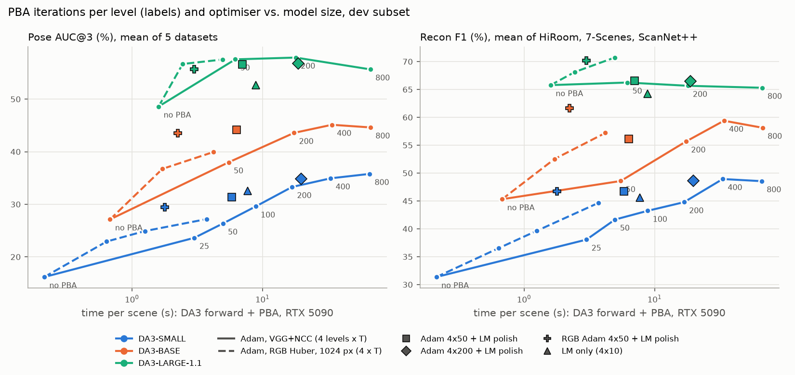
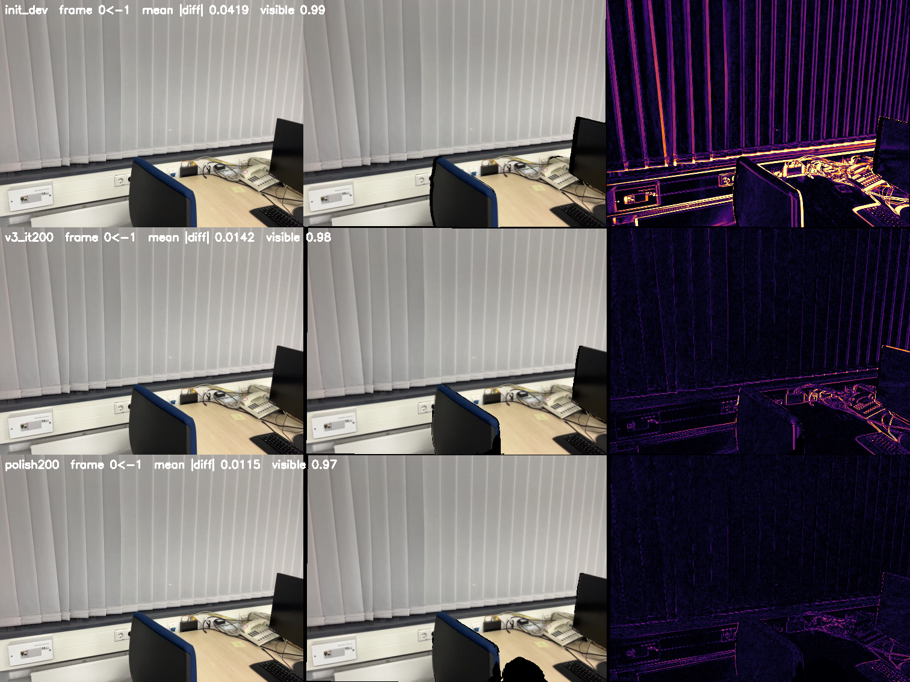

# Photometric / feature-metric BA, session 2: optimisers, DINO features, iterations, pipeline variants

Second 12 h session (2026-10-31), building on `REPORT.md` (session 1). Nothing was committed or pushed, and nothing
existing was deleted. Same setup as before: TTO on the saved DA3 predictions (`workspace/evaluation/<model>`),
scored with the DA3 evaluator; dev subset = HiRoom 10, 7-Scenes 2, ScanNet++ 3, DTU-64 4, ETH3D 3 scenes (+ DTU-49 4
for Chamfer). Baseline configuration "v3" = VGG16 features (PCA 16), 3x3-patch NCC, geometric term, shared focal,
8-cell log-depth grid, 10 neighbours spread over the covisibility ranking, 4 blur levels (8, 4, 2, 1 px), Adam.
"4x200" means 200 Adam iterations on each of the 4 levels.

## Summary

- **Second-order optimisation works best as a final polish.** A dense Levenberg–Marquardt solver (exact
  forward-mode Jacobians, poses + focal + depth grid solved jointly) is not a good replacement for Adam (narrow
  basin, short Gauss–Newton steps on the large-residual NCC objective), but **a few LM iterations after a short Adam
  run** give the accuracy of 3-10x more Adam iterations for ~1 s: Adam 4x50 + 5 LM iterations (6 s/scene) is at
  the level of Adam 4x200 (17 s), Adam 4x200 + LM at the level of Adam 4x800 (~65 s). On the full benchmark this
  "hybrid" improves on session 1's best configuration for every model at the same or a third of the time budget
  (SMALL HiRoom A@3 37.1 -> 45.7, ScanNet++ 28.6 -> 38.5, DTU Chamfer 4.21 -> 3.66 mm; BASE HiRoom 48.8 -> 57.4;
  LARGE ScanNet++ 73.8 -> 76.3, ETH3D 42.5 -> 46.0, DTU Chamfer 1.89 -> 1.62 mm at 6 instead of 18 s), with ETH3D
  as the exception for SMALL/BASE (-1/-4 A@3).
- **More iterations do help**, but only on poorly initialised scenes (ScanNet++ keeps improving up to 4x800; SMALL A@3
  17.9 -> 31.1). On well-initialised scenes (ETH3D, 7-Scenes, everything with LARGE) the accuracy peaks early and
  then drops, although the loss still decreases.
- **The reason is that the photometric objective is flat along some pose directions**, and converging (with many Adam
  steps or with LM) drifts along them. A prior pulling the poses towards DA3's prediction fixes this for LARGE
  (mean A@3 +3.5, ETH3D 28 -> 49 on dev); for SMALL the initial poses are too poor to serve as a prior. The
  regularisation has to follow the quality of the initialisation (as the depth prior in session 1).
- **Your DINO idea:** a coarse level on DA3's own DINOv2 tokens, then the photometric levels, is neutral on DA3's
  initialisations (they are already inside the basin of the blurred VGG level), and with deeper (cross-view) tokens
  it hurts. With artificially perturbed poses (15 deg) it does widen the basin (A@30 +5-8 points). Token
  matching as a correspondence term does not work (most mutual-NN matches are wrong; the frame-local tokens have
  a strong positional bias).
- **Own ideas:** a cheap RGB Adam stage + an LM polish is the best quality per second of all variants
  (~1.7 s per scene). Fine-tuning DA3's depth head instead of the depth grid (network-space TTO) helps LARGE's
  reconstruction (+4-5 F1 on 7-Scenes/ScanNet++ on dev) but costs 8x the time and hurts SMALL; a finer depth grid
  and re-running DA3 conditioned on the refined cameras did not give consistent gains.
- **Matched compute (the project question):** the best TTO makes smaller models much better, but at equal time a
  larger model + cheap TTO still wins: LARGE + the fast hybrid (~3 s per scene) is the best point on the dev
  frontier, and neither SMALL nor BASE with any TTO reaches LARGE's feed-forward mean pose/reconstruction quality.

## What I built this session

All in `scripts/run_tto_pba.py` (new options, old configurations reproduce exactly) plus two new scripts.

1. **Levenberg–Marquardt (Gauss–Newton) solver**, `optimizer=lm` (all levels) or `lm_levels=<i,..>` (only these levels, the
   rest Adam; used as a final "polish" level). Exact Jacobians by forward-mode AD: every pose enters the residual twice,
   once in its source role and once in its target role, so that one `jvp` with the tangent "component c of all frames"
   gives each residual's derivative w.r.t. its own source (target) frame. The depth grid enters through per-patch
   log-depth offsets whose derivatives are spread onto the 4 grid cells around the patch centre with the bilinear
   weights. 15 tangents per chunk of source frames, evaluated in one `vmap`-ed pass (2.3x faster than a loop,
   bit-identical). The full normal equations (poses of frames 1..N-1, shared focal, all grid cells; 5395 unknowns at
   100 frames) are assembled densely (scatter of 21x21 blocks per patch) and solved by Cholesky in float64 with
   Marquardt damping (`lambda * diag`), accept/reject on the true robust loss of the same samples, and a two-point
   line search (step x1, x2). NCC is written as a least-squares residual (difference of the normalised patches, half
   its squared norm is 1 - NCC), the geometric Huber term by IRLS weights.
   *Check:* the LM gradient `J^T W r` equals the autograd gradient of the Adam loss (cosine 1.0000 for rotation,
   translation, focal; 0.9992 for the grid, the patch-centre approximation).
2. **Per-level features** `levels=<features>:<sigma>[:<iters>],...` with `features` in rgb, vgg or DA3 backbone tokens
   (`local` = last frame-local layer before cross-view attention, `mid`, `final`), e.g.
   `levels=local:0,vgg:4,vgg:2,vgg:1` = the "coarse BA on DINO features, then photometric BA" idea.
   `scripts/cache_da3_feats.py` re-runs DA3 exactly as the evaluator (depth identical to the saved predictions,
   relative difference 1e-8) with `export_feat_layers`, and caches per scene the L2-normalised tokens, PCA-reduced to
   64 channels (92-98% of the variance), as `[N, 64, H/14, W/14]`. For BA the leading 32 channels are bilinearly
   upsampled (token centres at patch centres), NCC patch spacing 7 px (half a token).
3. **DA3 token matches** `w_match>0`: mutual nearest neighbours between the tokens of each frame and its neighbours
   (cosine > 0.5, best 128 per pair), reprojection error in token units (Huber) as an extra term on coarse levels.
4. **Fine depth grid** `depth_grid_fine=32`: a second log-depth grid (32 cells on the long side) added to the 8-cell one
   from level `fine_from` (2) on, with its own prior.
5. **Network-space depth** `depth_param=head`: instead of a grid, the depth is DA3's own DPT depth head (3.9 M
   parameters for SMALL) on frozen, cached backbone features, fine-tuned per scene by the same loss (Adam, lr 1e-5;
   per iteration 8 frames recomputed with gradients, all frames refreshed every 20 iterations; prior on the
   log-depth change; weights reset per scene). Cameras stay free variables as in PBA. Exact at init (head reproduces
   the saved depth, difference 0).
6. **DA3 re-conditioning** `scripts/run_tto_recond.py`: feed the refined cameras back into DA3's posed mode (as the
   benchmark does with GT cameras; intrinsics converted back to the original image size), keep the refined cameras
   and take DA3's new depth. One extra forward pass.
7. **Rotation-noise basin test** `init_noise_deg=<a>`: rotates every camera but the first by `a` degrees about a random
   axis (centre fixed) before the optimisation.

## 1. More iterations (Adam, v3)

Dev subset, AUC@3 / AUC@30 / F1 in %, time = PBA optimisation per scene on one RTX 5090 (4x400 and 4x800 shared the
GPU with other runs, their clean time is ~linear: 0.7 s + 0.08 s x T, i.e. ~33 s and ~65 s).

| SMALL | HiR A@3 | HiR A@30 | HiR F1 | 7S A@3 | 7S F1 | SN++ A@3 | SN++ A@30 | SN++ F1 | DTU64 A@3 | ETH A@3 | ETH A@30 | s/scene |
|---|---|---|---|---|---|---|---|---|---|---|---|---|
| no PBA | 10.6 | 75.5 | 23.9 | 29.3 | 50.9 | 5.9 | 55.4 | 19.2 | 29.9 | 5.1 | 59.5 | 0 |
| 4x25 | 19.6 | 80.6 | 35.6 | 39.2 | 54.7 | 9.2 | 60.4 | 23.9 | 39.5 | 10.6 | 64.5 | 2.9 |
| 4x50 | 24.0 | 82.3 | 44.8 | 38.4 | 56.8 | 10.7 | 61.9 | 23.4 | 45.1 | 13.6 | 66.4 | 4.7 |
| 4x100 | 28.7 | 84.4 | 48.4 | 38.2 | 55.2 | 13.5 | 63.9 | 26.0 | 53.1 | 14.5 | 68.0 | 9.0 |
| 4x200 | 34.2 | 85.9 | 47.4 | 37.7 | 56.4 | 17.9 | 66.3 | 30.5 | 58.8 | 17.9 | 70.2 | 16.7 |
| 4x400 | 36.9 | 85.2 | **50.0** | 36.8 | **57.2** | 23.2 | 69.2 | 39.6 | 59.9 | **18.0** | 74.4 | 32.0 |
| 4x800 | **37.5** | 83.4 | 47.7 | 33.9 | 56.5 | **31.1** | **70.7** | **41.5** | **59.9** | 16.5 | **78.3** | ~65 |

| BASE | HiR A@3 | HiR A@30 | HiR F1 | 7S A@3 | 7S F1 | SN++ A@3 | SN++ A@30 | SN++ F1 | DTU64 A@3 | ETH A@3 | ETH A@30 | s/scene |
|---|---|---|---|---|---|---|---|---|---|---|---|---|
| no PBA | 21.3 | 82.7 | 34.5 | 32.6 | 63.6 | 13.3 | 70.7 | 37.8 | 55.5 | 13.0 | 79.2 | 0 |
| 4x50 | 37.7 | 87.9 | 43.3 | 38.3 | 58.4 | 27.0 | 76.8 | 44.1 | 57.3 | 29.7 | 86.4 | 4.7 |
| 4x200 | 50.8 | 91.2 | 63.0 | 37.4 | 58.7 | 38.2 | 80.6 | 45.4 | 59.7 | **31.8** | 88.4 | 16.7 |
| 4x400 | **54.7** | **91.6** | **68.2** | 36.6 | 59.6 | 42.7 | 82.8 | **50.4** | 60.8 | 30.9 | **88.8** | 32.6 |
| 4x800 | 53.8 | 89.4 | 63.8 | 35.8 | 60.3 | **46.0** | **84.0** | 50.3 | **61.3** | 26.2 | 87.8 | ~65 |

| LARGE | HiR A@3 | HiR A@30 | HiR F1 | 7S A@3 | 7S F1 | SN++ A@3 | SN++ A@30 | SN++ F1 | DTU64 A@3 | ETH A@3 | ETH A@30 | s/scene |
|---|---|---|---|---|---|---|---|---|---|---|---|---|
| no PBA | 53.8 | 92.6 | 69.9 | **42.1** | **67.2** | 44.2 | 91.3 | 60.2 | 72.3 | 30.4 | 89.6 | 0 |
| 4x50 | 69.1 | 95.4 | **77.5** | 38.8 | 59.9 | 57.9 | 94.0 | 61.4 | 69.6 | **52.4** | **93.3** | 4.7 |
| 4x200 | **72.5** | **95.6** | 77.4 | 35.5 | 54.8 | 64.3 | **94.4** | **64.7** | 71.5 | 45.9 | 92.5 | 16.7 |
| 4x800 | **72.5** | 95.2 | 76.6 | 34.3 | 56.0 | **68.0** | **94.4** | 63.3 | **74.1** | 29.3 | 88.2 | ~65 |

- **Yes, the plots were right that there is more to gain, but only for poorly initialised scenes.** The big 100-frame
  ScanNet++ scenes keep improving up to 4x800 for every model (SMALL A@3 17.9 -> 31.1, F1 30.5 -> 41.5; BASE 38.2 ->
  46.0; LARGE 64.3 -> 68.0), HiRoom up to 4x400. Long frame chains propagate corrections slowly with a first-order
  method.
- **Where the initialisation is already good, long runs hurt**: ETH3D A@3 peaks early and then falls (LARGE 52.4 at
  4x50 -> 29.3 at 4x800, BASE 31.8 -> 26.2), 7-Scenes falls monotonically for every model (see session 1 for the
  7-Scenes pseudo-GT caveat). The loss keeps decreasing, so this is the optimum of the objective being worse than an
  early iterate: the iteration count acts as a regulariser (section 2 shows the same with LM, which gets to the
  optimum faster).
- Practical sweet spot without other changes: 4x400 for SMALL/BASE, 4x50-200 for LARGE (with `w_prior=100`, session 1).

## 2. Second-order optimisation (Levenberg–Marquardt)

### LM alone vs Adam

On one HiRoom scene with fixed samples (a deterministic objective), LM decreases the loss quickly for ~5 iterations
and then crawls (0.40 -> 0.215 at the blur-8 level after 10 iterations, where Adam reaches 0.14 after 200). The gain
ratio shows why: the actual decrease is ~2x the one predicted by the Gauss–Newton model (doubling the step is
better, 4x overshoots), i.e. `J^T J` overestimates the curvature of this large-residual objective (normalised-patch
NCC on blurred features, many patches far from aligned). Gauss–Newton's fast local convergence needs small
residuals; away from the optimum its steps are too short, while Adam's normalised steps do not care about curvature.

On the dev subset (SMALL), LM alone (4 levels x 10 iterations) is a different trade-off from Adam:

| SMALL, dev | HiR A@3 | HiR A@30 | HiR F1 | 7S A@3 | SN++ A@3 | SN++ A@30 | DTU64 A@3 | ETH A@3 | ETH A@30 | s/scene |
|---|---|---|---|---|---|---|---|---|---|---|
| Adam 4x50 | 24.0 | 82.3 | 44.8 | 38.4 | 10.7 | 61.9 | 45.1 | 13.6 | 66.4 | 4.7 |
| Adam 4x200 | 34.2 | 85.9 | 47.4 | 37.7 | 17.9 | 66.3 | 58.8 | 17.9 | 70.2 | 16.7 |
| Adam 4x800 | 37.5 | 83.4 | 47.7 | 33.9 | 31.1 | 70.7 | 59.9 | 16.5 | 78.3 | ~65 |
| LM 4x10 | 32.0 | 81.4 | 49.2 | 31.2 | 26.9 | 65.4 | 58.7 | 14.2 | 79.6 | 7.9 |
| LM 4x10, 1024 px/frame | 26.1 | | | 31.8 | 28.0 | | 57.5 | 11.6 | | 3.4 |
| LM 4x5 | 31.9 | | | 31.1 | 20.0 | | 58.2 | 9.8 | | 4.2 |
| **Adam 4x50 + LM 5 at 1 px** | 36.5 | 86.2 | 50.9 | 32.9 | 19.0 | 66.2 | 56.1 | 12.2 | 71.0 | **6.0** |
| Adam 4x50 + LM 15 at 1 px | 38.4 | 85.6 | 53.9 | 31.7 | 23.1 | 69.0 | 57.7 | 11.9 | 74.1 | (~8) |
| **Adam 4x200 + LM 5 at 1 px** | **39.3** | **86.7** | 51.4 | 31.9 | 29.0 | 70.2 | **59.9** | 14.0 | 74.0 | 19.5 |

- LM's global solve fixes what Adam propagates slowly (ScanNet++, 100 frames: A@3 26.9 vs 17.9 for Adam 4x200; ETH
  A@30 79.6 vs 70.2, i.e. gross errors), but is less precise where the initialisation is good (7-Scenes, ETH A@3).
  One LM iteration on 100 frames costs ~0.38 s with the vmap Jacobian (15 forward-mode passes, chunked), ~10 Adam
  steps (0.039 s); the dense Cholesky solve of the 5395 unknowns is ~0.1 s of it.
- **The hybrid is the clear winner: Adam to get into the basin, then a few LM iterations at the sharp level.**
  5 LM iterations cost ~1.2 s per scene on average and are worth ~150-600 Adam iterations: Adam 4x50 + LM (6.0 s)
  is at the level of Adam 4x200 (16.7 s) on HiRoom, ScanNet++ and DTU; Adam 4x200 + LM (19.5 s) matches or beats
  Adam 4x800 (~65 s) on HiRoom, DTU and the HiRoom F1, and is close on ScanNet++. LM is still decreasing the loss
  after 5 iterations (15 iterations are better on HiRoom/ScanNet++).
- Same for the other models: BASE Adam 4x50 + LM (5.8 s) beats Adam 4x200 on HiRoom (53.3 vs 50.8) and matches 4x800
  on ScanNet++ (46.6 vs 46.0); LARGE Adam 4x50 + LM (5.6 s) beats Adam 4x800 on ScanNet++ (71.4 vs 68.0) and HiRoom
  (74.8 vs 72.5).
- **The catch: 7-Scenes and ETH3D get worse, for every model** (LARGE ETH A@3 52.4 after Adam 4x50 -> 28.4 with the
  polish). The next subsection explains why.

### Why converging further can hurt: flat directions

For LARGE on ETH3D, the photometric error is identical after Adam 4x50 and 4x800 (0.0888 vs 0.0886), the visible
fraction too (no "hide the hard pixels" degeneracy), but A@3 drops from 52.4 to 29.3. Larger LM batches (4x) do not
change it either (not sampling noise). So the objective is flat along directions that change the relative poses by
degrees: the photometric term does not determine them, and both optimisers drift along them (Adam slowly, through
the noise of the random samples; LM quickly, since its damping decays to 1e-7 and Gauss–Newton takes large steps in
near-null directions). With few Adam iterations the iteration count is an implicit regulariser that keeps DA3's
pose in these directions; converging removes it.

Explicit regularisation of the flat directions confirms this (LARGE, Adam 4x50 + LM 5, pose AUC@3/AUC@30, dev):

| LARGE, Adam 4x50 + LM 5 | HiR | 7S | SN++ | DTU64 | ETH | mean A@3 |
|---|---|---|---|---|---|---|
| no regulariser | 74.9/96.4 | 34.6/91.2 | **71.4**/95.8 | 74.1/97.2 | 28.4/88.4 | 56.7 |
| pose prior `w_pose=10` | 74.4/96.0 | 37.9/91.7 | 65.5/95.2 | 73.9/97.2 | 49.3/93.3 | **60.2** |
| pose prior `w_pose=100` | 68.3/95.2 | **40.6**/92.1 | 57.0/93.8 | 73.8/97.2 | 46.6/92.6 | 57.3 |
| LM damping floor `lambda_min=1e-2` | 72.2/95.9 | 37.1/91.6 | 62.1/94.6 | 72.4/97.0 | 47.4/92.7 | 58.2 |
| Levenberg damping `mu=1e-3` (x mean diag x I) | **75.8**/96.4 | 35.0/91.2 | 68.7/95.4 | 73.6/97.2 | 31.3/89.5 | 56.9 |
| Levenberg damping `mu=1e-2` | 74.0/96.1 | 36.6/91.5 | 64.5/94.9 | 72.2/97.0 | 41.7/92.2 | 57.8 |
| Levenberg damping `mu=1e-1` | 71.8/95.8 | 37.8/91.7 | 60.7/94.4 | 70.9/96.9 | **50.9**/93.2 | 58.4 |
| (Adam 4x200, `w_pose=10`, no LM) | 73.0/95.9 | 37.8/91.7 | 64.4/95.0 | 73.1/97.1 | 50.2/93.3 | 59.7 |

| SMALL, Adam 4x50 + LM 5 | HiR | 7S | SN++ | DTU64 | ETH | mean A@3 |
|---|---|---|---|---|---|---|
| no regulariser | **36.6**/86.2 | 32.9/90.9 | **19.0**/66.2 | **56.1**/94.6 | 12.2/71.0 | **31.4** |
| pose prior `w_pose=10` | 31.7/84.9 | **39.5**/91.7 | 12.9/62.2 | 55.5/94.5 | 14.6/66.5 | 30.8 |
| LM damping floor `lambda_min=1e-2` | 29.1/84.2 | 38.7/91.6 | 13.3/63.6 | 50.1/93.8 | **14.9**/67.7 | 29.2 |
| Levenberg damping `mu=1e-2` | 31.7/85.1 | 37.0/91.4 | 15.3/64.2 | 52.8/94.2 | 13.0/68.7 | 30.0 |

- Every regulariser recovers ETH3D and 7-Scenes (LARGE ETH 28.4 -> 46-51) at the price of the scenes that need large
  corrections (ScanNet++). That is the flat-direction diagnosis: the lost accuracy is in directions where the data
  are weak, and DA3's pose is a better estimate there than the drifted one.
- A **pose prior towards DA3's prediction** is the best of these for LARGE (`w_pose=10`: mean A@3 56.7 -> 60.2) and
  costs nothing. Levenberg damping (which suppresses weak eigen-directions of `J^T J` only) does not separate them
  better: the drift directions are not much weaker in `J^T J` than the ones ScanNet++ needs.
- **For SMALL, regularisation does not pay** (31.4 -> 29-31): its initial poses are too far off to be a useful prior.
  Like the depth prior in session 1, the pose prior has to follow the quality of the initialisation, i.e. the model.
  A principled version would weight the prior by the network's own pose uncertainty, which DA3 does not output.

## 3. DINO (DA3 backbone) features for a coarse BA

Your idea: first a coarse BA on the DINOv2 patch tokens (one feature per 14x14 patch), then the usual photometric
levels. I used DA3's own backbone tokens (fine-tuned DINOv2, free because the forward pass computes them), replacing
the blur-8 VGG level by a token level (4x200 iterations in total, the same budget as the baseline):

| run (dev) | HiR A@3 | HiR A@30 | HiR F1 | 7S A@3 | 7S F1 | SN++ A@3 | SN++ F1 | DTU64 A@3 | ETH A@3 | ETH A@30 |
|---|---|---|---|---|---|---|---|---|---|---|
| SMALL v3 4x200 (VGG at all levels) | 34.2 | 85.9 | 47.4 | 37.7 | 56.4 | 17.9 | 30.5 | 58.8 | 17.9 | 70.2 |
| SMALL `local` tokens, then VGG | 34.8 | 86.3 | 48.8 | 37.2 | 56.1 | 17.0 | 31.5 | 57.9 | 17.9 | 70.5 |
| SMALL `mid` tokens, then VGG | 34.8 | 86.6 | 53.6 | 36.5 | 53.1 | 16.4 | 30.7 | 59.2 | 16.2 | 67.6 |
| SMALL `final` tokens, then VGG | 32.5 | 85.4 | 47.3 | 36.8 | 53.8 | 10.3 | 25.7 | 60.1 | 16.7 | 67.3 |
| LARGE v3 4x200 | 72.5 | 95.6 | 77.4 | 35.5 | 54.8 | 64.3 | 64.7 | 71.5 | 45.9 | 92.5 |
| LARGE `local` tokens, then VGG | 74.0 | 96.0 | 79.7 | 35.6 | 54.9 | 63.9 | 64.1 | 71.6 | 45.3 | 92.4 |

- **Neutral with the frame-local tokens, harmful with deeper ones.** The `local` layer (last layer before DA3's
  cross-view attention, i.e. closest to plain DINOv2) changes nothing beyond noise for SMALL and LARGE. Deeper
  layers, which have mixed in information from the other views, are worse (`final`: ScanNet++ A@3 17.9 -> 10.3).
- Why no gain: DA3's initial poses are already inside the basin of the blurred VGG level (the A@30 numbers, which
  measure gross errors, are already 85-96% and barely change). A coarse stage can only help where the fine stages
  fail to converge; section 5 tests this with artificially perturbed poses.
- **Token matches (correspondence-based coarse BA) do not work.** Mutual nearest neighbours of the tokens between
  covisible frames, checked against the refined LARGE geometry as a reference: only 6-32% of the matches are within
  one token (14 px) and 46-84% are off by more than 3 tokens. The frame-local layer has a strong positional bias:
  39% (HiRoom) and 48% (DTU) of its matches are at exactly the same image position in both frames (absolute
  position embedding), deeper layers have fewer (5-15%) but are still mostly wrong. As an extra Huber reprojection
  term on the coarse levels they make the poses worse (single-scene test: A@30 0.687 -> 0.52-0.61, vs 0.77
  without), so I dropped them. Sub-token refinement and RANSAC would be needed; a dedicated matcher (e.g. the
  LightGlue/VGGSfM tracks of the sparse BA) is the better source of correspondences.

## 4. Own ideas on the pipeline: depth parametrisation and model in the loop

SMALL, dev subset, all with the v3 settings:

| run | HiR A@3 | HiR F1 | 7S A@3 | 7S F1 | SN++ A@3 | SN++ F1 | DTU64 A@3 | ETH A@3 | s/scene |
|---|---|---|---|---|---|---|---|---|---|
| 4x50, 8-cell grid | 24.0 | 44.8 | 38.4 | 56.8 | 10.7 | 23.4 | 45.1 | 13.6 | 4.7 |
| 4x50, DA3 depth head fine-tuned (no grid) | 23.6 | 42.3 | 39.1 | 51.2 | 10.1 | 25.1 | 37.9 | 13.1 | 10.5 |
| 4x200, 8-cell grid | 34.2 | 47.4 | 37.7 | 56.4 | 17.9 | 30.5 | 58.8 | 17.9 | 16.7 |
| 4x200, 8-cell + 32-cell grid (from level 2) | 35.6 | 48.9 | 36.6 | 53.0 | 17.8 | 32.9 | 59.7 | 17.6 | (~17) |
| 4x200, then DA3 re-run on the refined cameras | 34.2 | **50.2** | 37.7 | 56.0 | 17.9 | **32.6** | 58.8 | 17.9 | +0.3-2.5 |
| ... then a second PBA round (levels 2, 1 px, 2x100) | 35.8 | 51.2 | 37.5 | 55.8 | 18.0 | 31.7 | 59.3 | 17.9 | +9.6 |
| control: DA3 re-run on its own (unrefined) cameras | 10.6 | 21.9 | 29.3 | 48.4 | 5.9 | 21.9 | 29.9 | 5.1 | +0.3-2.5 |

- **Network-space TTO (fine-tuning DA3's depth head per scene, Test3R-style, cameras still free variables) depends
  on the model.** For SMALL it does not beat the 8-cell output-space grid: same pose, worse reconstruction
  (7-Scenes F1 -5.6, DTU Chamfer worse), 2x the time. For LARGE (dev, 4x50) it is the better depth
  parametrisation for reconstruction: 7-Scenes F1 59.9 -> 63.6, ScanNet++ 61.4 -> 66.4, DTU-64 A@3 69.6 -> 72.6, HiRoom
  and ETH3D slightly lower (-0.6 / -2.6 A@3), but at 8x the time (38.6 vs 4.7 s per scene: 8 head forward/backward
  passes per iteration plus refreshes, and LARGE's head is bigger). A good network keeps the depth plausible while
  it adapts; a poor one is not a useful prior. Not tuned (lr 1e-5, 8 frames per step); cheaper variants
  (LoRA/bias-only, fewer refreshes, only on the last level) would be the next step if reconstruction matters.
- **A finer depth grid is neutral** (HiRoom/ScanNet++ F1 +1.5/+2.4, 7-Scenes F1 -3.4): the extra capacity is not
  constrained by the photometric term either.
- **Model in the loop: feeding the refined cameras back into DA3 (posed mode)** helped reconstruction on the dev
  subset after plain Adam: +2.8 F1 on HiRoom and +2.1 on ScanNet++ for one extra forward pass (pose unchanged by
  construction). The control shows that this comes from the better cameras (re-running DA3 on its own predicted
  cameras is neutral to slightly worse). **But on the full benchmark after the stronger hybrid it is not a
  consistent gain** (section 6: F1 down by 0.4-6 points, DTU Chamfer better): once PBA has refined depth and
  cameras jointly, its depth is already better than what DA3 produces for the same cameras, except on DTU. A second
  short PBA round after re-conditioning adds little (+1 F1 HiRoom on dev).

## 5. Basin of convergence: perturbed initial poses

To see what each scheme can recover from, every camera but the first is rotated by 5 or 15 degrees about a random
axis (camera centres fixed) before the optimisation (SMALL, HiRoom 10 / DTU-64 4 / ScanNet++ 3 / ETH3D 3 scenes,
pose AUC@3 / AUC@30):

| | HiR | DTU64 | SN++ | ETH |
|---|---|---|---|---|
| no noise, Adam 4x200 (reference) | 34.2/85.9 | 58.8/95.0 | 17.9/66.3 | 17.9/70.2 |
| **5 deg**, initial | 0.5/61.5 | 1.9/75.9 | 0.6/48.4 | 0.6/52.4 |
| Adam 4x200 (VGG) | **30.7**/84.8 | **52.8**/94.2 | 17.6/66.0 | **17.1**/69.4 |
| DINO `mid` level, then VGG (4x200) | 29.6/84.6 | 51.8/94.1 | 15.8/64.8 | 15.1/66.9 |
| LM 4x10 | 18.0/64.6 | 8.2/71.7 | **23.6**/63.0 | 16.4/**75.9** |
| Adam 4x50 + LM 5 | 30.9/84.7 | 49.5/93.8 | 16.6/66.1 | 12.3/70.7 |
| **15 deg**, initial | 0.1/27.9 | 0.1/33.1 | 0.1/22.9 | 0.1/24.6 |
| Adam 4x200 (VGG) | **14.4**/67.9 | 4.8/75.0 | 5.2/53.4 | **6.1**/51.5 |
| DINO `mid` level, then VGG (4x200) | 14.0/**76.1** | **5.1**/**76.9** | **6.5**/**58.5** | 5.7/**53.4** |
| LM 4x10 | 0.0/16.2 | 0.0/34.7 | 0.0/18.6 | 0.0/15.3 |
| Adam 4x50 + LM 5 | 1.3/53.4 | 1.2/65.0 | 0.5/40.7 | 1.3/44.9 |

- Adam with the blurred VGG pyramid has a wide basin: from 5 degrees it gets back to almost the unperturbed result.
- **The DINO coarse level does widen the basin**, as you expected, but only where it matters: from 15 degrees it
  recovers clearly more gross errors (A@30 HiRoom 67.9 -> 76.1, ScanNet++ 53.4 -> 58.5) and is neutral at 5 degrees.
  It does not help the final precision (A@3), which is set by the fine levels.
- **LM alone has a narrow basin**: poor from 5 degrees on HiRoom/DTU and it diverges from 15 degrees (worse than the
  initialisation). Gauss–Newton needs a good starting point, so it belongs at the end of the pipeline, after a
  first-order stage with a wide basin, not at the beginning.
- So the ordering that falls out is: coarse features (DINO) for large errors -> blurred VGG/RGB levels with Adam ->
  LM at full resolution. With DA3 initialisations only the last two matter.

## 6. Full benchmark

All scenes of the five pose datasets and the HiRoom / 7-Scenes / ScanNet++ / DTU-49 reconstruction sets, same
evaluator as the paper (AUC@3 / AUC@30 / F1 in %, DTU Chamfer distance in mm, s = mean PBA time per scene; DA3's
forward pass comes on top: SMALL 0.1-0.9 s, BASE 0.2-2.0 s, LARGE 0.3-3.8 s per scene, medians 0.4, 0.8, 1.5 s).

| run | HiR A@3 | HiR A@30 | HiR F1 | 7S A@3 | 7S F1 | SN++ A@3 | SN++ A@30 | SN++ F1 | DTU64 A@3 | ETH A@3 | ETH A@30 | DTU CD | s |
|---|---|---|---|---|---|---|---|---|---|---|---|---|---|
| SMALL no PBA | 9.4 | 75.2 | 18.4 | 14.6 | 39.2 | 8.9 | 68.3 | 32.6 | 30.6 | 8.6 | 62.2 | 5.64 | 0 |
| SMALL v3 (session 1 best) | 37.1 | 87.7 | 46.2 | **25.8** | 47.3 | 28.6 | 79.4 | 45.5 | 62.3 | **22.8** | 75.7 | 4.21 | 17.7 |
| **SMALL Adam 4x200 + LM 5** | **45.7** | **89.3** | **52.0** | **25.8** | **47.6** | **38.5** | **81.4** | **46.3** | **66.3** | 21.9 | **77.6** | 3.66 | 18.6 |
| SMALL ... + DA3 re-conditioning | 45.7 | 89.3 | 46.1 | 25.8 | 45.5 | 38.5 | 81.4 | 44.0 | 66.3 | 21.9 | 77.6 | **3.51** | +0.1-0.9 |
| SMALL RGB Adam 4x50 + LM 5 (fast hybrid) | 36.7 | 86.5 | 41.9 | 25.6 | **50.1** | 29.6 | 78.7 | 43.6 | 58.2 | 15.0 | 71.9 | 4.00 | **1.6** |
| BASE no PBA | 19.0 | 83.2 | 23.2 | 21.4 | 49.8 | 20.2 | 80.8 | 47.9 | 60.8 | 15.0 | 74.5 | 2.85 | 0 |
| BASE v3 (session 1) | 48.8 | 92.0 | 56.8 | **27.8** | 48.9 | 49.1 | 89.4 | 56.9 | 70.4 | 31.8 | 83.9 | 3.50 | 17.8 |
| BASE v3, `w_prior=10` (session 1) | 48.7 | 92.2 | 53.7 | 27.3 | **50.5** | 49.0 | 89.4 | **58.4** | 70.3 | **32.4** | **84.2** | 3.40 | 17.8 |
| **BASE Adam 4x200 + LM 5** | **57.4** | **93.6** | **62.3** | 27.6 | 50.1 | **55.4** | **90.6** | 57.3 | **72.6** | 28.1 | **84.2** | 3.09 | 18.7 |
| BASE ... + DA3 re-conditioning | 57.4 | 93.6 | 60.0 | 27.6 | 49.7 | 55.4 | 90.6 | **58.4** | 72.6 | 28.1 | 84.2 | **2.58** | +0.2-2.0 |
| BASE RGB Adam 4x50 + LM 5 (fast hybrid) | 50.9 | 92.0 | 59.3 | **29.4** | **51.4** | 50.3 | 89.4 | **60.2** | 68.4 | 26.6 | 81.4 | 3.27 | **1.6** |
| LARGE no PBA | 59.7 | 94.4 | 69.5 | 27.6 | 50.7 | 56.5 | 94.0 | 68.5 | 78.0 | 34.9 | 88.0 | 1.81 | 0 |
| LARGE v3, `w_prior=100` (session 1 best) | 79.8 | 97.3 | 82.8 | 28.0 | 53.3 | 73.8 | 96.7 | **73.5** | 81.1 | 42.5 | 89.5 | 1.89 | 17.8 |
| LARGE RGB Adam 4x50 (session 1, fast50) | 73.2 | 96.5 | 78.3 | 27.6 | **53.6** | 72.4 | 96.6 | 72.3 | 77.1 | 43.0 | 88.9 | 2.75 | 0.9 |
| LARGE Adam 4x200 + LM 5, `w_prior=100` | **82.8** | **97.7** | **84.4** | 27.3 | 53.4 | 74.8 | 96.8 | 72.5 | **83.2** | 34.5 | 88.1 | 1.73 | 18.8 |
| LARGE Adam 4x50 + LM 5, `w_prior=100` | 82.2 | 97.6 | 83.1 | 27.4 | 53.5 | 74.6 | 96.8 | 71.9 | 83.1 | 34.9 | 88.3 | 1.76 | 6.0 |
| **LARGE Adam 4x50 + LM 5, `w_prior=100`, `w_pose=10`** | 79.5 | 97.2 | 81.2 | **28.1** | 53.4 | **76.3** | **97.1** | **73.5** | 83.0 | **46.0** | **90.2** | **1.62** | 6.0 |
| LARGE ... + DA3 re-conditioning (from 4x200 + LM) | 82.8 | 97.7 | 83.7 | 27.3 | 54.1 | 74.8 | 96.8 | 71.4 | 83.2 | 34.5 | 88.1 | 1.71 | +0.3-3.8 |
| LARGE RGB Adam 4x50 + LM 5, `w_prior=100`, `w_pose=10` (fast hybrid) | 76.1 | 96.8 | 80.9 | **28.4** | 53.2 | 71.2 | 96.4 | 72.9 | 81.7 | 43.2 | 89.7 | **1.59** | **1.7** |

- The hybrid improves on session 1 for every model at the same time (SMALL, BASE) or a third of it (LARGE), on
  almost every column; the remaining weak spot of the unregularised hybrid is ETH3D (SMALL -0.9, BASE -3.7 vs
  session 1, LARGE -8 without the pose prior).
- With the pose prior, LARGE has its best ETH3D (46.0), ScanNet++ (76.3) and DTU Chamfer (1.62 mm, the first PBA
  result clearly below DA3's own 1.81 mm) in 6 s; it gives back 2.7 points of HiRoom A@3 compared with no pose prior.
- DA3 re-conditioning (one more forward pass with the refined cameras) is not a consistent improvement on top of the
  hybrid: it lowers F1 (SMALL HiRoom -5.9) but improves the DTU Chamfer distance (BASE 3.09 -> 2.58 mm). On the dev
  subset after plain Adam it had helped F1 (+2-3); after the stronger hybrid the PBA depth is already better than
  DA3's depth for the same cameras, except on DTU.
- **The fast hybrid (RGB Adam 4x50 + LM, ~1.5 s per scene after warm-up) is the cost-efficient choice**: SMALL at
  the pose quality of session 1's 18 s configuration on HiRoom/ScanNet++, BASE better than it on HiRoom, 7-Scenes
  and ScanNet++ F1 (weaker on ETH3D/DTU for both), LARGE within 2-4 A@3 of its best 6-18 s configurations and with
  the best DTU Chamfer distance of all runs (1.59 mm).
- 7-Scenes stays where it was in session 1 (A@3 ~26-28 for every model and method), see session 1 for the
  pseudo-ground-truth caveat.

## 7. Quality vs. compute

Dev subset, x = DA3 forward + PBA time per scene (one RTX 5090). Lines: Adam with T iterations per level (solid
VGG+NCC, dashed RGB Huber with 1024 samples per frame); markers: hybrids and LM alone.

- The hybrids (markers above the lines) are the best quality per second for every model. The RGB + LM hybrid
  ("+") is the cheapest (1.6-1.8 s) and has the best reconstruction F1 of all LARGE variants (70.2 vs 65.7 without
  PBA).
- **Larger model beats smaller model + TTO at equal time, also with the improved TTO.** At ~2-3 s per scene, LARGE +
  RGB hybrid (pose 55.8, F1 70.2) is far above BASE + RGB hybrid (43.5, 61.7) and SMALL + any TTO. BASE + RGB hybrid
  reaches the quality of its own Adam 4x800 at 1/30 of the time but stays below LARGE without TTO (48.5, 65.7); on
  single datasets it gets close (HiRoom A@3 53.5 vs 53.8). The remaining gap is in the 7-Scenes/ETH3D-type scenes where PBA cannot add
  information (flat directions) and the network's prior is what counts.
- Session 1's answer to the project question therefore stands, but the margin shrank: the compute at which a
  small model + TTO is worth it is set by how good the TTO is per second, and the hybrid moved it by 3-10x.

ScanNet++ 1ada7a0617, SMALL: a neighbour warped into frame 0 with the unrefined DA3 prediction, after Adam 4x200 and
after Adam 4x200 + LM polish (right: |difference|). Pose A@3 of the scene: 0.04 -> 0.17 -> 0.40.

## 8. Suggested next steps

1. **Uncertainty-aware priors instead of fixed weights.** Both the depth prior (session 1) and the pose prior
   (this session) must scale with the quality of the initialisation. DA3 gives a depth confidence but no pose
   uncertainty; a cheap proxy is the disagreement between DA3's camera-head pose and the pose implied by its depth
   + ray outputs, or the LM Hessian's weak directions (only regularise those).
2. **Make the hybrid the default** and tune its two knobs on the matched-compute plot: Adam iterations before the
   polish and LM iterations (LM was still improving after 5; 15 were better on HiRoom/ScanNet++).
3. **DINO coarse level only when needed**, e.g. when the first VGG level's loss stays high (large initial errors);
   on DA3 initialisations it is not.
4. **Correspondences from a real matcher** (the sparse BA's tracks) as an extra term in the hybrid, instead of DINO
   token matches.
5. Network-space TTO deserves one more try with a different parametrisation (LoRA/bias-only, higher lr), but there
   was no sign that it beats the grid.

## 9. Housekeeping and reproduction

- **Nothing committed or pushed, nothing deleted.** You had committed session 1 in the meantime (`1809d69`,
  `303bf7d`); this session's code changes are uncommitted modifications on top (`git diff`): `scripts/run_tto_pba.py`
  (all new options, defaults unchanged, so session-1 configurations reproduce exactly) and `scripts/plot_compute.py`
  (generalised families/markers, warm-up-robust timing). New, untracked: `scripts/cache_da3_feats.py`,
  `scripts/run_tto_recond.py`, and in `results/pba/` only new files (`REPORT2.md`, `figures2/`, `table_dev2.md`,
  `table_full2.md`, new run directories under `runs/`, new job scripts; `jobs/pba_run.sh` updated with the
  `PBA_SRC` variable). The only things I removed were my own outputs from this session: a token cache written
  concurrently by a mistakenly 4-fold launched job step (regenerated) and scratch test directories.
- Outputs on scratch (auto-deleted after 30 days untouched): runs in `workspace/tto/<model>/<run>/`, the basin test
  in `workspace/tto/basin/`, the regularisation sweep in `workspace/tto/posedev/`, the DA3 token cache in
  `workspace/tto/feats/` (1.3 GB), single-scene tests in `workspace/tto/dev_lm/`.
- Jobs: `$SCRATCH/jobs/chain2_submit.sh <name> <list>` submits a list of commands (one per line, `$J` = jobs dir)
  with a snapshot of `run_tto_pba.py`; `pba_run.sh <model> <run> dev|full <overrides>` (PBA + scoring),
  `recond_run.sh`, `basin.sh`, `posedev.sh` (pose-only dev sweep), `cache_dev.sh` (token cache). Copies in
  `results/pba/jobs/`.
- Recommended configurations (`V3` = `features=vgg photo_loss=ncc nbr_mode=spread neighbors=10 lr_rot=3e-3
  lr_trans=3e-3 lr_focal=3e-3`, `FAST` = `nbr_mode=spread neighbors=10 lr_rot=3e-3 lr_trans=3e-3 lr_focal=3e-3
  samples=1024`):
  - SMALL/BASE: `V3 iters=200 levels=8,4,2,1,1 lm_levels=4 lm_iters=5` (or `iters=50` for a third of the time)
  - LARGE: `V3 iters=50 levels=8,4,2,1,1 lm_levels=4 lm_iters=5 w_prior=100 w_pose=10`
  - cheapest: `FAST iters=50 levels=8,4,2,1,1 lm_levels=4 lm_iters=5 lm_samples=4096`
  - DINO coarse level: `levels=local:0,vgg:4,vgg:2,vgg:1` after `scripts/cache_da3_feats.py <model> workspace/evaluation/<model> workspace/tto/feats/<model>`
- Timing caveat: some dev runs shared their GPU with another of my runs (overlapping job steps to get around the
  queue): Adam 4x400/4x800, `polish50`, `polish50_lm15`, `dino_*`, `fine32`, `rc_polish`. Their quality numbers are
  unaffected; times in the text use clean re-runs (`polish50_t`, `lm10_t`) or the linear extrapolation stated there.
  The plot replaces the first scene of each dataset (process warm-up, up to 16 s for the LM path) by the median.
- Cluster: at times I had all four GPUs (the other group's queued jobs had much lower fairshare priority); when their
  jobs were waiting I trimmed my queue (dropped the lowest-value dev runs).

