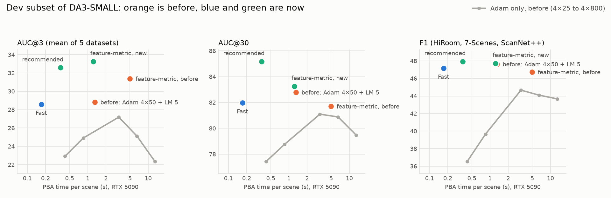
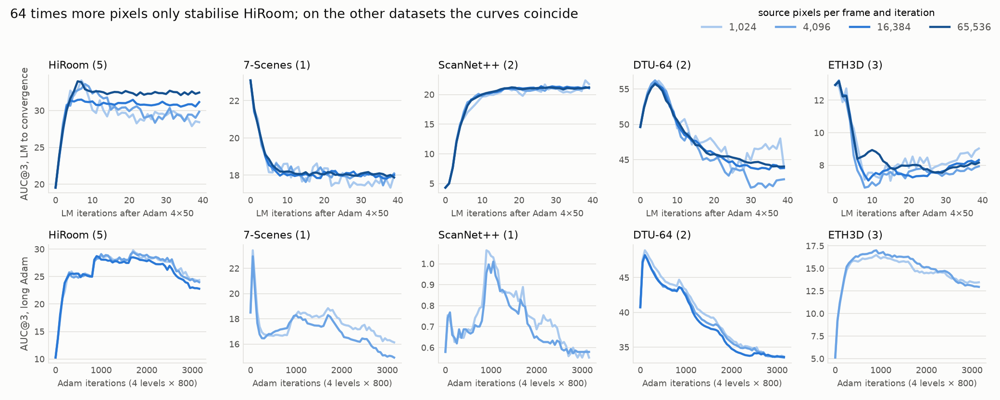
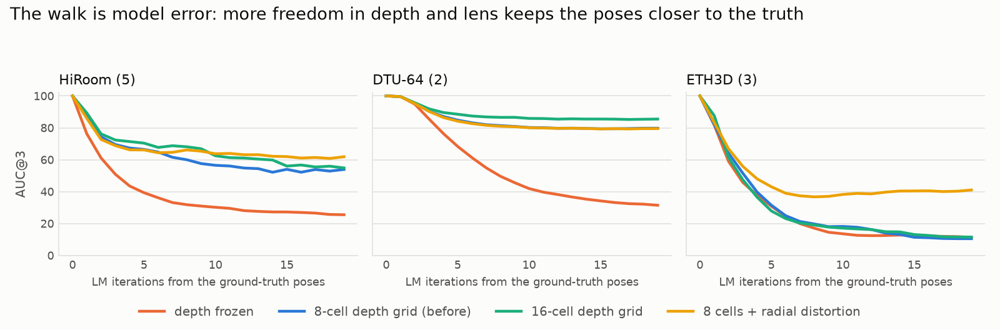
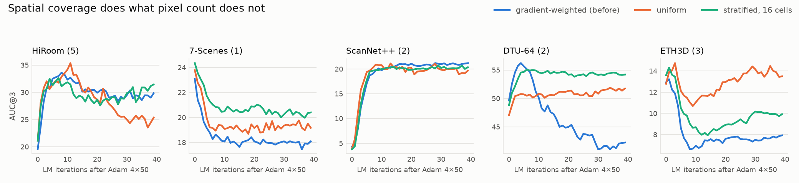
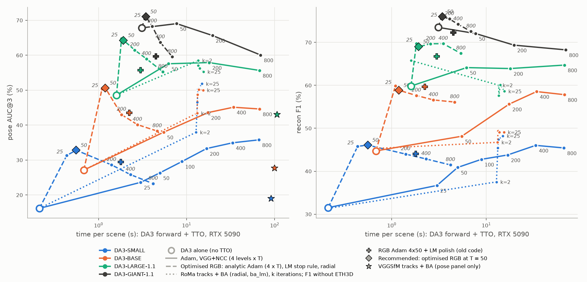

# Photometric / feature-metric BA, session 3: speed, and what limits long runs

Session of 2026-11-05 21:15 to 2026-11-06 05:50 (of the 10 hours available), on DA3-SMALL only, plus the rollout of the recommended configuration to the other models on 2026-11-06 (section 11). Nothing was committed or pushed. Runs:
`workspace/tto/DA3-SMALL/pm_*`, their configs and metrics: `results/pba/runs/DA3-SMALL/pm_*`, jobs:
`results/pba/jobs/pmba/`, figures: `results/pba/figures3/` (`scripts/plot_pba_speed.py`).

## Summary

- **The photometric hybrid is 7.7 times faster at about the same quality**, on an RTX 5090: 1.30 s → 0.17 s per scene
  after warm-up (the one-off warm-up of a process falls from about 3 s to 0.3 s). That is now well below DA3-SMALL's own
  forward pass (0.42 s), so one forward pass + PBA costs 0.6 s instead of 1.7 s. On the 59 scenes not used for tuning:
  AUC@3 34.0 → 32.6, AUC@30 83.3 → 82.8, F1 43.1 → 42.1.
- **With the stop rule and a gated radial coefficient it is both 3.6 times faster and better**: 0.36 s per scene, on the
  held-out scenes AUC@3 34.0 → 37.1, AUC@30 83.3 → 84.4, F1 43.1 → 44.8 (F1 measured with gate 0.02, the pose numbers with the recommended 0.01). This is the recommended configuration. Most of
  the gain is on ETH3D (17.4 → 27.0) and HiRoom (37.1 → 41.7). DTU-64 is 0.6 lower.
- **The feature-metric hybrid (VGG + NCC) is 4.3 times faster at the same pose quality**: 4.98 s → 1.17 s with 8 PCA
  channels instead of 16 and a faster feature extractor (dev: AUC@3 31.4 → 31.5). With the stop rule and radial, on the held-out
  scenes: AUC@3 38.5, AUC@30 85.1, at 1.54 s, the most accurate configuration tested, at about the old photometric hybrid's cost.
- **Peak GPU memory falls from 21 GiB to 2.5-5 GiB** for the photometric configurations (the forward-mode Jacobians
  were the cost), which is inside the 8 GiB budget of the local machines. Not run there yet.
- **It was already on the GPU.** The time went into per-operation overhead, not pixels: 4-7 ms per Adam iteration whatever
  the number of frames. Hand-derived gradients and Jacobians are most of the speed-up (section 2).
- **Your question about the pixels: partly right, but the count is not the main cause, and the distribution matters more.**
  Near convergence, most of a Gauss-Newton step at ≤ 4096 pixels is indeed sampling noise, and on HiRoom 64 times more
  pixels stop the drift. On the other four datasets the curves coincide: 64 times the pixels give +0.7 AUC@3 at 26 times the
  cost. The main cause is that **the objective's minimum is not at the true poses**: started at the ground truth, LM walks away
  while the photometric error falls (ETH3D AUC@3 100 → 10, HiRoom 100 → 52), and everything points to model error (depth rigidity
  and, on ETH3D, lens distortion). Stratified sampling (+3.7 AUC@3 in long runs, at no extra cost) and a radial coefficient do
  what pixel count doesn't, and they can now run for longer: LM 20 is no longer worse than LM 5 (section 3).
- **Rolled out to BASE, LARGE-1.1 and GIANT-1.1** (dev subset, one seed, section 11): TTO takes 0.31-0.36 s on every model, 3.7 to 4.3 times less than
  the old polish, and AUC@3 rises over the old polish by 7.1, 8.6 and 11.4. Almost all of that comes from ETH3D's three scenes: on the other four datasets
  the two are about level (+0.6, 0.0, +1.0). GIANT no longer loses from PBA on the five-dataset mean (67.8 alone, 59.7 old polish, 71.1 now), but without ETH3D it's still below GIANT alone (69.8 vs 71.6). Over T the optimised curve beats the old Adam-only curve at every point, and more Adam only makes it worse: quality peaks at T = 25-50 on all four models.

## 0. How this session ran

All four GPUs were held by another group's array until 02:36, so quality experiments ran on 8 free CPU cores per node, and
GPU timing started when a GPU became free. A CPU run reproduces the GPU's numbers (long Adam at M = 1024 on the 13-scene
subset: HiRoom 24.4 vs 24.6, ETH3D 13.5 vs 13.5), so CPU and GPU quality numbers are compared directly. All times below are from
the RTX 5090 unless a column says CPU. Sets: **dev** (22 scenes), a 13-scene **subset** for sweeps (the first scenes of each dataset;
correlation with the dev mean over 109 earlier runs 0.98), and the **full** benchmark (81 scenes, of which 59 are **held-out**: never
used to choose anything). AUC@3/AUC@30: mean of the five datasets. F1: mean of HiRoom, 7-Scenes and ScanNet++.
Times: mean per scene, without the first scene of each dataset (warm-up of a new process), as in `plot_compute.py`.

Noise: over seeds, dev AUC@3 ±0.2, AUC@30 ±0.1, F1 ±0.5. A single scene moves by several points: the optimisation is chaotic
(section 2), so don't read per-scene differences.

## 1. Where the time went

| RTX 5090 | N = 12 | N = 100 |
|---|---|---|
| Adam iteration, autograd (M = 1024) | 3.9 ms | 6.8 ms |
| Adam iteration, analytic | **1.0 ms** | **1.35 ms** |
| LM normal equations, forward mode (M = 4096) | 23 ms | 140 ms |
| LM normal equations, analytic | **3.0 ms** | **22 ms** |
| dense Cholesky, float64 | 2.6 ms | 38 ms |
| dense Cholesky, float32 after Jacobi scaling | **0.6 ms** | **6 ms** |
| one cost evaluation | 0.8 ms | 3.2 ms |

An Adam iteration was about 740 tensor operations (plus 309 views), now 266. At 4-5 µs per operation, this overhead was most of
the time: in the analytic version, 8 times the pixels (12 to 100 frames) add only 30 %. Setup per level (blur, sampling, pool) is 1-6 ms,
covisibility 4-23 ms, neither is worth optimising. Image decoding (~1.8 s per scene) isn't counted: a pipeline has the images.

## 2. The ladder: one change at a time

| dev, RTX 5090 | HiR | 7S | SN++ | DTU | ETH | A@3 | A@30 | F1 | s/scene | peak GiB |
|---|---|---|---|---|---|---|---|---|---|---|
| original: Adam 4×50 + LM 5 (grey) | 32.7 | 34.8 | 18.0 | 50.5 | 8.0 | 28.8 | 82.8 | 47.6 | 1.30 | 21.2 |
| 1. analytic Adam gradient | 32.5 | 34.9 | 17.9 | 50.4 | 9.4 | 29.0 | 82.6 | – | 0.68 | 21.3 |
| 2. analytic LM Jacobians | 33.7 | 34.8 | 17.9 | 50.2 | 8.5 | 29.0 | 82.8 | – | 0.40 | 5.2 |
| 3. Adam 4×25 | 32.7 | 33.6 | 16.1 | 52.8 | 8.2 | 28.7 | 82.1 | – | 0.27 | 5.2 |
| 4. LM at 1024 pixels | 32.6 | 32.7 | 16.0 | 52.7 | 8.7 | 28.5 | 81.9 | – | 0.23 | 2.7 |
| 5. float32 Cholesky, and the last trimming of operations | 32.1 | 32.7 | 16.3 | 53.1 | 8.8 | 28.6 | 82.0 | 47.2 | 0.17 | 2.6 |

Steps 1 and 2 don't change the objective: AUC@3 stays within noise. On CPU the same ladder is 27.4 s → 25.3 s → 10.1 s
(at 3 seeds: AUC@3 29.4, AUC@30 83.0, F1 47.8) → Fast 3.2 s (with Adam at 512 pixels, which costs less on a CPU: 29.1, 82.1, 47.0).

**What changed in the code** (`scripts/pba_analytic.py`, switched on by `impl=analytic lm_impl=analytic lm_solver=dense32`):

- The gradient comes from the 3-vector dL/dX_t of each warp. The pose gradient of a frame pair needs only two sums, Σ dL/dX_t and
  Σ X_t × dL/dX_t, and u, v and the four corners of a bilinear lookup are one tensor. Adam works on a single vector with a learning
  rate per entry (`FlatAdam`, 10 operations instead of ~60). There's no `float()` in the loop, which would make every iteration wait for the GPU.
- LM: one pass gives all Jacobian columns instead of 15 forward-mode passes, the pose block of a frame pair is a matrix product,
  and the cells of the depth grid are added per warp. Single-precision Cholesky after Jacobi scaling lost nothing (same AUC to 0.1, 42.1 vs 42.6 F1 on the subset).

**Checked in float64 against the old code** (`scripts/bench_pba.py`, on the final code; Huber and NCC, grey and VGG): loss to 8 digits, gradient cosine
1.0000000 and largest relative difference 1e-6, Gauss-Newton matrix 6e-7, LM step cosine 1.0000000. NCC's grid blocks differ by 1e-3, because the old code uses the patch centre's
bilinear weights and the new one each sample's. The radial terms have no autograd version, so they are checked against central differences with a frozen visibility mask.

**The whole loop does not reproduce exactly, and can't.** Old and new diverge after tens of iterations, even in float64. The control:
the new code against itself with a 1e-9 jitter on the rotations diverges just as much (rotation 1.6e-3 vs 1.8e-3, grid 3.3e-2 vs 2.6e-2). So the
optimisation is chaotic: the bilinear gradient jumps at pixel boundaries, and tiny differences get amplified. One-seed comparisons at scene level mean little.



## 3. Pixels, drift and what the objective wants

### Does the pixel count stop the degeneration?

Long Adam (4×800) and LM to convergence (40 iterations), one change: `samples` or `lm_samples`.

| subset, LM 40 after Adam 4×50 | HiR | 7S | SN++ | DTU | ETH | A@3 | A@30 | F1 | CPU s/scene |
|---|---|---|---|---|---|---|---|---|---|
| 1,024 pixels | 28.6 | 17.4 | 21.0 | 44.2 | 9.5 | 24.1 | 81.2 | 42.3 | 18 |
| 4,096 | 29.7 | 17.7 | 21.1 | 42.5 | 7.8 | 23.8 | 81.7 | 42.1 | 38 |
| 16,384 | 30.7 | 18.1 | 21.2 | 43.9 | 8.4 | 24.4 | 81.9 | 43.4 | 116 |
| 65,536 (a third of all pixels) | 32.6 | 18.0 | 21.3 | 43.8 | 8.1 | 24.8 | 82.0 | 42.8 | 464 |
| for comparison: LM 5 at 4,096 (3 seeds) | 32.8 | 18.6 | 16.4 | 55.8 | 9.7 | 26.7 | 81.2 | 41.8 | 11 |

HiRoom is what you predicted: the drift falls with the pixel count and is gone at 65,536. The others don't respond. Long Adam doesn't either: DTU ends at 33.5 / 33.5 / 33.6 at 1,024 / 4,096 / 16,384 pixels.



### Where the noise is

Two LM steps from independent pixel samples at the same state (DTU scan105, pose part, cosine, λ = 1e-3 / 1e-7):

| | 1,024 | 4,096 | 16,384 | 65,536 |
|---|---|---|---|---|
| after Adam | 0.89 / 0.94 | 0.97 / 0.99 | 0.99 / 1.00 | 1.00 / 1.00 |
| after 5 LM iterations | 0.28 / 0.67 | 0.57 / 0.88 | 0.85 / 0.97 | 0.96 / 0.99 |
| after 20 LM iterations | 0.15 / 0.33 | 0.44 / 0.34 | 0.78 / 0.78 | 0.91 / 0.94 |

- Early steps are signal even at 1,024 pixels, which is why cheap LM works.
- Near convergence, steps at ≤ 4,096 pixels are largely noise. So is the same-sample cost decrease: it never reaches zero, and stays at ~3 % per
  iteration at 1,024 and ~0.8 % at 4,096 (about 1/M), while the decrease on held-out pixels is ~0 after 5 iterations on DTU and after 1 on 7-Scenes.
- The flat directions are real: the pose system's condition number is 6e4, and after 5 LM iterations 95 % of the step's squared norm is in the weakest 10 % of directions (ETH3D 99 %).
- At 65,536 pixels the steps agree and are still not zero. Something real keeps moving the poses.

### The objective's minimum is not at the true poses

LM started at the ground-truth poses and focal (AUC@3 = 100), without Adam. The photometric error falls while the poses walk away.

| AUC@3 at LM iteration 5 / 20 | HiRoom (5) | DTU-64 (2) | ETH3D (3) |
|---|---|---|---|
| 8-cell depth grid, 4,096 pixels | 66.5 / 51.9 | 84.8 / 79.5 | 31.5 / 10.1 |
| 16,384 pixels | 66.4 / 52.6 | 84.8 / 79.7 | 31.7 / 11.3 |
| **depth frozen** (no grid) | 39.3 / 24.6 | 68.3 / 31.2 | 30.8 / 11.0 |
| 4-cell grid | 60.6 / 40.3 | 82.8 / 75.1 | 33.7 / 10.1 |
| **16-cell grid** | 70.4 / 56.0 | 88.5 / 85.4 | 27.9 / 11.5 |
| **radial coefficient** | 66.1 / 61.5 | 84.2 / 79.4 | **43.1 / 40.7** |
| no geometric term | 63.5 / 48.9 | 78.3 / 75.4 | 35.8 / 11.7 |
| confidence quantile 0.5 | 57.9 / 52.4 | 80.1 / 77.2 | 22.2 / 9.8 |
| Huber δ = 0.02 | 71.3 / 54.8 | 86.7 / 79.8 | 39.2 / 11.2 |
| no focal | 67.5 / 52.9 | 83.2 / 67.3 | 33.8 / 13.4 |
| uniform sampling | 54.9 / 40.9 | 81.5 / 73.6 | 34.1 / 15.7 |
| stratified, 8 cells | 65.7 / 53.6 | 85.1 / 78.3 | 35.1 / 13.0 |

- Pixel count changes nothing here, which settles it for this part of the drift: **it is bias, not noise.**
- Depth is the lever: frozen depth collapses, and more cells help. The poses compensate for depth errors that the grid can't express. A likely reading, not proven: any depth error the grid can't absorb that looks like a pose change pulls the poses by that much.
- ETH3D's raw images have strong fisheye distortion, which the pinhole model puts about 10 px off at the corners at this resolution (my estimate from the calibration). One radial coefficient lifts it from 10 to 41.



### Which pixels: distribution matters more than count

| subset, LM 40 at 4,096 pixels | HiR | 7S | SN++ | DTU | ETH | A@3 | A@30 | F1 |
|---|---|---|---|---|---|---|---|---|
| gradient-weighted (before) | 29.7 | 17.7 | 21.1 | 42.5 | 7.8 | 23.8 | 81.7 | 42.1 |
| uniform | 25.5 | 19.3 | 19.6 | 51.7 | 13.7 | 26.0 | 82.3 | 42.4 |
| stratified, 4 cells | 25.3 | 19.7 | 19.7 | 53.0 | 9.0 | 25.3 | 82.0 | 41.9 |
| stratified, 8 cells | 29.7 | 20.2 | 20.4 | 54.2 | 9.6 | 26.8 | 82.4 | 42.5 |
| **stratified, 16 cells** | 32.2 | 20.5 | 20.4 | 54.3 | 9.9 | **27.5** | 82.7 | 45.1 |
| stratified, 32 cells | 31.7 | 20.7 | 21.0 | 51.5 | 11.2 | 27.2 | 83.3 | 45.3 |
| confidence quantile 0.5 | 34.9 | 16.7 | 17.7 | 32.2 | 7.5 | 21.8 | 81.1 | 38.3 |

`strat_cells=n` gives every cell of an n-cell grid the same sampling mass, keeping the gradient weighting inside each cell. On the two DTU scenes of the subset this removes the drift completely: 54-55 from
iteration 5 to 40, instead of falling to 42.5. So your idea that the sampling lets LM slide around was right, but the fix is coverage: gradient weighting concentrates the pixels on a few textured places. A limit: on all four
DTU scenes of the dev set LM 20 is still worse than LM 5 (45.7 vs 50.6). At the short budget it gives no pose gain on dev (AUC@3 28.6 vs 29.1 at Fast, F1 47.9 vs 47.0): its use is in long runs.



### The radial coefficient, with a gate

`radial=true`: one shared coefficient of the division model, x_u = x_d / (1 + k r²), in the analytic code only. Three steps:

| dev, 3 seeds, CPU | HiR | 7S | SN++ | DTU | ETH | A@3 | A@30 | F1 |
|---|---|---|---|---|---|---|---|---|
| Fast | 33.7 | 33.7 | 16.5 | 52.8 | 9.0 | 29.1 | 82.1 | 47.0 |
| + radial, k ≤ 0 | 28.7 | 33.7 | 17.6 | 53.5 | 15.8 | 29.8 | 82.2 | 45.0 |
| + radial, k ≤ 0, gate 0.02 | 32.8 | 33.7 | 16.5 | 53.4 | 11.9 | 29.7 | 82.5 | 46.7 |

| dev, RTX 5090, Adam 4×50, stop | HiR | 7S | SN++ | DTU | ETH | A@3 | A@30 | F1 |
|---|---|---|---|---|---|---|---|---|
| radial, k ≤ 0, gate 0.02 (3 seeds) | 32.2 | 36.5 | 21.1 | 51.0 | 17.4 | 31.6 | 84.9 | 47.6 |
| **radial, k ≤ 0, gate 0.01** (3 seeds; F1 one seed) | 32.7 | 37.1 | 21.2 | 51.2 | 20.7 | **32.6** | **85.2** | 47.9 |

Left free (subset, one seed, Adam 4×50), k goes positive on undistorted scenes and trades off with the focal length: HiRoom AUC@3 32.5 → 24.6, ScanNet++ 17.1 → 5.1, focal error of a HiRoom scene 0.015 → 0.087. `radial_max=0` allows only barrel distortion. On HiRoom it still costs, so
`radial_gate=0.02` drops the coefficient at the start of the LM level if Adam hasn't moved it past 0.02. On ETH3D's 11 scenes it stayed on for 7, all with k between −0.034 and −0.053 (against the stop rule alone: kicker 46.7 → 77.8, facade 12.3 → 26.2, courtyard 8.3 → 23.0).
A threshold of 0.02 misses scenes: `electro` is really distorted, but is at −0.016 when the gate decides (24.5 → 19.7). **0.01 catches it** (27.0), and `delivery_area` (9.9 → 18.0). It still drops all 30 HiRoom scenes (their largest |k| is 0.0088), but only just: it needs a look on other models. Most of its gain on dev is these two scenes, and both are dev scenes: on the held-out scenes 0.01 and 0.02 are level (section 6). It never hurt, so I recommend 0.01.

### Stopping on held-out pixels

Since the true gain ends early and differs per scene, `lm_stop=2e-3` stops LM when the cost on 2,048 fixed held-out pixels per frame falls by less than 0.2 % in an iteration (one extra cost evaluation per iteration). It needs `lm_samples=4096`: at 1,024 the
held-out cost is too noisy (simulated from the tracks). It stops after 2.5 iterations on 7-Scenes and 10.7 on ScanNet++, in line with where each one gains.

| dev, RTX 5090 | HiR | 7S | SN++ | DTU | ETH | A@3 | A@30 | F1 | s/scene | peak GiB |
|---|---|---|---|---|---|---|---|---|---|---|
| Adam 4×25, stop (3 seeds) | 33.9 | 35.1 | 19.9 | 53.3 | 8.5 | 30.1 | 83.6 | 46.7 | 0.25 | 5.1 |
| Adam 4×50, stop (3 seeds) | 31.4 | 37.1 | 20.7 | 50.2 | 13.5 | 30.6 | 84.2 | 47.4 | 0.33 | 5.1 |
| threshold 1e-3 | 31.3 | 35.7 | 20.8 | 50.0 | 15.6 | 30.7 | 84.3 | 47.1 | 0.35 | 5.1 |
| threshold 5e-3 | 30.1 | 37.9 | 20.0 | 50.2 | 16.3 | 30.9 | 84.1 | 47.3 | 0.29 | 5.1 |
| Adam 4×50, stop + radial, gate 0.02 (3 seeds) | 32.2 | 36.5 | 21.1 | 51.0 | 17.4 | 31.6 | 84.9 | 47.6 | 0.36 | 5.1 |
| ... + stratified, 16 cells | 30.8 | 36.5 | 22.2 | 45.8 | 17.7 | 30.6 | 85.3 | 48.1 | 0.35 | 5.1 |
| **Adam 4×50, stop + radial, gate 0.01 (3 seeds)** | 32.7 | 37.1 | 21.2 | 51.2 | 20.7 | **32.6** | **85.2** | 47.9 | 0.36 | 5.1 |

### Can it now run for longer?

| dev | HiR | 7S | SN++ | DTU | ETH | A@3 | A@30 | F1 | CPU s/scene |
|---|---|---|---|---|---|---|---|---|---|
| reference: analytic, LM 5 (3 seeds) | 33.2 | 34.8 | 18.4 | 50.7 | 9.7 | 29.4 | 83.0 | 47.8 | 10 |
| LM 20, gradient-weighted | 32.3 | 32.3 | 24.3 | 44.3 | 7.5 | 28.2 | 83.5 | 46.4 | 20 |
| LM 20, stratified | 29.7 | 32.2 | 24.5 | 45.7 | 8.8 | 28.2 | 83.9 | 48.9 | 20 |
| **LM 20, stratified, gated radial** | 33.0 | 32.2 | 24.9 | 46.2 | 13.7 | **30.0** | **85.0** | **49.5** | 22 |

Yes: LM 20 goes from worse than LM 5 to better on all three means, with ScanNet++ up by 6.5 points. It still loses on DTU and 7-Scenes, where the early stop stays better. See section 6 for what's left of the bias.

## 4. What didn't work

All on the subset or dev, compared with the analytic baseline (subset A@3 26.5-26.9, AUC@30 81.2, F1 41.4-42.1).

- **Eliminating the depth grid.** The obvious way to a smaller system. Leaving out the coupling of the cells of different frames: 27.1 / 81.2 / 43.1 on dev (29.4 / 83.0 / 47.8), ScanNet++ AUC@3 18.4 → 8.9, and the reduced system can even become indefinite. PCG on the exact system with this as a
  preconditioner (at most 5 or 10 iterations, tolerance 1e-3) loses in the same way: ScanNet++ 17 → 4.3. A plausible reason: ScanNet++'s gain lives in the weak global modes that a residual of 1e-3 says little about at a condition number of 6e4. Those are the same flat directions that cause the drift elsewhere. Float32 made this moot: the dense solve is now as cheap as the elimination.
- **Reusing a factorisation** (chord method, `lm_refactor`): cheap iterations, but 24.4 with 1 new matrix per 5 iterations and 25.4 per 3, again from ScanNet++ (7.7, 8.6).
- **LM without Adam:** a pyramid of LM (24.7, DTU 45.8), starting at less damping (`lm_lambda` 1e-4: 22.0, 1e-5: 21.0 vs 23.1 on the same scenes).
- **Going too far on the budget:** Adam 4×10 (24.8, ScanNet++ F1 22 vs 32), Adam at 256 pixels (25.1), LM 3 instead of 5 (28.6 / 81.3 / 44.6 on dev vs 28.6 / 82.0 / 47.2), 4-cell grid (24.7), 5 or 3 neighbours (F1 39.6, 39.4). A 6-cell grid is unclear (F1 38.4 at the Fast schedule, 42.0 at the original one), and with float32 the smaller system isn't needed.
- **Neutral:** a smaller pixel pool, a single pool for all levels (setup is negligible on the GPU anyway), fixed samples during LM, and uniform or square-root gradient weighting at the short budget.
- **Worse:** a confidence filter on the pixels, LM without the geometric term (25.4, F1 39.9).

## 5. Feature-metric BA

VGG16 + NCC of 3×3 patches, same ladder. Three independent changes: analytic NCC gradient and Jacobians, fewer channels, and the feature extractor: `vgg_fast=true` keeps the network between scenes, runs 8 frames per pass instead of 2, and does the PCA by eigendecomposition. It takes 0.06-0.36 s per scene.

| dev, RTX 5090 | HiR | 7S | SN++ | DTU | ETH | A@3 | A@30 | F1 | s/scene | peak GiB |
|---|---|---|---|---|---|---|---|---|---|---|
| original: 16 channels, 4,096 samples, 4×50 + LM 5 | 37.0 | 33.1 | 18.7 | 56.2 | 11.9 | 31.4 | 81.7 | 46.7* | 4.98 | 11.7 |
| analytic | 35.8 | 33.0 | 19.1 | 55.7 | 11.9 | 31.1 | 81.7 | – | 2.21 | 14.1 |
| + fast extractor | 36.5 | 33.1 | 19.8 | 55.9 | 11.9 | 31.4 | 81.7 | – | 1.73 | 14.1 |
| **+ 8 channels** | 37.4 | 32.9 | 19.7 | 56.3 | 11.2 | **31.5** | 81.6 | 48.0 | **1.17** | 10.5 |
| 8 channels, 1,024 samples, 4×25 | 33.0 | 34.0 | 15.4 | 53.7 | 10.0 | 29.2 | 80.9 | – | 0.37 | 7.2 |
| 4 channels, 1,024 samples, 4×25 | 31.4 | 34.2 | 15.4 | 51.9 | 10.2 | 28.6 | 80.5 | – | 0.33 | 6.2 |
| 8 channels, 4×50, stop | 34.6 | 39.0 | 20.4 | 56.5 | 12.6 | 32.6 | 82.2 | 47.9 | 1.18 | 10.5 |
| **8 channels, 4×50, stop + gated radial** | 30.8 | 37.8 | 20.6 | 57.9 | 19.1 | **33.2** | **83.3** | 47.7 | 1.23 | 10.7 |

\* F1 of the earlier run `polish50`, the same configuration. All rows are one seed.

So 4.3 times faster at the same pose quality. Before, feature-metric cost 3.8 times the photometric hybrid for +2.6 AUC@3 and −1.1 AUC@30; now, 3.4 times for +1.6 and −1.6 (33.2 / 83.3 against 31.6 / 84.9). On dev, which of the two is better depends on which AUC you care about. On the held-out scenes (section 6) feature-metric wins on both, and it's the most accurate configuration tested: AUC@3 38.5, AUC@30 85.1, at 1.54 s, about the cost of the old photometric hybrid. No F1 for it on the full benchmark (the run didn't save predictions).

## 6. The test: 59 scenes not used for anything

| held-out scenes (59) | HiR | 7S | SN++ | DTU | ETH | A@3 | A@30 | F1 | s/scene (all 81) |
|---|---|---|---|---|---|---|---|---|---|
| DA3-SMALL alone | 8.8 | 8.7 | 9.5 | 31.0 | 9.9 | 13.6 | 74.9 | – | – |
| original | 37.1 | 22.0 | 32.0 | 61.4 | 17.4 | 34.0 | 83.3 | 43.1 | 1.36 |
| Fast | 34.8 | 20.7 | 29.6 | 61.7 | 16.3 | 32.6 | 82.8 | 42.1 | 0.16 |
| Adam 4×50, stop | 41.2 | 21.4 | 32.1 | 60.5 | 17.8 | 34.6 | 83.5 | 44.5 | 0.36 |
| Adam 4×50, stop + radial, gate 0.02 | 41.6 | 23.4 | 32.2 | 60.5 | 27.3 | 37.0 | 84.4 | **44.8** | 0.40 |
| **Adam 4×50, stop + radial, gate 0.01** | 41.7 | 23.5 | 32.8 | 60.8 | 27.0 | **37.1** | **84.4** | – | 0.40* |
| LM 20, stratified, gated radial | 44.9 | 22.2 | 34.5 | 57.6 | 27.9 | 37.4 | 84.2 | 44.2 | 0.65 |
| VGG + NCC, 8 channels, stop + gated radial | 40.5 | 23.6 | 30.5 | 66.5 | 31.4 | **38.5** | **85.1** | – | 1.54 |

\* The run was cut by the end of the GPU job and its ETH3D scenes finished on CPU, so 0.40 s is the time of the 0.02 run, which is the same computation. No F1: that run didn't save predictions. All rows are one seed.

It was worth doing:

- **The speed-ups hold**, since they don't depend on the scene.
- **The stop rule's gain was partly fitting the dev set**: +1.8 AUC@3 on dev and only +0.6 here. It's HiRoom (+4.1), with the others about level. Dev's two 7-Scenes scenes gained +2.3 from it; on the other five it's −0.6.
- **The radial gain generalises better than it looked on dev**: ETH3D +9.2 over the stop rule here. Lowering the gate to 0.01 is the opposite: +1.3 AUC@3 on dev and +0.1 here, which is why I chose it on grounds of not hurting, not on the dev number.
- DTU-64 is the one dataset that gets slightly worse with the photometric configurations (61.4 → 60.8), and LM 20 costs it more (57.6). Feature-metric gains on it (66.5).

## 7. Recommended configurations

```sh
BASE="nbr_mode=spread neighbors=10 lr_rot=3e-3 lr_trans=3e-3 lr_focal=3e-3 levels=8,4,2,1,1 lm_levels=4 samples=1024 impl=analytic lm_impl=analytic lm_solver=dense32"
# Fast, 0.17 s: about the old quality at about 1/8 of the time
.venv/bin/python scripts/run_tto_pba.py workspace/evaluation/DA3-SMALL <dst> $BASE iters=25 lm_iters=5 lm_samples=1024
# Recommended, 0.36 s: faster and better than before
.venv/bin/python scripts/run_tto_pba.py workspace/evaluation/DA3-SMALL <dst> $BASE iters=50 lm_iters=15 lm_samples=4096 lm_stop=2e-3 radial=true radial_max=0 radial_gate=0.01
# Long, 0.65 s: no early stop, the best F1 on dev (49.5). Tested with gate 0.02
.venv/bin/python scripts/run_tto_pba.py workspace/evaluation/DA3-SMALL <dst> $BASE iters=50 lm_iters=20 lm_samples=4096 strat_cells=16 radial=true radial_max=0 radial_gate=0.02
# Feature-metric, 1.2-1.5 s: the most accurate. Tested with gate 0.02
.venv/bin/python scripts/run_tto_pba.py workspace/evaluation/DA3-SMALL <dst> $BASE features=vgg photo_loss=ncc vgg_fast=true feat_dim=8 samples=4096 iters=50 lm_iters=15 lm_stop=2e-3 radial=true radial_max=0 radial_gate=0.02
```

## 8. Caveats

- **Sections 0-10 are only DA3-SMALL.** The other models have better initial poses, so the stop rule, the gate's threshold and the LM counts might not transfer. Section 11 tests that on dev only; the held-out test hasn't been run on them. In session 2 LM hurt LARGE on ETH3D, and section 11 confirms that this was largely the distortion.
- **The gate's threshold and the stop threshold were chosen on dev**, and the held-out test above is one seed. The gate's margin on HiRoom is thin (0.0088 against 0.01), so it may need a scene-independent criterion. The radial coefficient changes the camera model in the optimisation only: `results.npz` stays pinhole, so the evaluator's fusion doesn't see k, and F1 on ETH3D isn't improved by it directly. ETH3D F1 isn't in the F1 column.
- **Old configurations no longer reproduce bit-exactly**, though their defaults are unchanged: the sampling probabilities now use the blurred grey image directly, which differs from the mean of the blurred channels by rounding (`pm_G_I0` 28.8 / 82.8 / 47.6 vs the earlier `loss_V1_gray` 29.3 / 83.0 / 47.1, within noise given the chaos above).
- **Timing.** GPU runs shared a node with my CPU scoring job, on separate cores. The original's time here (1.30 s, 1.64 s with warm-up) matches the earlier 1.6 s. Runs `pm_G*` have `wandb` off; the rest log to `compact3d-pba`. `opt_s` doesn't include covisibility (4-23 ms) or decoding.
- **Incidents, none affecting the results above:**
  1. A 16-second check of mine ran on another group's GPU on VC15: `CUDA_VISIBLE_DEVICES=""` on the `srun` line was ignored, because SLURM unsets an empty value for a step. It didn't happen again, all worker runs are confirmed on CPU (0 GPU memory). You may want to tell that group if you think it's needed.
  2. I filled `/scratch/vc17` at about 03:46: tonight's runs had written 391 GB, on a disk that already held most of this account's data. Other writes of this account would have failed for about 11 minutes. I deleted `model_results` of tonight's `pm_*` runs (regenerable from the configs; all metrics and configs kept), except `pm_GZ_orig_full`, `pm_GZ_fast_full`, `pm_GZ_best_full`, `pm_GE_T50_s2_gate`, `pm_Z_g10stop_s0` and `pm_GX_best`, and nothing else. One more save failed with the same error at 04:23 with about 160 GB free, which I could not reproduce or explain; rerunning worked. The disk is still at about 87 %, mostly runs of earlier sessions (DA3-SMALL 375 GB, LARGE 203 GB, BASE 141 GB), and scratch is deleted after 30 days untouched anyway, so **it needs a look**.
  3. A bug in my new per-scene keys crashed a few runs (the evaluator's mean takes its keys from the first scene), fixed and resumed.

## 9. Next steps

1. **Roll out to the other models.** Done on dev (section 11). Still open: the held-out comparison on BASE, LARGE-1.1 and GIANT-1.1, roughly 15 minutes per model on a GPU, plus scoring.
2. **Fix the bias rather than stop before it.** The GT-start test is a cheap metric for any objective change. The direct candidates: a finer depth grid (16 cells held better, but the dense system is too large: Adam-only or with block-wise LM), better lens models than one coefficient, and a coefficient that isn't gated per scene but per camera.
3. **The compute plot for the matched-compute question.** Done for Recommended (section 11). Fast on the other models isn't run: BASE + Fast would cost about what SMALL + Recommended does.
4. A gate decided by something better than Adam's k at a fixed time, for example whether k lowers the held-out cost that the stop rule already computes. The present margin is thin, and `relief` is still missed.

## 10. Files

- New: `scripts/pba_analytic.py` (the kernels), `scripts/bench_pba.py` (checks, op counts, timing, noise and chord diagnostics), `scripts/plot_pba_speed.py`, `results/pba/REPORT3.md`, `results/pba/figures3/`, `results/pba/runs/DA3-SMALL/pm_*`, `results/pba/jobs/pmba/`.
- Changed: `scripts/run_tto_pba.py`: new options, all off by default: `impl`, `lm_impl`, `lm_solver`, `lm_cg_iters`, `lm_cg_tol`, `lm_refactor`, `lm_stop`, `lm_stop_samples`, `lm_w_geo`, `strat_cells`, `nbr_iter`, `pool_once`, `pool_factor`, `radial`, `w_radial`, `radial_max`, `radial_gate`, `lr_radial`, `vgg_fast`, `init_gt`, `track_every`. Per-scene `decode_s`, `covis_s` and `<dataset>_pba_track.jsonl`.
- Changed for section 11: `scripts/plot_compute.py` now draws the series of `~/jobs/plot_fast.py` (which it leaves in place), plus GIANT and Recommended, with the optimised curve `rec_it<T>` in place of the old `fast_it<T>`. `point()` gained an optional `recon_run` and accepts an empty `recon`; the scripts that import it are unaffected. New: `results/pba/figures3/compute_all_models.png`, `results/pba/runs/<model>/recommended`, `recommended_t` and `rec_it<T>`.

## 11. Rollout to BASE, LARGE-1.1 and GIANT-1.1

The recommended configuration of section 7 on the 22 dev scenes of all four models, first unchanged and then over T, with one more SMALL run so that all four share the same code (snapshot `d15`). `recommended` ran on 8 CPU cores and gives quality and F1. `recommended_t` ran on an RTX 5090 with nothing else on the node and gives the time, the convention of `plot_compute.py`. The two agree within 0.5 AUC@3 on every model, which also works as a second seed: SMALL 32.8 / 32.6, BASE 50.6 / 50.1, LARGE-1.1 64.3 / 64.4, GIANT-1.1 71.1 / 71.3.



| dev, one seed | HiR | 7S | SN++ | DTU | ETH | A@3 | A@30 | F1, 4 sets | F1, 3 sets | TTO s/scene | total s/scene |
|---|---|---|---|---|---|---|---|---|---|---|---|
| SMALL alone | 10.6 | 29.3 | 5.9 | 29.9 | 5.1 | 16.2 | 73.8 | 31.5 | 31.4 | – | 0.40 |
| SMALL, old polish | 35.0 | 34.7 | 17.8 | 50.6 | 9.2 | 29.4 | 83.0 | 44.1 | 46.7 | 1.32 | 1.79 |
| **SMALL, Recommended** | 32.5 | 36.9 | 21.5 | 51.4 | 21.8 | **32.8** | **85.3** | **46.1** | 48.0 | 0.36 | 0.77 |
| BASE alone | 21.3 | 32.6 | 13.3 | 55.5 | 13.0 | 27.1 | 83.6 | 44.7 | 45.3 | – | 0.85 |
| BASE, old polish | 53.5 | 37.5 | 45.9 | 57.2 | 23.6 | 43.5 | 89.3 | 59.7 | 61.7 | 1.31 | 2.24 |
| **BASE, Recommended** | 51.1 | 37.9 | 47.1 | 60.5 | 56.6 | **50.6** | **91.1** | 58.9 | 59.0 | 0.34 | 1.19 |
| LARGE-1.1 alone | 53.8 | 42.1 | 44.2 | 72.3 | 30.4 | 48.6 | 92.6 | 59.8 | 65.8 | – | 1.60 |
| LARGE-1.1, old polish | 75.6 | 37.8 | 63.6 | 72.9 | 28.7 | 55.7 | 93.5 | 66.7 | 70.2 | 1.32 | 2.99 |
| **LARGE-1.1, Recommended** | 74.8 | 38.1 | 63.5 | 73.4 | 71.6 | **64.3** | **95.3** | **69.0** | 69.3 | 0.31 | 1.92 |
| GIANT-1.1 alone | 79.4 | 37.3 | 74.5 | 95.2 | 52.8 | 67.8 | 95.7 | 73.5 | 76.3 | – | 3.10 |
| GIANT-1.1, old polish | 81.4 | 38.7 | 65.2 | 89.9 | 23.2 | 59.7 | 93.8 | 72.3 | 77.2 | 1.31 | 4.49 |
| **GIANT-1.1, Recommended** | 83.0 | 39.8 | 69.6 | 86.9 | 76.0 | **71.1** | **96.1** | **76.0** | 76.9 | 0.33 | 3.44 |

F1, 4 sets is the mean of the plot (with ETH3D). F1, 3 sets is the mean used in the rest of this report. Peak GPU memory is 5.2-5.3 GiB on every model. The old polish is `fastpolish50`, from before this session.

### The curve over T

The dashed curve in the figure replaces the old photometric one (`fast_it<T>`: Adam only, on the old code). It is the recommended configuration with only T changed, the Adam iterations per level. T = 50 is the run above, with quality from the CPU and time from the GPU. The other T are single GPU runs, `rec_it<T>`, which give both.

| dev, one seed | T | HiR | 7S | SN++ | DTU | ETH | A@3 | A@30 | F1, 4 sets | TTO s/scene | total s/scene | old A@3 | old F1 | old total s |
|---|---|---|---|---|---|---|---|---|---|---|---|---|---|---|
| SMALL | 25 | 33.1 | 34.8 | 20.0 | 54.6 | 14.1 | 31.3 | 84.3 | 45.8 | 0.26 | 0.68 | 22.9 | 36.1 | 0.83 |
| **SMALL** | 50 | 32.5 | 36.9 | 21.5 | 51.4 | 21.8 | 32.8 | 85.3 | 46.1 | 0.36 | 0.77 | 24.9 | 37.9 | 1.25 |
| SMALL | 200 | 31.9 | 38.0 | 19.8 | 40.2 | 13.1 | 28.6 | 83.7 | 44.0 | 0.99 | 1.40 | 27.2 | 41.0 | 3.73 |
| SMALL | 400 | 28.8 | 36.1 | 14.1 | 32.8 | 17.4 | 25.8 | 81.9 | 42.9 | 1.89 | 2.30 | 25.1 | 39.9 | 7.06 |
| SMALL | 800 | 24.0 | 33.5 | 15.7 | 26.9 | 16.1 | 23.2 | 79.8 | 41.5 | 3.76 | 4.17 | 22.3 | 40.4 | 13.72 |
| BASE | 25 | 53.5 | 37.0 | 46.1 | 60.3 | 54.8 | 50.3 | 91.0 | 59.9 | 0.23 | 1.09 | – | – | – |
| **BASE** | 50 | 51.1 | 37.9 | 47.1 | 60.5 | 56.6 | 50.6 | 91.1 | 58.9 | 0.34 | 1.19 | 36.7 | 46.1 | 1.71 |
| BASE | 200 | 48.8 | 37.4 | 36.1 | 51.7 | 41.2 | 43.0 | 89.8 | 57.6 | 0.96 | 1.82 | 39.9 | 50.1 | 4.20 |
| BASE | 400 | 48.7 | 37.3 | 35.6 | 43.6 | 35.6 | 40.1 | 89.2 | 56.6 | 1.90 | 2.76 | 38.1 | 51.7 | 7.55 |
| BASE | 800 | 45.4 | 37.8 | 35.2 | 35.4 | 37.7 | 38.3 | 88.8 | 56.1 | 3.76 | 4.63 | 36.6 | 53.5 | 14.25 |
| LARGE-1.1 | 25 | 75.2 | 37.5 | 65.3 | 73.7 | 72.5 | 64.8 | 95.2 | 69.7 | 0.21 | 1.82 | – | – | – |
| **LARGE-1.1** | 50 | 74.8 | 38.1 | 63.5 | 73.4 | 71.6 | 64.3 | 95.3 | 69.0 | 0.31 | 1.92 | 56.7 | 64.3 | 2.45 |
| LARGE-1.1 | 200 | 72.9 | 39.1 | 65.3 | 67.7 | 62.6 | 61.5 | 94.8 | 69.7 | 0.97 | 2.57 | 57.5 | 67.6 | 4.94 |
| LARGE-1.1 | 400 | 73.8 | 40.4 | 59.4 | 62.6 | 58.6 | 59.0 | 94.5 | 69.7 | 1.89 | 3.50 | 55.9 | 63.5 | 8.29 |
| LARGE-1.1 | 800 | 68.3 | 40.5 | 53.3 | 57.3 | 56.9 | 55.3 | 94.0 | 67.4 | 3.77 | 5.38 | 52.6 | 63.2 | 14.98 |
| GIANT-1.1 | 25 | 81.7 | 38.9 | 68.0 | 88.8 | 74.7 | 70.4 | 96.0 | 75.6 | 0.21 | 3.32 | – | – | – |
| **GIANT-1.1** | 50 | 83.0 | 39.8 | 69.6 | 86.9 | 76.0 | 71.1 | 96.1 | 76.0 | 0.33 | 3.44 | 67.9 | 73.8 | 3.97 |
| GIANT-1.1 | 200 | 81.2 | 39.0 | 72.2 | 81.0 | 68.0 | 68.3 | 95.8 | 75.5 | 0.96 | 4.07 | 64.3 | 73.4 | 6.49 |
| GIANT-1.1 | 400 | 78.0 | 37.2 | 66.7 | 72.8 | 64.1 | 63.7 | 95.3 | 74.2 | 1.90 | 5.01 | 59.1 | 72.2 | 9.89 |
| GIANT-1.1 | 800 | 72.6 | 35.2 | 62.2 | 65.8 | 62.0 | 59.5 | 94.7 | 72.5 | 3.76 | 6.88 | 54.6 | 70.7 | 16.67 |

The old curve has no T = 25 on the three larger models. Its times above T = 200 are scaled from T = 200, as before.

- **The new curve is better at every T.** On all four models and at every T it has higher AUC@3 and F1 than the old curve and takes less time (1.2 to 3.3 times in total). This isn't only the code: the old curve is Adam alone, and the new one adds LM and the radial coefficient.
- **More Adam makes it worse on every model.** AUC@3 peaks at T = 25 or 50, and by T = 800 it has lost 9.5 to 12.3 points. Most of that is DTU-64 (SMALL 54.6 → 26.9, GIANT-1.1 88.8 → 65.8) and ETH3D. F1 falls more slowly: LARGE-1.1 holds 69.7 from T = 200 to 400. So speeding Adam up doesn't make long runs worthwhile, and it's consistent with section 3: Adam follows the same biased objective. From T = 400 the stop rule usually ends LM after about one iteration, because there's little left to gain on the held-out pixels.
- **T = 25 is as good as T = 50 on BASE and LARGE-1.1**, within noise (50.3 / 50.6 and 64.8 / 64.3, F1 59.9 / 58.9 and 69.7 / 69.0), at 0.10 s less. On SMALL and GIANT-1.1, T = 50 is ahead (32.8 / 31.3 and 71.1 / 70.4).
- **The gate's threshold fits T = 50, not the whole curve.** At T = 25 SMALL keeps k on only one of three ETH3D scenes, and its ETH3D is 7.7 points below T = 50. From T = 200 one HiRoom scene passes the gate on SMALL and on GIANT-1.1 (|k| up to 0.0215), SMALL loses an ETH3D scene, and BASE drops 7-Scenes. So the points away from T = 50 mix the effect of T with the gate's decisions.

### What transferred

- **The speed.** TTO costs the same on every model, as expected for a per-pixel cost, so the gain in total time shrinks as the forward pass grows: 1.79 → 0.77 s on SMALL, 4.49 → 3.44 s on GIANT.
- **The stop rule.** It stops earlier on better initial poses: ScanNet++ after 11.0, 9.0, 3.0 and 3.0 LM iterations from SMALL to GIANT.
- **The radial coefficient on ETH3D, more than expected.** Against the old polish: 9.2 → 21.8, 23.6 → 56.6, 28.7 → 71.6, 23.2 → 76.0. This holds on all three scenes, all four models and both runs. On courtyard the coefficient is −0.043, −0.043, −0.043 and −0.041 across the models, so it does look like a property of the lens. It also explains session 2, where LM lowered LARGE's ETH3D: 30.4 alone, 28.7 with the old polish, 71.6 with the coefficient.
- **The gate on the undistorted datasets.** It dropped the coefficient on all HiRoom and ScanNet++ dev scenes on all four models. The HiRoom margin stays thin: the largest |k| at the gate in the GPU run is 0.0097 on SMALL, 0.0002 on BASE, 0.0044 on LARGE-1.1 and 0.0084 on GIANT-1.1 (CPU run: 0.0070, 0.0000, 0.0064, 0.0077), against the threshold of 0.01.

### What to be careful about

- **Nearly all of the gain over the old polish is three ETH3D scenes.** ETH3D gets one fifth of the mean, and it accounts for 2.5 of SMALL's +3.4 AUC@3, 6.6 of BASE's +7.1, 8.6 of LARGE-1.1's +8.6 and 10.6 of GIANT-1.1's +11.4. On the other four datasets the old polish and Recommended are about level: 34.5 / 35.6, 48.5 / 49.2, 62.5 / 62.4, 68.8 / 69.8.
- **F1 outside ETH3D doesn't improve, apart from SMALL.** On the three sets, against the old polish: SMALL +1.3, BASE −2.7, LARGE-1.1 −0.9, GIANT-1.1 −0.3. The gain in the four-set mean is ETH3D's, and BASE stays 0.8 below the old polish even there.
- **DTU-64 keeps a large coefficient that looks wrong.** The gate keeps k on all DTU scenes, and the final k reaches −0.22, five times ETH3D's, with a range that changes from model to model (−0.004 to −0.08 on LARGE-1.1, −0.08 to −0.22 on BASE). That is unlike a lens property, so k may be absorbing some other error there. I haven't checked DTU's calibration. GIANT loses on DTU either way: 95.2 alone, 89.9 old polish, 86.9 and 89.7 in the two Recommended runs.
- **This is the set the settings were chosen on.** The stop rule and the gate were tuned on SMALL's dev scenes, and two of ETH3D's three dev scenes decided the gate's threshold. On SMALL the held-out ETH3D gain was smaller than on dev in absolute terms (17.4 → 27.0 against 9.2 → 21.8 here, section 6). The other models have no held-out test yet.

### The matched-compute question

| the next size up costs about the same | s/scene | A@3 | A@3 without ETH3D | A@30 | F1, 4 sets |
|---|---|---|---|---|---|
| **SMALL + Recommended** | 0.77 | 32.8 | 35.6 | 85.3 | 46.1 |
| BASE alone | 0.85 | 27.1 | 30.7 | 83.6 | 44.7 |
| **BASE + Recommended** | 1.19 | 50.6 | 49.2 | 91.1 | 58.9 |
| LARGE-1.1 alone | 1.60 | 48.6 | 53.1 | 92.6 | 59.8 |
| **LARGE-1.1 + Recommended** | 1.92 | 64.3 | 62.4 | 95.3 | 69.0 |
| GIANT-1.1 alone | 3.10 | 67.8 | 71.6 | 95.7 | 73.5 |
| **GIANT-1.1 + Recommended** | 3.44 | 71.1 | 69.8 | 96.1 | 76.0 |

- **SMALL + Recommended beats BASE alone** on all four columns, and takes less time.
- **BASE + Recommended is about level with LARGE-1.1 alone**, at 74 % of its time. Its higher AUC@3 depends on ETH3D, and it's slightly lower on AUC@30 and F1.
- **LARGE-1.1 + Recommended stays below GIANT-1.1 alone** on every quality column, at 62 % of its time.
- **GIANT-1.1 + Recommended has the highest AUC@3, AUC@30 and F1 of all rows**, but on the four datasets without ETH3D it's lower than GIANT alone (DTU −8.3, ScanNet++ −4.9, HiRoom +3.6, 7-Scenes +2.5).

### Against the tracks

RoMa tracks + BA take 13-16 s per scene on these models, and have no GIANT runs. On AUC@3 Recommended matches BASE's best (50.1 at 13.8 s against 50.6 at 1.19 s) and beats LARGE-1.1's best (58.5 at 13.6 s against 64.3 at 1.92 s). SMALL still gains far more from tracks (51.8 at 15.0 s against 32.8 at 0.77 s). On F1 over the same three sets: SMALL 48.2 / 48.0, BASE 49.4 / 59.0, LARGE-1.1 60.1 / 69.3.

The dotted track lines in the figure have no ETH3D recon, so **their F1 can't be compared with the four-dataset series in the same panel**. The figure now starts them at the three-dataset F1 of DA3 alone, and the legend says so; the earlier figure started them at the four-dataset ring. This matters most on LARGE-1.1, which scores 65.8 alone on those three sets, not the ring's 59.8: its dotted line falls to about 60 rather than staying flat.
