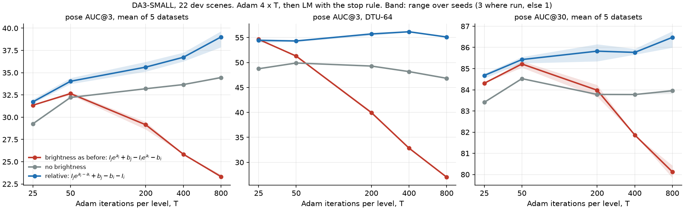
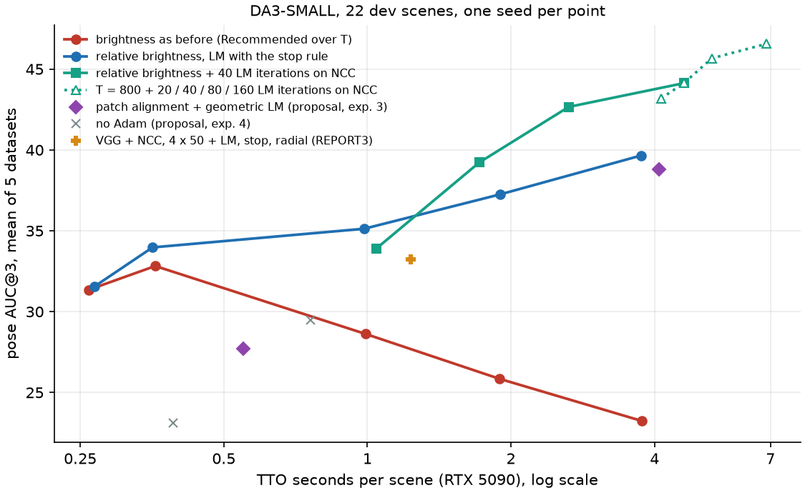

# Photometric BA, session 4: testing the patch-BA proposal, and why quality fell with T

Session of 2026-11-07, DA3-SMALL only. It tests a proposal: align small patches once, then solve the geometry without reading the images, which should end the drift of long runs. The proposal came with four experiments, and all four were run. Quality numbers are on the 22 **dev** scenes unless a table says **held-out** (the 59 scenes of the full benchmark not used for tuning, as in REPORT3 section 6). Times are TTO seconds per scene on an RTX 5090, without each dataset's first scene. Nothing is committed. Runs: `workspace/tto/DA3-SMALL/x1*` to `x7*`, configs and metrics in `results/pba/runs/DA3-SMALL/x*`, job lines in `results/pba/jobs/pmba/x*_lines.py`, code snapshots `e1` to `e4` (`$SCRATCH/jobs/pmba/snap/`).

## Summary

- **Quality fell with T mainly because of a degenerate brightness model, not because of the pose objective.** The per-frame affine brightness was `r = I_j e^{a_j} + b_j - I_i e^{a_i} - b_i`, with only frame 0 fixed. This loss goes to zero if every other frame's contrast goes to zero, and Adam finds that. At T = 800 the mean log gain is -2.6 to -4.4 (on DTU the contrast shrinks 78 times), and even at T = 50 it's already -0.3 to -0.8. REPORT3 put the decline down to a biased objective. That bias is real (section 4), but it isn't what made long Adam runs worse.
- **The fix is one line: make the gain relative** (`bright_rel=true`: `r = I_j e^{a_j - a_i} + b_j - b_i - I_i`). The curve over T now rises (3 seeds on dev): AUC@3 31.7, 34.0, 35.6, 36.7 and 39.0 at T = 25, 50, 200, 400 and 800, where before it was 31.3, 32.7, 29.2, 25.8 and 23.3. **Held-out: 39.2 / 85.0 at T = 50 (0.39 s) and 41.3 / 85.2 at T = 800**, against 37.1 / 84.4 for Recommended and 38.5 / 85.1 for VGG+NCC, the best configuration before. F1 no longer falls with T (46.1 at T = 800, was 41.5), but it doesn't rise either.
- **With the fix, LM on NCC after Adam is the best configuration found**: Adam 4×800 then 40 LM iterations on NCC of 3×3 patches, with the grid. **Held-out 46.7 / 86.6 at 4.8 s**; with Adam 4×200, 44.2 / 86.0 at 1.9 s.
- **Experiment 1** (separating causes): neither Adam's noise on the poses nor the residual type was the main driver. Learning rates ÷ 4 change nothing (23.2 vs 23.3). NCC and VGG held DTU because the code turns brightness off for them.
- **Experiment 2** (free per-sample depth, started at the ground truth): it passes the bar of the 16-cell grid by far, but most of that is the switch to NCC; free depth adds 3 to 7 points over the 8-cell grid. Started from DA3's prediction it does worse than the grid (29.6 vs 33.9).
- **Experiment 3** (patch alignment, then geometric LM): LM does settle on a fixed point, as predicted, but the fixed point is worse: 27.7 vs 34.0 after Adam 4×50, and 30.0 for the best of 10 settings.
- **Experiment 4** (no Adam): it fails, 17 to 30. This is the proposal's own "range" risk.

## 1. Experiment 1: what makes long runs worse

The proposal: take `rec_it800` and change one thing per run. Three seeds each, dev.

| dev, T = 800, 3 seeds | HiR | 7S | SN++ | DTU | ETH | A@3 | A@30 | TTO s |
|---|---|---|---|---|---|---|---|---|
| brightness as before (`rec_it800`) | 24.1 | 34.0 | 15.6 | 27.0 | 16.0 | 23.3 | 80.1 | 3.80 |
| learning rates of poses, focal, depth / 4 | 24.3 | 35.8 | 9.9 | 32.2 | 13.9 | 23.2 | 80.7 | 3.82 |
| NCC of 3x3 patches, 4,096 samples | 38.6 | 33.5 | 27.7 | 56.7 | 31.4 | 37.6 | 83.2 | 7.68 |
| VGG features (8 channels), Huber | 33.5 | 34.7 | 31.7 | 55.5 | 34.5 | 38.0 | 84.7 | 4.45 |
| no brightness (`bright=false`) | 35.1 | 33.8 | 31.6 | 46.8 | 24.9 | 34.4 | 84.0 | 3.50 |
| for comparison: T = 50, brightness as before | 32.4 | 37.0 | 21.4 | 51.3 | 21.2 | 32.7 | 85.2 | 0.36 |

Spread of the A@3 mean over seeds: ±0.1 to ±0.4.

- **The proposal's control didn't scale the brightness's learning rate** (`lr_bright` stayed at 1e-2), and of all the parameters that is the one that moves. The NCC and VGG arms differ from Huber in two ways: the residual, and the absence of brightness (`run_tto_pba.py` turns brightness off for both). `bright=false` alone recovers most of the loss: 23.3 → 34.4.
- Follow-ups, one seed each:

| dev, T = 800 | HiR | 7S | SN++ | DTU | ETH | A@3 | A@30 | TTO s |
|---|---|---|---|---|---|---|---|---|
| all learning rates / 4, brightness's too (`lr4all`) | 28.4 | 35.9 | 15.6 | 38.0 | 14.7 | 26.5 | 82.9 | 3.80 |
| only the brightness's learning rate / 4 | 28.0 | 34.1 | 22.5 | 34.7 | 18.2 | 27.5 | 82.9 | 3.81 |
| `lr_bright=1e-3` | 31.3 | 34.9 | 29.9 | 47.2 | 24.6 | 33.6 | 84.0 | 3.83 |
| no brightness, other learning rates / 4 | 35.3 | 36.3 | 25.0 | 48.6 | 21.3 | 33.3 | 84.2 | 3.52 |
| relative brightness (section 2, 3 seeds) | 37.0 | 33.3 | 32.9 | 55.1 | 36.7 | 39.0 | 86.5 | 3.75 |
| relative brightness, all learning rates / 4 | 37.3 | 35.8 | 24.9 | 56.7 | 25.3 | 36.0 | 85.5 | 3.77 |

- **Adam's noise on the poses isn't the driver.** Without brightness, quartering the other learning rates changes nothing (33.3 vs 34.4), and with the relative brightness it's worse (36.0 vs 39.0). The simulated drift of the proposal is correct (1.9° at T = 50, 6.3° at T = 800, reproduced independently), but at these sizes it doesn't cost accuracy.
- **The residual type matters less than it seemed.** With brightness handled, Huber on grey (39.0) is as good as NCC (37.6) or VGG (38.0) at T = 800, at half NCC's cost. Over T, NCC and VGG rise too:

| dev, no brightness parameters | HiR | 7S | SN++ | DTU | ETH | A@3 | A@30 | TTO s |
|---|---|---|---|---|---|---|---|---|
| NCC, T = 50 | 27.9 | 36.7 | 15.8 | 50.6 | 15.5 | 29.3 | 79.8 | 0.58 |
| NCC, T = 200 | 35.2 | 35.9 | 19.9 | 60.0 | 23.8 | 34.9 | 81.4 | 1.94 |
| NCC, T = 800 (3 seeds) | 38.6 | 33.5 | 27.7 | 56.7 | 31.4 | 37.6 | 83.2 | 7.68 |
| VGG + Huber, T = 50 | 31.3 | 37.8 | 18.9 | 53.2 | 21.3 | 32.5 | 84.4 | 0.67 |
| VGG + Huber, T = 200 | 34.1 | 37.3 | 25.0 | 56.2 | 27.9 | 36.1 | 85.0 | 1.33 |
| VGG + Huber, T = 800 (3 seeds) | 33.5 | 34.7 | 31.7 | 55.5 | 34.5 | 38.0 | 84.7 | 4.45 |

## 2. The cause: the brightness model has a degenerate minimum

Mean log gain `a` of frames 1..N-1 at the end (one seed):

| dev | HiR | 7S | SN++ | DTU | ETH |
|---|---|---|---|---|---|
| as before, T = 50 | -0.34 | -0.61 | -0.68 | -0.81 | -0.68 |
| as before, T = 800 | -2.55 | -3.84 | -4.05 | -4.36 | -3.92 |
| relative, T = 50 | +0.00 | +0.00 | +0.05 | +0.04 | +0.03 |
| relative, T = 800 | -0.01 | +0.02 | +0.06 | +0.11 | +0.07 |

All negative, on every dataset: it's a direction, not noise. Between two frames other than frame 0, `I_j e^{a_j} - I_i e^{a_i}` shrinks with both gains, so the photometric loss falls while the images lose their contrast (DTU's photometric error at the end: 0.0252 at T = 50, 0.0057 at T = 800). The gradient that moves the poses shrinks with the contrast, Adam normalises it, and the poses follow whatever remains. That fits what REPORT3 saw: the photometric error falls while the poses get worse, and more pixels don't help. The gain grows more negative with T on every dataset.

`bright_rel=true` measures only the source's contrast: `r = I_j e^{a_j - a_i} + b_j - b_i - I_i`, the form of DSO. A frame can still be darker than another, but not all of them at once. It's implemented in the analytic gradient (`pba_analytic.Kernel.photo_res` and `gradient`, checked against central differences: ratio 1.00000) and in `PBA.residuals` (autograd, tracker). LM levels keep the brightness fixed, as before.

## 3. The fix over T

| dev | HiR | 7S | SN++ | DTU | ETH | A@3 | A@30 | TTO s |
|---|---|---|---|---|---|---|---|---|
| as before, T = 25 | 33.1 | 34.8 | 20.0 | 54.6 | 14.1 | 31.3 | 84.3 | 0.26 |
| as before, T = 50 (3 seeds) | 32.4 | 37.0 | 21.4 | 51.3 | 21.2 | 32.7 | 85.2 | 0.36 |
| as before, T = 200 (3 seeds) | 31.3 | 37.7 | 19.6 | 40.0 | 17.1 | 29.2 | 84.0 | 0.99 |
| as before, T = 400 | 28.8 | 36.1 | 14.1 | 32.8 | 17.4 | 25.8 | 81.9 | 1.89 |
| as before, T = 800 (3 seeds) | 24.1 | 34.0 | 15.6 | 27.0 | 16.0 | 23.3 | 80.1 | 3.80 |
| relative, T = 25 (3 seeds) | 34.0 | 32.2 | 19.6 | 54.4 | 18.3 | 31.7 | 84.7 | 0.27 |
| **relative, T = 50** (3 seeds) | 34.7 | 35.1 | 20.4 | 54.3 | 25.7 | **34.0** | 85.4 | 0.35 |
| relative, T = 200 (3 seeds) | 35.0 | 36.8 | 26.5 | 55.7 | 24.0 | 35.6 | 85.8 | 1.00 |
| relative, T = 400 (3 seeds) | 38.0 | 35.8 | 27.6 | 56.2 | 26.2 | 36.7 | 85.8 | 1.90 |
| **relative, T = 800** (3 seeds) | 37.0 | 33.3 | 32.9 | 55.1 | 36.7 | **39.0** | 86.5 | 3.75 |
| relative, T = 1600 | 33.6 | 31.6 | 38.2 | 54.0 | 32.6 | 38.0 | 86.7 | 7.41 |
| relative, T = 3200 | 33.5 | 31.5 | 38.9 | 52.9 | 42.1 | 39.8 | 87.5 | 14.93 |

- It rises up to T = 800 and is flat beyond. ScanNet++ and ETH3D gain the most from long runs, and 7-Scenes is the only dataset that falls (36.8 at T = 200, 33.3 at T = 800). ETH3D varies between seeds at T = 800 (30.4 to 39.9) because the radial gate decides differently.
- Same cost per iteration as before: the fix changes no tensor shapes.

**Held-out (59 scenes, one seed):**

| held-out | HiR | 7S | SN++ | DTU | ETH | A@3 | A@30 | TTO s |
|---|---|---|---|---|---|---|---|---|
| original (REPORT3) | 37.1 | 22.0 | 32.0 | 61.4 | 17.4 | 34.0 | 83.3 | 1.36 |
| Recommended, gate 0.02 (REPORT3) | 41.6 | 23.4 | 32.2 | 60.5 | 27.3 | 37.0 | 84.4 | 0.40 |
| VGG + NCC, stop + radial (REPORT3) | 40.5 | 23.6 | 30.5 | 66.5 | 31.4 | 38.5 | 85.1 | 1.54 |
| **relative, T = 50** | 41.9 | 23.2 | 36.4 | 63.7 | 30.7 | **39.2** | 85.0 | 0.39 |
| **relative, T = 800** | 47.8 | 24.1 | 39.9 | 62.7 | 32.3 | **41.3** | 85.2 | 3.80 |

REPORT3's Recommended with gate 0.01 is 37.1 / 84.4 on these scenes. So the fix is +2.1 AUC@3 at the same cost, and long runs help on held-out scenes too, but less than on dev (+2.1 from T = 50 to 800, against +5.0).

**F1** (dev, TSDF fusion, one seed):

| dev | HiR | 7S | SN++ | ETH | F1, 3 sets | F1, 4 sets |
|---|---|---|---|---|---|---|
| Recommended | 50.8 | 57.7 | 35.3 | 40.5 | 47.9 | 46.1 |
| as before, T = 200 | 44.4 | 56.4 | 36.8 | 38.5 | 45.9 | 44.0 |
| as before, T = 800 | 33.4 | 61.5 | 33.1 | 37.9 | 42.7 | 41.5 |
| relative, T = 50 | 56.9 | 56.0 | 33.2 | 46.3 | 48.7 | **48.1** |
| relative, T = 200 | 51.8 | 54.5 | 37.5 | 39.6 | 47.9 | 45.9 |
| relative, T = 800 | 47.7 | 56.6 | 39.4 | 40.6 | 47.9 | 46.1 |

F1 doesn't collapse any more, but it doesn't follow the poses: HiRoom's F1 falls with T (56.9 → 47.7) while ScanNet++'s rises. The depth grid keeps changing during long Adam, and the poses improving doesn't make the depth better.

## 4. Experiment 2: free per-sample depth, started at the ground truth

`lm_free_depth=true`: each LM sample (each 3×3 patch with NCC) gets its own log depth z with a prior `0.5 w z²` (`w_free_depth`). A warp's Jacobian then has entries only for its two frames' poses, the focal, k and its own z. Holding the target's depth fixed makes the block of the z diagonal, so the Schur complement is exact (`Kernel.solve_free`). The system keeps the size of the poses: 6 + 6k + 1 rows per source frame, whatever the number of samples. It's checked in float64 against central differences and a dense solve of the whole system (`bench_pba.py ... free`): the step agrees to 1e-13.

The test of REPORT3 section 3: LM from the ground-truth poses and focal, AUC@3 at LM iteration 5 / 20, HiRoom (5 scenes), DTU-64 (2), ETH3D (3). Free depth needs fixed samples, so the controls use fixed samples too.

| ground-truth start, AUC@3 at it. 5 / 20 | HiRoom | DTU-64 | ETH3D | TTO s |
|---|---|---|---|---|
| Huber, depth frozen | 38.3 / 28.7 | 68.8 / 31.8 | 31.4 / 11.6 | |
| Huber, 8-cell grid | 65.8 / 48.7 | 85.5 / 81.4 | 33.1 / 12.0 | |
| Huber, 16-cell grid (the proposal's bar: 56.0 / 85.4) | 69.0 / 63.9 | 88.9 / 86.0 | 30.0 / 11.7 | 2.03 |
| Huber, free depth, w = 20 | 63.7 / 50.7 | 89.0 / 88.0 | 40.0 / 17.1 | 0.20 |
| Huber, free depth, no geometric row | 73.7 / 65.8 | 92.2 / 89.3 | 50.9 / 16.8 | |
| NCC, depth frozen | 88.3 / 64.6 | 99.4 / 91.4 | 85.0 / 50.5 | 0.15 |
| NCC, 8-cell grid | 92.2 / 73.8 | 99.3 / 94.8 | 81.9 / 49.3 | 0.33 |
| NCC, 16-cell grid | 93.0 / 78.7 | 99.4 / 95.6 | 81.5 / 47.8 | 2.42 |
| **NCC, free depth** | 91.8 / 78.9 | 99.6 / 97.4 | 83.3 / 56.4 | 0.17 |
| **NCC, free depth, no geometric row** | 89.5 / 86.0 | 99.5 / 96.9 | 86.5 / 61.9 | 0.17 |
| NCC, free depth, radial | 91.9 / 77.2 | 99.6 / 97.2 | 87.1 / 64.5 | 0.18 |

- **It passes**, with NCC by a wide margin and with Huber on DTU. But **most of the gain is NCC, not the depth model**: NCC with frozen depth (64.6 / 91.4 / 50.5) is already above Huber with 16 cells. REPORT3's conclusion that the bias is depth rigidity was drawn from the Huber objective only. Without brightness parameters (LM keeps them at zero here), per-pixel grey differences carry a bias that NCC doesn't.
- Free depth then adds 3 to 7 points over the 8-cell grid and matches or beats 16 cells at a fourteenth of its time (0.17 vs 2.42 s). The geometric row pulls the depths back towards DA3's errors: without it, HiRoom holds 86.0. The prior strength matters little between 2 and 200, and from 1,024 to 16,384 samples NCC goes from 72.9 to 84.2 on HiRoom.
- **From DA3's prediction it does worse.** After Adam 4×50, 40 LM iterations on NCC give 29.6 with free depth against 33.9 with the grid (section 6 table). Free depth converges early (flat from about iteration 15), while the grid keeps improving. A free depth per patch can explain away a pose error where the grid can't, which is what reach requires: here that freedom hurts.

## 5. Experiment 3: align patches, then solve the geometry

`patch=<sigma:alignments,...>` (`scripts/pba_patch.py`). Per alignment, each of 200 patches per frame (the steepest pixel of each cell of a grid) is warped into each neighbour with the current parameters, and Lucas-Kanade runs on it alone (3 iterations, zero-mean, with a gain, central-difference gradients). Each warp gives a target pixel, the 2×2 matrix H/S of the zero-mean gradients and an NCC score. Warps under NCC 0.5, beyond 4 strides or occluded are dropped. Then LM on `rho(sqrt(e^T W e))`, plus a geometric row against the target's depth at the aligned pixel, with one free depth per patch (eliminated as in section 4). There are no image lookups in this loop. Checked like section 4 (cost, blocks and gradient against central differences, step against a dense solve: 1e-13).

| dev, one seed | HiR | 7S | SN++ | DTU | ETH | A@3 | A@30 | TTO s |
|---|---|---|---|---|---|---|---|---|
| Adam 4×50 + LM on Huber, stop rule (relative brightness, 3 seeds) | 34.7 | 35.1 | 20.4 | 54.3 | 25.7 | 34.0 | 85.4 | 0.35 |
| Adam 4×50 + patch stage, 8 alignments × 10 LM | 23.2 | 34.0 | 15.6 | 49.1 | 16.5 | 27.7 | 80.2 | 0.55 |
| Adam 4×800 + LM on Huber, stop rule (3 seeds) | 37.0 | 33.3 | 32.9 | 55.1 | 36.7 | 39.0 | 86.5 | 3.75 |
| Adam 4×800, no second stage | 38.7 | 33.6 | 32.6 | 54.9 | 30.2 | 38.0 | 85.9 | 3.78 |
| Adam 4×800 + patch stage | 35.2 | 32.1 | 36.4 | 55.6 | 34.8 | 38.8 | 85.8 | 4.08 |

- **The prediction about LM holds**: within an alignment the cost settles (in the float64 check it changes by less than 1e-5 per iteration after 7 iterations), and over 8 alignments the curve doesn't collapse. The mean AUC@3 goes 26.1 → 27.7 over the 80 iterations after Adam 4×50, and DTU, ScanNet++ and ETH3D rise monotonically. HiRoom and 7-Scenes slip a little.
- **But it settles lower** than LM on the images, by 6 points after Adam 4×50. After Adam 4×800, it adds 0.8 over Adam alone and is 0.2 below LM on Huber.
- No setting closes the gap (this sweep is on the old brightness, snapshot `e3`, against 27.3 for its base):

| dev, Adam 4×50 + patch stage, one change | HiR | 7S | SN++ | DTU | ETH | A@3 | A@30 | TTO s |
|---|---|---|---|---|---|---|---|---|
| patch stage as set up (`x3_base`) | 21.6 | 33.7 | 15.1 | 47.7 | 18.5 | 27.3 | 80.8 | 0.55 |
| 800 patches per frame instead of 200 | 22.8 | 35.0 | 14.3 | 48.1 | 16.3 | 27.3 | 80.4 | 0.68 |
| 5×5 patches instead of 3×3 | 24.3 | 33.3 | 15.6 | 51.0 | 18.1 | 28.5 | 81.4 | 0.58 |
| `patch_info=shape` (no weighting by contrast) | 27.4 | 33.4 | 15.5 | 48.3 | 22.1 | 29.3 | 80.8 | 0.54 |
| geometric row weight 0.1 | 26.4 | 34.7 | 15.3 | 49.8 | 21.5 | 29.5 | 81.5 | 0.56 |
| no geometric row | 28.5 | 33.8 | 15.3 | 49.9 | 22.7 | 30.0 | 81.8 | 0.55 |
| depth prior 2 instead of 20 | 22.1 | 33.4 | 15.1 | 47.9 | 17.9 | 27.3 | 80.4 | 0.54 |
| depth prior 200 | 22.3 | 35.0 | 13.8 | 46.9 | 17.1 | 27.0 | 80.3 | 0.56 |
| NCC threshold 0.8 instead of 0.5 | 23.7 | 35.5 | 15.9 | 48.2 | 18.9 | 28.4 | 80.7 | 0.56 |
| 1 Lucas-Kanade iteration instead of 3 | 22.7 | 35.5 | 11.7 | 45.6 | 15.3 | 26.2 | 79.7 | 0.55 |
| blur 2 then 1 (4 alignments each) | 22.2 | 33.5 | 17.1 | 47.9 | 18.7 | 27.9 | 81.4 | 0.55 |

The two helpful changes point the same way as section 4: the geometric row hurts, and weighting by contrast hurts. My reading, not tested: a per-warp alignment is a hard decision taken from 9 pixels. Its errors become constraints the geometry has to satisfy, whereas LM on the images keeps re-deciding with all patches together. The time is also above the estimate of 30 ms per alignment + 4 ms per iteration: the stage adds about 0.3 s for 8 alignments and up to 80 iterations on these scenes (0.55 s against about 0.25 s for Adam 4×50 alone), about the cost of Adam 4×50 again.

## 6. Experiment 4: no Adam

| dev, one seed | HiR | 7S | SN++ | DTU | ETH | A@3 | A@30 | TTO s |
|---|---|---|---|---|---|---|---|---|
| no Adam: patch stage 8:2, 4:2, 2:2, 1:4 | 5.4 | 33.0 | 5.5 | 37.3 | 6.0 | 17.4 | 70.5 | 0.40 |
| no Adam: patch stage, no geometric row | 13.5 | 35.9 | 7.1 | 44.5 | 5.1 | 21.2 | 75.4 | 0.39 |
| no Adam: patch stage, `patch_info=shape` | 13.9 | 37.6 | 6.9 | 50.4 | 6.8 | 23.1 | 76.1 | 0.39 |
| no Adam: LM on NCC at 4 blur levels, grid | 33.1 | 30.1 | 18.8 | 58.0 | 7.3 | 29.5 | 79.0 | 0.76 |
| no Adam: LM on NCC at 4 blur levels, free depth | 25.1 | 29.6 | 13.2 | 42.9 | 4.9 | 23.1 | 74.8 | 0.57 |
| Adam 4×50 + LM on NCC, grid, 40 iterations | 34.2 | 30.7 | 18.2 | 59.8 | 26.7 | 33.9 | 83.3 | 1.05 |
| Adam 4×50 + LM on NCC, free depth, 40 iterations | 30.6 | 31.5 | 13.0 | 55.5 | 17.5 | 29.6 | 80.8 | 0.90 |

Without Adam the patch stage loses even DA3 alone's AUC@3 on HiRoom (10.6 → 5.4). Lucas-Kanade on blurred patches doesn't reach SMALL's initial errors, and ETH3D gets no radial coefficient before the gate decides. This is the risk the proposal named. With brightness fixed, there is also less reason to remove Adam: it no longer degrades.

## 7. LM on NCC after the fixed Adam

The direct counterpart of the patch idea: LM with the image lookups, on NCC of 3×3 patches (`lm_photo_loss=ncc`, 4,096 samples = 455 patches per frame, fresh each iteration, grid solved), after Adam on Huber with relative brightness. No stop rule: its curve keeps rising.

| dev, Adam 4×T + n LM iterations on NCC | HiR | 7S | SN++ | DTU | ETH | A@3 | A@30 | TTO s |
|---|---|---|---|---|---|---|---|---|
| T = 50 + 40 | 34.2 | 30.7 | 18.2 | 59.8 | 26.7 | 33.9 | 83.3 | 1.05 |
| T = 50 + 80 | 37.1 | 30.5 | 18.8 | 60.5 | 34.5 | 36.3 | 84.5 | 1.83 |
| T = 50 + 160 | 37.3 | 30.3 | 20.2 | 59.1 | 45.1 | 38.4 | 84.9 | 3.39 |
| T = 200 + 40 | 37.7 | 31.4 | 28.6 | 62.4 | 36.1 | 39.2 | 85.6 | 1.72 |
| T = 200 + 80 | 39.6 | 29.7 | 30.2 | 62.0 | 35.5 | 39.4 | 85.9 | 2.52 |
| T = 200 + 160 | 40.3 | 30.1 | 32.0 | 61.2 | 43.0 | 41.3 | 86.4 | 4.10 |
| T = 400 + 40 | 38.0 | 30.4 | 37.3 | 62.2 | 45.4 | 42.7 | 86.7 | 2.64 |
| T = 800 + 20 | 39.4 | 30.4 | 37.5 | 61.1 | 47.5 | 43.2 | 87.6 | 4.13 |
| **T = 800 + 40** (3 seeds) | 38.3 | 30.6 | 38.4 | 61.6 | 51.1 | **44.0** | 87.9 | 4.56 |
| T = 800 + 80 | 38.6 | 30.4 | 39.3 | 61.7 | 58.4 | 45.7 | 88.0 | 5.27 |
| T = 800 + 160 | 39.1 | 28.8 | 40.5 | 60.9 | 63.5 | 46.6 | 87.8 | 6.87 |
| for comparison: T = 800, LM on Huber with the stop rule (3 seeds) | 37.0 | 33.3 | 32.9 | 55.1 | 36.7 | 39.0 | 86.5 | 3.75 |

| held-out (59 scenes) | HiR | 7S | SN++ | DTU | ETH | A@3 | A@30 | TTO s |
|---|---|---|---|---|---|---|---|---|
| relative, T = 50, LM on Huber with the stop rule | 41.9 | 23.2 | 36.4 | 63.7 | 30.7 | 39.2 | 85.0 | 0.39 |
| **relative, T = 200 + 40 LM on NCC** | 46.0 | 22.8 | 42.9 | 68.1 | 41.2 | **44.2** | 86.0 | 1.93 |
| **relative, T = 800 + 40 LM on NCC** | 50.8 | 22.6 | 48.0 | 67.7 | 44.3 | **46.7** | 86.6 | 4.78 |

- Seeds of T = 800 + 40 on dev: 44.1, 43.9, 44.0. On held-out, +9.6 AUC@3 over Recommended, mostly ScanNet++ (+15.2), ETH3D (+17.3), HiRoom (+9.1) and DTU (+6.9). 7-Scenes is the one dataset where NCC is worse, on dev and on held-out.
- F1 of T = 800 + 40 (dev): HiR 51.5, 7S 54.7, SN++ 36.3, ETH 49.7, so 47.5 on 3 sets and 48.0 on 4 (Recommended 47.9 / 46.1).
- An LM iteration on NCC costs about 18 ms per scene here. ETH3D keeps gaining with more of them (47.5 → 63.5 from 20 to 160).

## 8. What this changes

- **REPORT3, sections 3 and 11:** "more Adam only makes it worse" and "Adam follows the same biased objective" were mostly the brightness collapse. The ground-truth test of REPORT3 (LM without brightness updates) still shows a bias of per-pixel grey differences, but NCC removes most of it (section 4).
- **Every photometric run so far had this collapse to some degree**, including session 1 and 2 runs, `fast_it<T>`, the old polish, and all configurations and models of REPORT3 section 11 (gain -0.3 to -0.8 at T = 50). VGG+NCC and NCC runs didn't, because they have no brightness parameters, which is part of why they looked better on DTU.
- **For the compute plot:** the photometric curve should be redone with `bright_rel=true`, and the NCC-LM points are a new curve. Not done on the other models yet.
- **The proposal:** its mechanism (fixed geometry problem, LM settles) works as described, but on SMALL the second stage on images (LM on NCC) is clearly better at the same budget, and dropping Adam fails. Free depth is useful as a model (section 4) but not from DA3's start. Its experiment 1 was the right test: it found the cause, though a different one from either hypothesis.

## 9. Caveats

- **DA3-SMALL only.** The held-out test is on SMALL. The other models start better, and the gain over T may be smaller there.
- **Dev-set choices:** T, the NCC-LM length and all patch settings were chosen on dev. The held-out rows are one seed each, and 7-Scenes has only 5 held-out scenes.
- **The radial gate** (0.01, tuned on the old brightness) decides differently at long T: ETH3D's dev mean at T = 800 ranges from 30.4 to 39.9 over seeds.
- **F1 is from one seed per configuration**, and it is the mean over 3 or 4 sets on 22 dev scenes.
- **Time:** the GPU runs shared nodes with one of my CPU scoring jobs on separate cores, and two GPU workers ran at once on different nodes. The times are comparable to REPORT3 (`recommended_t` 0.36 s here vs 0.35 s for the relative T = 50).
- The patch sweep (section 5, second table) and the first direct runs (`x4_*`) used the old brightness. The rows that matter were rerun with the fix (`x6_*`).

## 10. Code and files

- `scripts/run_tto_pba.py`, new options, all off by default: `bright_rel`, `lm_photo_loss`, `lm_free_depth`, `w_free_depth`, `patch`, `patch_count`, `patch_radius`, `patch_lk`, `patch_inner`, `patch_tol`, `patch_ncc`, `patch_max_disp`, `patch_info`, `patch_delta`, `patch_iso`, `patch_gate_after`, `patch_depth_iters`, `patch_depth_sigma`. New per-scene keys: `free_depth_abs`, `bright_gain_abs`, `bright_bias_abs`, `bright_gain_mean`, `patch_*`.
- `scripts/pba_analytic.py`: relative brightness in `photo_res` and `gradient`, free depths (`z`, `z_prior`, `solve_free`; the grid stays in the warp but isn't solved), a frame-wise solver `frames`, and an optional cfg in `Kernel`.
- `scripts/pba_patch.py` (new): `PatchKernel` (selection, alignment, geometric objective) and `run_patch`, plus `depth_stage` (the grid with poses fixed; written, not run).
- `scripts/bench_pba.py`: checks `free` and `patch`, and `radial` now also covers `bright_rel`.
- `scripts/pm_table.py` (new): tables of runs by dataset, with `--track` for the ground-truth tests and `--seeds`.
- `scripts/plot_pba_brightness.py` (new): `results/pba/figures4/brightness_over_T.png` and `compute_session4.png`.
- Saved predictions (about 2 GB each, regenerable): `x5f_t50`, `x5f_t200`, `x5f_t800`, `x7f_t800_n40`.

## 11. Next steps

1. **Use `bright_rel=true` everywhere.** There's no reason to keep the old form.
2. **Redo the compute plot with it on all four models**, with the NCC-LM curve (T = 200 or 800 + 40 LM on NCC). That's about 10 GPU minutes per model and configuration on dev.
3. **A stop rule for the NCC LM**, which keeps gaining for 160 iterations on ETH3D but not on 7-Scenes.
4. **Recheck REPORT3's other long-run conclusions** that may have depended on the collapse: the value of the stop rule at T = 50, `strat_cells`, and the gate threshold.
5. If the patch idea is pursued further: replace the hard per-warp alignment with something softer, such as a few hypotheses per warp, or weights from the NCC over LK's basin.
