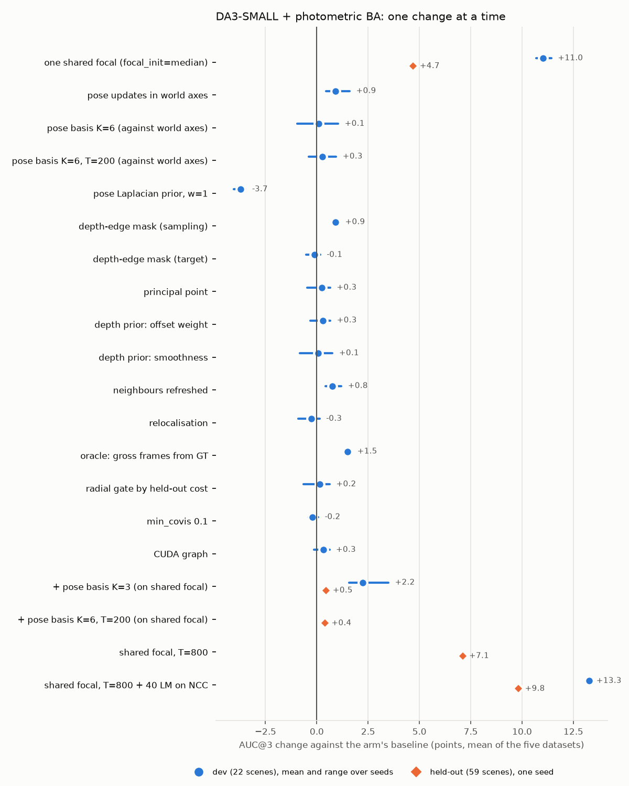

# Photometric BA, session 5: what the failure modes say about the parametrisation

Session of 2026-11-07/08 on the local RTX 3070 (8 GB, 16 cores), DA3-SMALL unless stated otherwise. It tests the ideas that came out of comparing the failure-mode analysis (`results/failure_modes/DA3-SMALL/REPORT.md`) with REPORT3/4: one change at a time against a fixed baseline. Nothing is committed. Runs: `workspace/tto/<model>/y_*`, configs and metrics in `results/pba/runs/<model>/y_*` (DA3-SMALL, and for section 7 DA3-BASE and DA3-LARGE-1.1), job scripts and the exact command lines in `results/pba/jobs/s5/`, code snapshots `workspace/tto/snap/s0` to `s8`, figure `results/pba/figures5/arms.png` (`scripts/plot_pba_s5.py`).

## Summary

- **One shared focal length is the largest gain of any single change since REPORT3, and it is free** (REPORT3's radial coefficient: +2.4 held-out AUC@3, REPORT4's relative brightness: +2.1). DA3 predicts a focal length per frame that varies by 0.5-1 % within a scene (up to 2 %), although every benchmark scene has one camera; PBA kept those differences and only scaled them. Replacing them by their median (`focal_init=median`, an option since session 2 that was never run) lifts DA3-SMALL + B50 from 33.7 to 44.7 AUC@3 on dev and from 39.3 to 44.0 on the 59 held-out scenes, with the largest gains on HiRoom and DTU-64. It adds to long runs (held-out B800 41.5 → 48.6) and to REPORT4's best configuration, Adam T = 800 + 40 LM iterations on NCC: **held-out 47.3 → 57.2 AUC@3, AUC@30 86.7 → 88.4, F1 51.3 → 57.0**, the best result so far. It holds on DA3-BASE (held-out 50.2 → 57.4; with NCC 57.6 → 68.3) and DA3-LARGE-1.1 (66.8 → 69.7; with NCC 71.3 → 74.8), and with it **BASE + TTO (57.4) is above LARGE-1.1 alone (52.0) at three quarters of its time**, where REPORT3 had the two level.
- **The diagnosis of the failure analysis is confirmed**: 42-76 % of DA3's pose error lies in the weakest 10 % of the directions of PBA's pose system (a random direction: 10 %), and what PBA leaves is even more concentrated there (60-90 %). PBA removes the well-constrained part of DA3's error.
- **But the remedy that follows from it most directly doesn't generalise**: a smooth pose basis over the covisibility graph lifted ScanNet++ by 8.6-9.6 AUC@3 on dev, at T = 200 beyond B800, and gave +0.2 to +0.5 on the held-out scenes. The dev gain was three ScanNet++ scenes.
- **The other ideas are neutral or harmful**, each tested alone against B50 with 3 seeds: depth-edge masks (the sampling mask does put fewer samples on bad depth, but the drift from the ground-truth start doesn't change), a free principal point (it doesn't move), weaker per-frame depth offsets and a grid smoothness prior fitted to DA3's error, a radial gate decided on held-out pixels, wider baselines, recomputed neighbours (+0.7), a CUDA graph (same result). A smoothness prior on the pose updates is harmful at every strength (−3.7 at the weakest).
- **Gross failures**: replacing them by GT before PBA is worth only +1.5 AUC@3 (+4.1 AUC@30). DA3's confidence finds them (AUROC 0.82-0.88), but the discrete relocalisation tried here fixes 1 of 48 and breaks 17 good frames.
- **Speed**: the CUDA graph of the Adam iteration saves 32 % on HiRoom at T = 800 and nothing on 100-frame scenes on this GPU (they are compute-bound), and costs time at T = 50. The real speed gain is that B′ at T = 50 beats B800 on held-out (44.0 vs 41.5) at about an eighth of the TTO time.



## 0. Setup

- **Baseline B** is REPORT4's "relative" configuration (REPORT3's Recommended with `bright_rel=true`), at T = 50 Adam iterations per level unless a row says otherwise (B50, B200, B800). Its command line is `B` in `results/pba/jobs/s5/configs.sh`. **B′** = B with `focal_init=median`, the first winner (section 2), is the baseline of the later tests. The NCC configuration of REPORT4 section 7 is `N` there (Adam T = 800, then 40 LM iterations on NCC of 3x3 patches).
- **Sets** as in REPORT3/4: dev (22 scenes), held-out (the other 59 scenes of the five pose datasets). Dev arms have 3 seeds (2 for the T = 200 and the NCC arms), held-out runs one. AUC@3 / AUC@30: mean of the five datasets. F1: TSDF fusion of the benchmark, mean of HiRoom, 7-Scenes, ScanNet++ and ETH3D ("4 sets").
- **Reproduction on this machine:** DA3-SMALL alone 16.2 on dev (REPORT3 16.2), B50 33.7 ± 0.4 (REPORT4 34.0), B800 39.2 (39.0), held-out B50 39.3 (39.2), held-out B800 41.5 (41.3), held-out NCC 47.3 (46.7), dev F1 of DA3 alone 31.4 (31.5), of B50 47.2 (48.1). The DTU-64 predictions were made here (they match `results/da3_bench/DA3-SMALL` to 1e-5).
- **Determinism.** On the CPU a run is bit-identical between runs and between the code snapshots of this session with the new options off (checked for `s0`, `s1`, `s7`). On the GPU it isn't: `index_add_` adds with atomics, and REPORT3's chaos amplifies the rounding (one HiRoom scene moved by 0.09 AUC@3 between two runs of equivalent code). So only seed means count.
- **Times** are TTO seconds per scene on the RTX 3070, without each dataset's first scene. The 3070 is 2.5x (small scenes) to 5-6x (100 frames) slower than the RTX 5090 of REPORT3/4, so the absolute times aren't comparable with them. The times in the quality tables come from runs that shared the machine with scoring jobs; section 6 has clean ones.

## 1. Diagnostics: where the error is, and what PBA removes

### Which pose directions DA3's error is in (`scripts/weak_modes.py`)

At DA3's initial state: the Gauss-Newton matrix of B's LM level (sharp images, 16,384 samples per frame), its Schur complement onto the poses (depth grid and focal eliminated), and its eigenvectors. The true correction (GT in DA3's gauge, in PBA's own pose parameters: rotation in rad, translation in median depths) is split by eigenvalue band. A random direction has 10 / 40 / 50 % of its squared norm in the weakest 10 % / the next 40 % / the strongest half.

| dev, share of the squared norm | HiR | 7S | SN++ | DTU | ETH |
|---|---|---|---|---|---|
| DA3's error, weakest 10 % / 10-50 % / strongest 50 % | 42 / 42 / 16 | 60 / 34 / 6 | 62 / 30 / 8 | 76 / 21 / 3 | 70 / 18 / 12 |
| the same without the grossly wrong frames | 40 / 42 / 18 | 60 / 34 / 6 | 46 / 35 / 19 | 76 / 21 / 3 | 46 / 33 / 21 |
| the error left after B50 | 60 / 36 / 4 | 75 / 22 / 3 | 63 / 27 / 10 | 90 / 8 / 2 | 75 / 16 / 9 |
| B50's own update | 37 / 43 / 20 | 64 / 28 / 7 | 55 / 33 / 12 | 44 / 46 / 10 | 64 / 21 / 16 |

- **DA3's pose error lies in the directions the photometric objective constrains least**: 4 to 8 times the random share in the weakest 10 %, a third to a sixteenth of it in the strongest half. Its Rayleigh quotient is 1.5-10 % of the mean eigenvalue (median per dataset).
- **PBA removes the well-constrained part and leaves the weak part**: after B50 60-90 % of what is left is in the weakest 10 %.
- This is the hypothesis of the analysis, now measured. It fits why long runs help (weak directions move slowly) and why any bias of the objective shows up as drift in these directions. What it does *not* say is that a smooth basis helps: see section 3.

### What long Adam runs and the shared focal remove (`scripts/pose_change_decomp.py`)

The camera errors of each run split as in the failure analysis (robust Sim(3), then along the frame order into a smooth part and the rest; gross: > 15° or > 25 % of the scene scale). Held-out, one seed:

| held-out | rotation smooth / rest (deg RMS) | median rotation of the other frames (deg) | centre smooth (scene scale) | gross frames | AUC@3 |
|---|---|---|---|---|---|
| ScanNet++, DA3 | 3.41 / 9.25 | 2.26 | 0.100 | 12.1 % | 9.5 |
| ScanNet++, B50 | 2.17 / 8.53 | 0.82 | 0.071 | 8.2 % | 36.2 |
| ScanNet++, B800 | 1.69 / 8.66 | 0.74 | 0.056 | 6.9 % | 40.0 |
| ScanNet++, B′ (T = 50) | 2.36 / 8.68 | 0.78 | 0.071 | 8.8 % | 35.9 |
| ETH3D, DA3 | 2.17 / 9.39 | 1.36 | 0.164 | 10.9 % | 9.9 |
| ETH3D, B50 / B800 / B′ | 1.64 / 1.69 / 1.68 (smooth) | 0.79 / 0.87 / 0.78 | 0.150 / 0.163 / 0.150 | 8.5 / 8.8 / 8.2 % | 29.6 / 33.6 / 31.0 |
| DTU-64, B50 / B800 / B′ | 0.55 / 0.61 / 0.48 (smooth) | 0.54 / 0.63 / 0.46 | 0.020 / 0.022 / 0.017 | 0 | 64.5 / 62.4 / 77.4 |
| HiRoom, B50 / B800 / B′ | 0.62 / 0.80 / 0.58 (smooth) | 0.61 / 0.87 / 0.49 | 0.015 / 0.017 / 0.014 | 0.8 / 2.3 / 0.8 % | 42.9 / 47.6 / 52.2 |

- **Long runs reduce the smooth error and a few gross frames on ScanNet++** (smooth rotation 2.2° → 1.7°, gross 8.2 % → 6.9 %). On HiRoom they add gross frames (0.8 % → 2.3 %) while AUC@3 still rises.
- **The shared focal (section 2) lowers the typical error of the good frames** (DTU median 0.54° → 0.46°, HiRoom 0.61° → 0.49°), not the smooth error of ScanNet++.
- **No configuration repairs most gross frames**: 7-9 % stay on ScanNet++ and ETH3D after PBA (DA3: 11-12 %).

## 2. One shared focal length (`focal_init=median`)

DA3 predicts a focal length per frame, and PBA multiplies all of them by one shared scale, so DA3's per-frame differences stay. In every scene of the benchmark the GT focal is the same for all frames (ETH3D within 0.07 %), so those differences are pure error: a per-frame log-std of 0.5-0.9 % (median over scenes; up to 2.2 % on ETH3D, 1.5 % at p90 on DTU). `focal_init=median` (an option since session 2, never run) replaces them by their median before the optimisation.

| | HiR | 7S | SN++ | DTU | ETH | A@3 | A@30 | F1 (4 sets) |
|---|---|---|---|---|---|---|---|---|
| dev, B50 (3 seeds) | 34.7 | 34.5 | 20.9 | 55.1 | 23.2 | 33.7 | 85.0 | 47.2 |
| dev, B′ = B50 + shared focal | 43.9 | 38.1 | 25.4 | 86.2 | 30.0 | **44.7** | 86.8 | 50.8 |
| held-out, B50 | 42.9 | 23.1 | 36.2 | 64.5 | 29.6 | 39.3 | 85.0 | 50.7 |
| held-out, B′ | 52.2 | 23.3 | 35.9 | 77.4 | 31.0 | **44.0** | 85.9 | 50.5 |
| held-out, B800 | 47.6 | 24.1 | 40.0 | 62.4 | 33.6 | 41.5 | 85.3 | – |
| held-out, B′ at T = 800 | 63.5 | 24.1 | 41.2 | 77.1 | 37.3 | **48.6** | 86.4 | – |
| held-out, NCC (T = 800 + 40 LM on NCC) | 53.9 | 22.8 | 48.7 | 67.1 | 44.3 | 47.3 | 86.7 | 51.3 |
| held-out, NCC + shared focal | 76.2 | 24.4 | 50.4 | 83.7 | 51.1 | **57.2** | 88.4 | **57.0** |
| dev, NCC (2 seeds) | 40.9 | 30.7 | 39.2 | 61.3 | 41.0 | 42.6 | 87.1 | – |
| dev, NCC + shared focal (2 seeds) | 55.1 | 33.8 | 41.8 | 93.4 | 55.3 | **55.9** | 89.3 | – |

- **It costs nothing and gains** +11.0 AUC@3 on dev, +4.7 on held-out, mostly HiRoom (+9.3 held-out) and DTU-64 (+12.9). On ScanNet++, where DA3's focal is right on average (0.7 %) and varies little (0.6 %), it does nothing.
- **It adds to long runs**: at T = 800 the held-out gain over B800 is +7.1 (48.6), more than at T = 50, and B′ at T = 800 beats REPORT4's best configuration (NCC, 47.3 here). With B′, T = 200 is level with T = 50 on held-out (44.1 vs 44.0); the gain of long runs is at T = 800.
- **F1 follows only in the NCC configuration**: at T = 50 dev +3.6 (from ETH3D, three scenes) and held-out level (50.5 vs 50.7); with NCC held-out +5.7 (51.3 → 57.0: ETH3D +15.2, HiRoom +5.9, ScanNet++ +2.1, 7-Scenes level).
- Why per-frame differences of 1 % cost this much: a frame whose focal is 1 % off puts its pixels up to 2.5 px off at 250 px from the centre. The poses then compensate with small rotations and translations; that these land in the weak directions of section 1 is plausible but not tested. The DTU-64 focal still drifts under PBA (mean error 1.5 % → 7 %, with or without the change), so this is about the per-frame differences, not the shared value.

## 3. A smooth pose basis

`pose_basis=K` (`pba_analytic.PoseBasis`): in the Adam levels the pose updates are written in world axes as a smooth part plus a per-frame part, (w, dC)_i = Σ_k B_ik θ_k + ε_i, B the K lowest eigenvectors of the Laplacian of the covisibility graph (unit RMS per frame), and Adam runs on θ and ε. LM is unchanged. Because Adam isn't invariant to a rotation of the coordinates, world axes alone (`pose_world=true`) is its own arm.

| | HiR | 7S | SN++ | DTU | ETH | A@3 | A@30 |
|---|---|---|---|---|---|---|---|
| dev, B50 | 34.7 | 34.5 | 20.9 | 55.1 | 23.2 | 33.7 | 85.0 |
| dev, world axes | 34.5 | 34.6 | 21.0 | 55.2 | 27.6 | 34.6 | 85.4 |
| dev, world axes + basis K = 6 | 34.2 | 33.0 | 29.6 | 52.7 | 24.0 | 34.7 | 85.0 |
| dev, T = 200: B / world axes / + basis (2 seeds) | 37.0 / 35.9 / 36.4 | 37.3 / 38.3 / 31.8 | 25.7 / 25.8 / **35.4** | 56.4 / 55.7 / 52.6 | 20.2 / 27.7 / 28.6 | 35.3 / 36.7 / 37.0 | 84.7 / 85.7 / 84.5 |
| dev, B′ | 43.9 | 38.1 | 25.4 | 86.2 | 30.0 | 44.7 | 86.8 |
| dev, B′ + basis K = 3 / 6 / 12 | 43.9 / 41.7 / 31.4 | 36.6 / 36.1 / 34.7 | 31.1 / 35.4 / 34.1 | 84.7 / 83.0 / 80.5 | 38.4 / 39.0 / 41.4 | 46.9 / 47.0 / 44.4 | 87.8 / 87.8 / 84.8 |
| held-out, B′ / + basis K = 3 / K = 6 | 52.2 / 58.0 / 56.5 | 23.3 / 22.4 / 22.2 | 35.9 / 33.9 / 34.8 | 77.4 / 76.7 / 76.1 | 31.0 / 31.3 / 31.2 | 44.0 / 44.4 / 44.2 | 85.9 / 85.4 / 84.8 |
| held-out, T = 200: B′ / + basis K = 6 | 58.0 / 58.3 | 23.6 / 20.9 | 33.1 / 33.5 | 71.9 / 74.3 | 33.8 / 35.4 | 44.1 / 44.5 | 85.4 / 85.1 |

- **On dev the basis did what the diagnosis predicted**: ScanNet++ +8.6 at T = 50 and +9.6 at T = 200 against world axes, at T = 200 above B800 (32.8) at a quarter of its time, paid on 7-Scenes and DTU.
- **It doesn't hold on the held-out scenes**: +0.2 to +0.5 AUC@3 at T = 50 and T = 200, ScanNet++ level or lower (33.5 vs 33.1 at T = 200, 33.9 vs 35.9 at T = 50), held-out F1 −1.2 (K = 3: 49.3 vs 50.5). The dev gain was three ScanNet++ scenes. So the weak directions are real (section 1), but faster movement along a Laplacian basis isn't what the held-out ScanNet++ scenes need; B800 still gets them furthest (40.0, 41.2 with the shared focal).
- K ≈ N breaks small scenes: K = 12 on HiRoom (10-23 frames) loses 12.5 points.

## 4. The other changes, one at a time against B50 (dev, 3 seeds)

| arm (option) | HiR | 7S | SN++ | DTU | ETH | A@3 | A@30 | |
|---|---|---|---|---|---|---|---|---|
| B50 | 34.7 | 34.5 | 20.9 | 55.1 | 23.2 | 33.7 ± 0.4 | 85.0 | |
| depth-edge mask on the samples (`depth_edge=0.05`) | 34.6 | 34.2 | 19.8 | 55.2 | 29.2 | 34.6 ± 0.1 | 85.0 | ETH3D only |
| depth-edge mask on the warps' targets (`tgt_edge=0.05`) | 33.0 | 34.0 | 18.6 | 57.2 | 25.2 | 33.6 | 83.5 | |
| shared principal-point offset, Adam (`pp=true`) | 35.5 | 35.4 | 19.0 | 55.4 | 24.5 | 33.9 | 85.0 | moves ±0.2 px |
| per-frame depth offset prior weaker (`w_scale=0.5`) | 34.7 | 35.0 | 20.8 | 55.6 | 23.8 | 34.0 | 84.8 | |
| grid smoothness prior (`w_smooth=0.14`) | 35.6 | 34.2 | 20.7 | 55.3 | 22.9 | 33.8 | 85.1 | |
| 12-cell grid (`depth_grid=12`) | 34.5 | OOM | OOM | 57.0 | 28.3 | (39.9 vs 37.7) | | 3 sets |
| 12-cell grid + fitted prior (`w_smooth=0.1 w_scale=0.25`) | 34.3 | OOM | OOM | 57.6 | 29.1 | (40.3 vs 37.7) | | 3 sets |
| pose Laplacian prior (`w_lap=1 / 10 / 100`) | 34.7 / 24.5 / 14.3 | 34.9 / 28.3 / 28.3 | 15.5 / 8.6 / 6.3 | 42.9 / 33.8 / 31.2 | 21.9 / 13.0 / 7.2 | 30.0 / 21.6 / 17.5 | 82.6 / 77.2 / 74.5 | |
| neighbours recomputed every level (`nbr_refresh=true`) | 36.6 | 33.5 | 21.9 | 54.9 | 25.3 | 34.4 | 85.1 | |
| relocalisation of low-confidence frames (`reloc=true`) | 35.3 | 34.5 | 21.0 | 55.4 | 21.0 | 33.4 | 82.9 | |
| oracle: gross frames from GT (`init_fix_gross=true`) | 35.7 | 34.5 | 24.6 | 55.5 | 25.6 | 35.2 | 89.1 | upper bound |
| radial gate by held-out cost (`radial_gate_heldout=true`) | 34.8 | 34.8 | 20.9 | 55.2 | 23.4 | 33.8 | 84.9 | |
| wider baselines (`min_covis=0.1`) | 36.0 | 34.0 | 19.5 | 55.8 | 22.1 | 33.5 | 84.6 | |
| 14 neighbours (`neighbors=14`) | 36.1 | OOM | OOM | 56.0 | 26.4 | (39.5 vs 37.7) | | 3 sets |
| CUDA graph of the Adam iteration (`cuda_graph=true`) | 35.6 | 34.5 | 20.6 | 55.2 | 24.1 | 34.0 | 85.1 | section 6 |

(OOM: the 100-frame sets ran out of the 8 GB with the larger dense LM system. In brackets: the mean of the three complete sets, against B50's 37.7 on the same sets.)

- **Depth edges** (idea 3a). A check on the predictions found that gradient-weighted sampling puts more samples on bad depth than uniform sampling (ScanNet++ 13.0 % vs 8.4 % of samples > 10 % off), and masking DA3's own depth discontinuities (1-6 % of the pixels) brings it back below uniform. But neither mask lowers the drift from the ground-truth start (HiRoom 66 / 66 against 69 / 67 at LM iteration 5 / 20, DTU-64 82 / 79 against 84 / 79, ETH3D 28 / 10 against 33 / 11, 2 seeds), and on dev only the sampling mask gains, on ETH3D alone. The bias of REPORT3 section 3 isn't the edge samples.
- **Principal point** (4b). DTU's GT principal point is 7 / 6 px off the centre at 504×378, while DA3 and PBA keep it in the centre. Freed in the Adam levels, it moves by at most 0.3 px and DTU's radial coefficient stays at −0.06 to −0.17: the data don't determine it (to first order it is a rotation), and it isn't what the coefficient absorbs.
- **Depth prior** (3b). Fitted by maximum likelihood to DA3's depth error on dev (`scripts/fit_depth_prior.py`): the offset prior should be about half as strong as the shape prior, and a smoothness term between cells improves the likelihood only a little (ratio 0.14). Both are neutral in PBA. The 12-cell grid gains on the three sets where it fits (DTU-64 +1.9, ETH3D +5.1) and its fitted prior adds +0.4; a 12-cell dense LM doesn't fit in 8 GB at 100 frames.
- **Pose Laplacian prior** (1c): harmful at every strength. Neighbouring cameras need different corrections (the failure analysis: error similarity 0.45 at 0.1 scene depths), and penalising their difference also blocks the corrections PBA gets right.
- **Gross failures** (2). The oracle bounds the gain from repairing them before PBA: +1.5 AUC@3, +4.1 AUC@30, as the failure analysis predicted. DA3's confidence flags them well (AUROC 0.82 ScanNet++, 0.88 ETH3D, 0.85 HiRoom, frame median against the scene's), but the discrete relocalisation (12 rotations about the vertical × the other cameras' centres, scored by depth and grey-value consistency) fixed 1 of the 48 gross ScanNet++ frames it moved and broke 17 good ones; ETH3D 0 of 14 and 6, HiRoom 0 and 6. The score favours putting a frame where another camera already is. Refreshing the neighbours from the current poses is +0.7.
- **Information instead of thresholds** (4c): deciding the radial coefficient by its effect on held-out pixels makes the same decisions as the 0.01 threshold except on 3 HiRoom scenes, with no effect.
- **More or wider pairs** (1d): `min_covis=0.1` is level; 14 neighbours gain on the three sets that fit (+1.8), the 100-frame sets ran out of memory.

## 5. Gross-failure relocalisation check

On all scenes of ScanNet++, ETH3D and HiRoom, against the oracle labels (DA3-SMALL, no optimisation):

| | frames | gross | flagged (conf < 0.5 × median) | flagged and gross | moved | moved and gross | fixed | broken |
|---|---|---|---|---|---|---|---|---|
| ScanNet++ | 2000 | 261 | 108 | 55 | 67 | 48 | 1 | 17 |
| ETH3D | 377 | 51 | 31 | 15 | 22 | 14 | 0 | 6 |
| HiRoom | 400 | 5 | 8 | 0 | 6 | 0 | 0 | 6 |

## 6. Speed

`cuda_graph=true` captures one Adam iteration per level (after warm-up iterations on a side stream) and replays it; the iterations that log the loss stay eager, and Adam's bias corrections and the cosine factor are device scalars. Same quality (dev, 3 seeds: 34.0 vs 33.7). Clean timing on the RTX 3070, nothing else running, dev, TTO s per scene:

| | HiR | 7S | SN++ | DTU | ETH | mean |
|---|---|---|---|---|---|---|
| B50 | 0.51 | 2.75 | 3.84 | 1.81 | 1.53 | 1.38 |
| B50, CUDA graph | 0.61 | 3.22 | 4.29 | 2.17 | 1.82 | 1.61 |
| B800 | 5.16 | 27.8 | 27.8 | 17.6 | 11.1 | 12.06 |
| B800, CUDA graph | 3.49 | 28.5 | 28.5 | 17.8 | 11.0 | 11.33 |

- **It only helps where launch overhead is the cost**: HiRoom at T = 800 −32 %, the 100-frame scenes not at all, because on the 3070 they are compute-bound. At T = 50 the capture (once per level) and the eager logging iterations cost more than the replays save. On the RTX 5090, whose kernels finish faster, launch overhead is a larger share of the time (REPORT3: 4-5 µs per operation was most of an iteration), so the gain there may be larger; not measured.
- So the speed side of the analysis comes from elsewhere: the shared focal makes the T = 50 configuration better than B800 on held-out (44.0 vs 41.5 at about an eighth of the time).
- The first T = 50 CUDA-graph runs ran out of memory on one ScanNet++ scene: the graph's private memory pool stayed allocated into the LM level. It is freed at the end of each level now (snapshot `s8`).

## 7. Other model sizes

DA3-BASE and DA3-LARGE-1.1 predictions were made here (pose only; they match `results/da3_bench` to 1e-4), then B50 with and without the shared focal. DA3's per-frame focal varies as much on BASE as on SMALL (median log-std 0.4-1.1 % per dataset) and two to three times less on LARGE-1.1 (0.2-0.6 %).

| AUC@3 (AUC@30) | dev, DA3 alone | dev, B50 (3 seeds) | dev, B′ (3 seeds) | held-out, DA3 alone | held-out, B50 | held-out, B′ |
|---|---|---|---|---|---|---|
| SMALL | 16.2 (73.7) | 33.7 (85.0) | **44.7** (86.8) | 13.6 (75.0) | 39.3 (85.0) | **44.0** (85.9) |
| BASE | 27.1 (83.6) | 51.4 (91.3) | **59.8** (92.5) | 27.0 (82.9) | 50.2 (90.0) | **57.4** (91.0) |
| LARGE-1.1 | 48.8 (92.6) | 64.9 (95.3) | **70.3** (95.9) | 52.0 (91.6) | 66.8 (93.9) | **69.7** (94.2) |

Per dataset, held-out, B50 → B′: BASE HiRoom 51.7 → 68.9, DTU-64 76.4 → 89.8, ETH3D 42.5 → 45.4, the others ±1.4; LARGE-1.1 HiRoom 86.0 → 90.0, DTU-64 86.2 → 95.1, the others ±1.8.

- **The gain holds on every model and shrinks as DA3's focal gets more consistent**: held-out +4.7, +7.2, +2.9.
- **The matched-compute answer of REPORT3 section 11 changes one step.** The TTO cost of B′ is that of REPORT3's Recommended (the shared focal costs nothing: 1.43 vs 1.38 s here), so REPORT3's totals on the RTX 5090 apply: SMALL + TTO 0.77 s, BASE alone 0.85 s, BASE + TTO 1.19 s, LARGE-1.1 alone 1.60 s. On the held-out scenes, **SMALL + B′ (44.0) is far above BASE alone (27.0), and BASE + B′ (57.4) is now above LARGE-1.1 alone (52.0)** at three quarters of its time, where REPORT3 had them about level on dev. LARGE-1.1 + B′ (69.7) is the best of these rows. GIANT-1.1 doesn't fit on this GPU, so the step to it isn't tested.
- SMALL with the NCC configuration and the shared focal (57.2 held-out) is also above LARGE-1.1 alone, but at about 20 s of TTO on the 3070.

With the NCC configuration (Adam T = 800 + 40 LM on NCC), held-out, one seed:

| held-out | HiR | 7S | SN++ | DTU | ETH | A@3 | A@30 |
|---|---|---|---|---|---|---|---|
| SMALL, NCC / + shared focal | 53.9 / 76.2 | 22.8 / 24.4 | 48.7 / 50.4 | 67.1 / 83.7 | 44.3 / 51.1 | 47.3 / **57.2** | 86.7 / 88.4 |
| BASE, NCC / + shared focal | 61.2 / 86.1 | 23.8 / 24.8 | 62.3 / 63.5 | 78.7 / 93.8 | 62.2 / 73.2 | 57.6 / **68.3** | 91.5 / 92.9 |
| LARGE-1.1, NCC / + shared focal | 87.1 / 92.1 | 24.2 / 24.8 | 76.1 / 77.7 | 88.9 / 96.7 | 80.4 / 82.8 | 71.3 / **74.8** | 94.5 / 95.0 |

- +9.9, +10.7 and +3.5: with NCC the shared focal is worth more than at T = 50 on SMALL and BASE.
- Each step down in model size with the shared focal reaches the step above without it: SMALL + NCC + shared focal (57.2) = BASE + NCC (57.6); BASE + NCC + shared focal (68.3) ≈ LARGE-1.1 + B′ (69.7). 7-Scenes stays at 22-25 for every model and configuration (its GT, see the failure-mode report).

## 8. Recommended configurations

`focal_init=median` should be on in every configuration. On top of `B` (`results/pba/jobs/s5/configs.sh`):

```sh
B="nbr_mode=spread neighbors=10 lr_rot=3e-3 lr_trans=3e-3 lr_focal=3e-3 levels=8,4,2,1,1 lm_levels=4 samples=1024 impl=analytic lm_impl=analytic lm_solver=dense32 lm_iters=15 lm_samples=4096 lm_stop=2e-3 radial=true radial_max=0 radial_gate=0.01 bright_rel=true"
N="nbr_mode=spread neighbors=10 lr_rot=3e-3 lr_trans=3e-3 lr_focal=3e-3 samples=1024 impl=analytic lm_impl=analytic lm_solver=dense32 radial=true radial_max=0 radial_gate=0.01 bright_rel=true levels=8,4,2,1,1 lm_levels=4 lm_samples=4096 lm_photo_loss=ncc"
# cheap: held-out 44.0 (SMALL), 57.4 (BASE), 69.7 (LARGE-1.1); 1.4 s per scene on the 3070, about 0.35 s on the 5090
.venv/bin/python scripts/run_tto_pba.py workspace/evaluation/DA3-SMALL <dst> $B iters=50 focal_init=median
# long Adam: held-out 48.6 (SMALL), 15 s per scene on the 3070
.venv/bin/python scripts/run_tto_pba.py workspace/evaluation/DA3-SMALL <dst> $B iters=800 focal_init=median
# the most accurate: held-out 57.2, F1 57.0 (SMALL), 20 s per scene on the 3070 (REPORT4: 4.8 s on the 5090)
.venv/bin/python scripts/run_tto_pba.py workspace/evaluation/DA3-SMALL <dst> $N iters=800 lm_iters=40 focal_init=median
```

## 9. Caveats

- **One model for most of it**: everything except section 7 is DA3-SMALL, and the held-out tests are one seed each (seed noise of a held-out mean is roughly ±0.5).
- **Dev decided the arms, held-out tested them**: the pose basis is the example of a dev gain that didn't survive. The shared focal survived on held-out at T = 50 and T = 800 and in the NCC configuration.
- **The 3070's memory** limited the 12-cell grid and 14 neighbours to the sets with fewer frames.
- **7-Scenes** remains unreliable as a pose and F1 reference (GT depth shifted 4-12 px against the images, failure-mode report).
- The radial coefficient changes only the optimisation's camera model, not `results.npz`, as before.

## 10. Code and files

- `scripts/run_tto_pba.py`, new options, all off by default (with them off, CPU runs are bit-identical to before): `first_scene`, `depth_edge`, `tgt_edge`, `depth_edge_dilate`, `pp`, `lr_pp`, `w_pp`, `pose_basis`, `pose_world`, `w_lap`, `w_scale`, `w_smooth`, `nbr_refresh`, `init_fix_gross`, `reloc`, `reloc_conf`, `reloc_gain`, `radial_gate_heldout`, `cuda_graph`; functions `depth_edges`, `relocalise`, `fix_gross`.
- `scripts/pba_analytic.py`: `PoseBasis`, the principal-point gradient, the `w_lap` and `w_scale`/`w_smooth` terms in the gradient and the LM system, `FlatAdam.set_scalars`/`step_graph`. Checked against central differences (pp: 1e-3 relative, as k; depth prior: 1e-8; `w_lap`: 1e-11, LM gradient equal to the Adam gradient, H d = Δg to 2e-8).
- New scripts: `weak_modes.py` (section 1), `pose_change_decomp.py` (section 1), `fit_depth_prior.py` (section 4), `plot_pba_s5.py`. `analyse_failure_modes.py` gained `--src` and `--name`.
- `results/pba/jobs/s5/`: `run.sh`, `snap.sh`, `runner.sh`, `enqueue.sh`, `configs.sh`, `sync_results.sh`; the job files of both queues are in `workspace/tto/queue/{gpu,cpu}/done/` with their logs.

## 11. Next steps

1. **Turn `focal_init=median` on everywhere** and redo the compute plot of REPORT3 section 11 with it on all four models, including GIANT-1.1 and the NCC curve (tum2; GIANT doesn't fit here).
2. **The DTU-64 focal still drifts** under PBA (mean error 1.5 % → 7 % with or without the change, radial coefficient −0.06 to −0.17). That is the focal-depth trade-off of narrow object scenes (REPORT1), now the largest remaining camera error there; DTU's AUC@3 is already 77-95 with the shared focal, so its effect on the mean is small.
3. **The weak directions need information, not faster movement.** The held-out ScanNet++ scenes still gain most from long Adam (40-41) and from NCC (49-50), and track-based BA gets SMALL furthest there. A wide-baseline term (tracks or NCC pairs chosen for the weak modes) on top of B′ is the consistent next test; the pose basis and the smoothness prior were the wrong tools.
4. **The decomposition and the weak-mode analysis on BASE and LARGE-1.1**: both scripts take any run directory.
