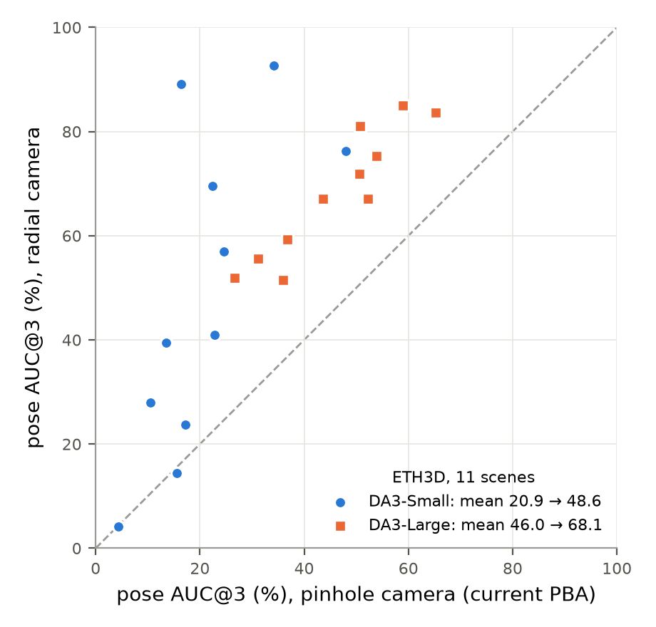

# Photometric BA, session 6: what if runtime didn't matter? (2026-11-09)

Question: with no runtime limit, how much better can the photometric BA (PBA) get? Three candidates were tested
against the recommended configurations of `REPORT2.md`:

1. **Higher resolution**: optimise at 2x the prediction resolution (the images are resized from the originals).
2. **All pairs / all pixels**: every other frame as a target instead of 10 neighbours; 16x the samples per Adam step
   (4x per LM step).
3. **A richer camera model**: radial lens distortion (k1, k2 shared by all frames).

**Where this sits.** This session was written on a branch from `main` *before* sessions 3-5 (`REPORT3.md` to
`REPORT5.md`), so all runs use session 2's code path: VGG features + NCC, autograd Adam and the forward-mode LM
polish (`impl=autograd lm_impl=jvp`), not the analytic kernels of sessions 3-5. It was merged afterwards; the merged
`run_tto_pba.py` reproduces session 3-5's analytic path exactly (checked on the CPU, where it is deterministic) and
session 2's path bit-identically on the GPU.

**Relation to session 3's radial coefficient.** Session 3 (`REPORT3.md`, sections 3 and 11) already found that
ETH3D's distortion limits PBA and added one radial coefficient of a division model to the analytic path (`radial=true`,
`radial_max=0`, `radial_gate=0.01`). This session found the same independently with a different model: two polynomial
coefficients (`camera=radial`) in the autograd/jvp path, on all 11 ETH3D scenes for DA3-Small and DA3-Large-1.1. One
difference is worth a look: session 3's free coefficient hurt undistorted scenes (HiRoom AUC@3 32.5 -> 24.6, hence
`radial_max=0` and the gate), while `camera=radial` here stays neutral on HiRoom and DTU **without a gate**. A likely
reason is the radius check described below: without it, this model hurt HiRoom too.

## Summary

- **The radial camera is the one change that matters, and it costs nothing.** On all 11 ETH3D scenes (real DSLR
  images with lens distortion) pose AUC@3 goes **20.9 -> 48.6 for DA3-Small** and **46.0 -> 68.1 for DA3-Large**
  (AUC@30 76.6 -> 82.6 and 89.9 -> 94.0): all 11 Large scenes and 9 of 11 Small scenes improve (the other two are
  -1 point), at +5-12% time. DA3-Small + PBA with the radial camera is above DA3-Large + session 2's best PBA on ETH3D
  (48.6 vs 46.0). The fitted coefficients are nearly the same in every scene and for both models (Large: k1
  -0.087 to -0.097, k2 0.059 to 0.070; Small: k1 -0.064 to -0.121, k2 0.061 to 0.098), as they should be for one
  camera and lens: it is the lens, not per-scene overfitting. HiRoom (synthetic pinhole) and DTU stay within noise.
- **2x resolution does not help pose.** Mixed and mostly within noise (`hires` / `hires_match`): Small HiRoom
  -2.3 / -3.3 AUC@3, ETH3D +1.6 / -0.2, DTU-64 +1.2 / +0.7; Large HiRoom +2.5 / +0.6 but ETH3D -4.7 / -2.6 (with the
  pinhole camera). The finest blur level of the current pyramid is not where the accuracy is lost. The one consistent
  sign is a small HiRoom recon gain with the sharp 2x polish (F1 +2.4 Small, +1.4 Large, 4 scenes), worth a check
  on more scenes if reconstruction matters.
- **All pairs only matters for scenes with many frames,** and then only sometimes: with <= 11 frames the 10 spread
  neighbours already are all pairs (identical results). The gain on Small HiRoom (40.6 -> 45.6) is one 23-frame scene
  (45 -> 66). ETH3D +2.5 (Small) / -0.6 (Large), DTU-64 (64 frames) +0.1, at 4-6x the time.
- **16x samples changes nothing** (Small HiRoom 39.1 vs 40.6, ETH3D 12.8 vs 12.1, DTU-64 55.4 vs 55.5; Large within
  0.5 everywhere) at 11-15x the time. Lower gradient noise does not move the optimum, consistent with session 2 (larger LM batches did
  not stop the ETH3D drift) and with session 3 (more Adam iterations make it worse).
- So for "unlimited compute" the answer is: don't spend it on more of the same objective. The error that was left on
  ETH3D was a **model** error (the pinhole camera), not an optimisation error. The next candidates are of that kind
  (see "Next steps").

## What was built

All in `scripts/run_tto_pba.py`; defaults unchanged. Before the merge the default path was bit-identical to `main` (HiRoom
828745: identical AUC, focal and photometric error); after it, see "Where this sits" above. The three options need
`impl=autograd lm_impl=jvp`, no patch levels and `radial=false`; the script exits otherwise.

| option | what |
|---|---|
| `camera=radial` (`lr_dist`) | shared radial distortion `x_d = x (1 + k1 r^2 + k2 r^4)` of the normalised coordinates: source pixels are undistorted by fixed-point iteration (differentiable), targets distorted after the projection; both coefficients are also unknowns of the LM polish (two extra columns in the normal equations). Output intrinsics stay pinhole (the evaluator has no distortion). |
| `res_scale=2` | optimise at 2x the prediction resolution: images resized from the originals, DA3's depth and confidence upsampled bilinearly, intrinsics scaled with the cv2/`align_corners=False` pixel-centre convention; blur sigmas of `levels` are in pixels of that resolution. The depth correction grid is applied to DA3's own depth at the output, intrinsics scaled back. A no-op run (no levels) returns DA3's prediction exactly. Feature maps > 2 GiB are kept on the CPU and their blurred copy on the GPU is float16 (only at `res_scale=2` on DTU). |
| `sample_chunk=<n>` | gradient accumulation over chunks of the samples (Adam), and chunked cost evaluations in LM, so that all pairs and 16x samples fit in 8 GB. Mathematically the same step. |
| `neighbors=1000 nbr_mode=top` | (existing options) all other frames as targets |

Pitfall found on the way: **with distortion, points far outside a target's field of view fold back into the
image** (the polynomial is not monotonic at large radii), are counted as visible and pull k2 negative; the first
radial run made HiRoom *worse* (focal error and geometric error doubled). `project()` now only accepts radii up to
1.5x the image corner's and where the mapping is monotonic; after that HiRoom is neutral.

Runs: `scripts/run_pba_unlimited.sh` (variants on HiRoom 4 / ETH3D 3 / DTU-64 2 scenes, the first scenes of the
dev subset; 7-Scenes and ScanNet++ have 100 frames and don't fit the variants on the 8 GB RTX 3070 this ran on) and
`scripts/run_pba_radial_eth3d.sh` (base vs radial on all 11 ETH3D scenes). Tables: `scripts/table_pba_unlimited.py`,
figure: `scripts/plot_radial_eth3d.py`. Per-run configs, metric JSONs and logs are copied to `results/pba/runs6/`
(`subset/` and `eth3d_all/`; predictions stay in `workspace/tto/unlimited*/` on the local machine), the variant
table to `table_unlimited.md`. Configurations (`REPORT2.md`'s recommendations, run on the pre-merge code):
Small `V3 iters=200 levels=8,4,2,1,1 lm_levels=4 lm_iters=5`, Large the same with `iters=50 w_prior=100 w_pose=10`.

## Radial camera on all of ETH3D

| ETH3D (11 scenes), pose AUC@3 / AUC@30 % | DA3-Small | DA3-Large-1.1 |
|---|---|---|
| no PBA | 8.6 / 62.2 | 34.8 / 87.7 |
| PBA, pinhole camera (current) | 20.9 / 76.6 | 46.0 / 89.9 |
| **PBA, radial camera** | **48.6 / 82.6** | **68.1 / 94.0** |
| time per scene (RTX 3070) | 57 -> 60 s | 17 -> 19 s |

The pinhole rows reproduce `REPORT2.md`'s full-benchmark ETH3D values for the same configurations (Small 21.9, Large
46.0 there, on the RTX 5090). Per scene (Small): electro 16 -> 89, kicker 34 -> 93, playground 22 -> 70, relief 25 ->
57, facade 14 -> 39; courtyard and delivery_area stay where they were (15 / 4). Large improves on all 11 scenes by
+15 to +30 points.

Why this is the big one: session 2 found that well-initialised ETH3D scenes got *worse* when PBA converged further
(flat directions), and the pose prior only stopped the damage. With a lens that the pinhole model can't represent,
no pinhole camera aligns the images everywhere, and the best compromise bends the poses (probably mostly through
the image border, where the distortion is largest and which carries most of the rotation information; not checked
separately). Modelling the lens removes that bias,
which no amount of extra iterations, pixels or resolution could.

## All variants on the small subset

Means over the scenes each variant shares with `base` ([n] scenes; in brackets the base value on the same scenes);
HiR F1 = HiRoom recon F1 after TSDF fusion (no-PBA value from `results/da3_bench`); s/scene = PBA time on one RTX
3070. Seed-to-seed noise (`base_s1`): <= 1.7 AUC@3 on HiRoom, <= 0.6 elsewhere.

### DA3-LARGE-1.1

| run | HiR A@3 / A@30 [n] | ETH A@3 / A@30 [n] | DTU64 A@3 / A@30 [n] | HiR F1 | focal err % | s/scene |
|---|---|---|---|---|---|---|
| no PBA | 58.4 / 94.6 [4] | 30.6 / 89.6 [3] | 69.5 / 96.7 [2] | 79.2 | 2.0 | 0 |
| base | 84.1 / 97.7 [4] | 50.6 / 93.4 [3] | 70.5 / 96.7 [2] | 83.8 | 1.1 | 21 |
| base_s1 | 84.7 / 97.8 [4] (base 84.1) | 50.5 / 93.3 [3] (base 50.6) | 70.7 / 96.7 [2] (base 70.5) | 82.8 (base 83.8) | 1.1 | 20 |
| radial | 84.1 / 97.7 [4] (base 84.1) | 69.0 / 96.2 [3] (base 50.6) | 71.3 / 96.8 [2] (base 70.5) | 84.0 (base 83.8) | 1.2 | 20 |
| hires | 86.6 / 97.7 [4] (base 84.1) | 45.9 / 92.5 [3] (base 50.6) | 71.1 / 96.8 [2] (base 70.5) | 85.2 (base 83.8) | 1.2 | 22 |
| hires_match | 84.7 / 97.6 [4] (base 84.1) | 48.0 / 93.1 [3] (base 50.6) | 71.0 / 96.8 [2] (base 70.5) | 84.1 (base 83.8) | 1.1 | 21 |
| allpairs | 85.0 / 97.8 [4] (base 84.1) | 50.0 / 93.4 [3] (base 50.6) | 70.7 / 96.7 [2] (base 70.5) | 83.0 (base 83.8) | 1.1 | 75 |
| allpix | 84.4 / 97.7 [4] (base 84.1) | 50.1 / 93.3 [3] (base 50.6) | 70.5 / 96.7 [2] (base 70.5) | 83.8 (base 83.8) | 1.1 | 237 |

Per scene AUC@3: hiroom: 828738 89/90/89/93/91/89/90, 828744 86/84/88/87/86/87/86, 828745 78/79/77/78/78/76/78, 828749 83/86/82/89/84/88/83; eth3d: courtyard 65/66/84/59/63/67/65, delivery_area 36/35/51/33/34/36/36, electro 51/51/72/46/47/47/50; dtu64: scan105 57/57/58/57/57/57/57, scan114 84/84/85/85/85/84/84  (order: base, base_s1, radial, hires, hires_match, allpairs, allpix)

### DA3-SMALL

| run | HiR A@3 / A@30 [n] | ETH A@3 / A@30 [n] | DTU64 A@3 / A@30 [n] | HiR F1 | focal err % | s/scene |
|---|---|---|---|---|---|---|
| no PBA | 8.7 / 73.6 [4] | 5.1 / 59.2 [3] | 40.8 / 93.1 [2] | 18.3 | 11.0 | 0 |
| base | 40.6 / 88.2 [4] | 12.1 / 72.9 [3] | 55.5 / 94.5 [2] | 55.6 | 3.5 | 56 |
| base_s1 | 38.9 / 88.1 [4] (base 40.6) | 12.3 / 73.5 [3] (base 12.1) | 55.4 / 94.4 [2] (base 55.5) | 56.0 (base 55.6) | 3.5 | 56 |
| radial | 39.3 / 87.8 [4] (base 40.6) | 35.9 / 76.7 [3] (base 12.1) | 55.3 / 94.5 [2] (base 55.5) | 55.4 (base 55.6) | 3.5 | 64 |
| hires | 38.3 / 87.1 [4] (base 40.6) | 13.7 / 70.5 [3] (base 12.1) | 56.7 / 94.6 [2] (base 55.5) | 58.0 (base 55.6) | 3.6 | 64 |
| hires_match | 37.3 / 86.7 [4] (base 40.6) | 11.9 / 71.5 [3] (base 12.1) | 56.2 / 94.5 [2] (base 55.5) | 56.1 (base 55.6) | 3.5 | 62 |
| allpairs | 45.6 / 88.9 [4] (base 40.6) | 14.6 / 74.2 [3] (base 12.1) | 55.6 / 94.5 [2] (base 55.5) | 55.7 (base 55.6) | 3.4 | 245 |
| allpix | 39.1 / 88.0 [4] (base 40.6) | 12.8 / 73.5 [3] (base 12.1) | 55.4 / 94.5 [2] (base 55.5) | 55.4 (base 55.6) | 3.5 | 872 |

Per scene AUC@3: hiroom: 828738 45/40/42/31/31/66/41, 828744 9/8/9/10/10/9/9, 828745 57/56/56/59/58/57/56, 828749 51/52/51/54/51/51/52; eth3d: courtyard 16/15/14/15/14/17/16, delivery_area 4/4/4/5/5/4/5, electro 16/17/89/21/16/22/17; dtu64: scan105 49/49/48/50/50/50/49, scan114 62/62/62/64/63/61/62  (order: base, base_s1, radial, hires, hires_match, allpairs, allpix)

## Caveats

- 2-4 scenes per dataset for the variant comparison; only the radial ETH3D effect is far above the noise, and it was
  confirmed on all 11 scenes. 7-Scenes and ScanNet++ were not tested (memory).
- The 2x-resolution ETH3D scenes delivery_area and electro ran out of memory in the LM Jacobian and were re-run
  with `lm_chunk=2` (same normal equations, summed in smaller pieces).
- With `camera=radial` the saved intrinsics are pinhole, so a reconstruction from these outputs would ignore the
  lens (HiRoom recon is unaffected, it has none). ETH3D recon was not scored (its full-resolution TSDF fusion needs
  more RAM than this machine had next to the runs).

## Next steps

1. **Compare the two radial models on the same path**: session 3's one-coefficient division model with gate against
   `camera=radial` (two coefficients, the radius check, no gate). If the radius check is what keeps undistorted scenes
   neutral, the analytic path can drop the gate and `radial_max=0`. `camera=radial` is not implemented in the analytic
   kernels yet (`run_tto_pba.py` exits if they are combined).
2. **Export the undistortion for reconstruction** (also open in session 3): undistort the images/depth with the fitted
   coefficients before the evaluator's TSDF fusion, then score ETH3D recon.
3. Full benchmark with the radial camera, including 7-Scenes and ScanNet++ (did not fit the variants on the 8 GB GPU).
4. Not worth more compute: 2x resolution, all pairs and more samples. The remaining error is model error (camera,
   depth parametrisation), as sessions 3 and 5 also concluded.
