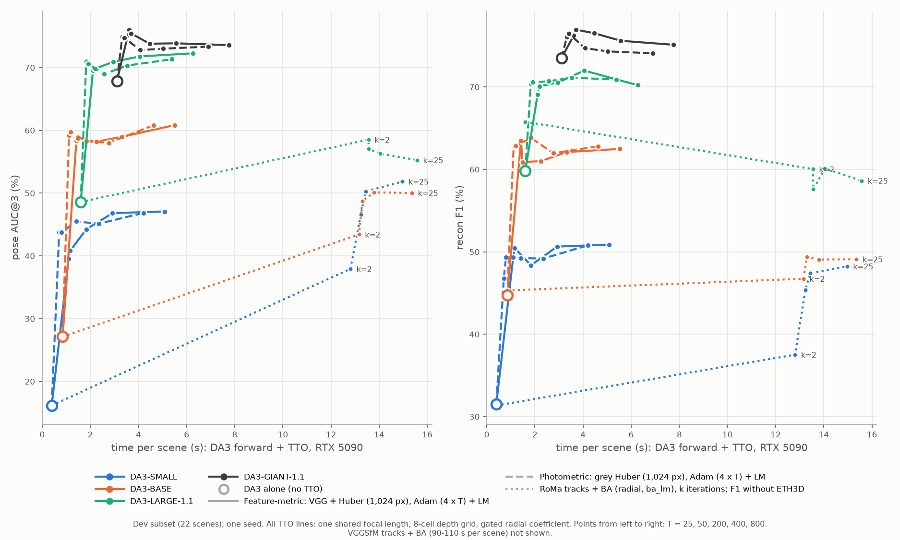

# Feature-metric BA, session 7: three times cheaper with Huber at 1,024 pixels (2026-11-09/10)

The feature-metric BA (VGG16 features + NCC, REPORT3 section 5) was the most accurate TTO line of the compute plot
(`figures5/compute_all_models.png`), but at T = 800 it cost 15.7 s per scene against 3.8 s for the photometric BA. This
session found where that time goes and replaced the configuration with a cheaper one: **VGG features with the per-pixel
Huber loss at 1,024 pixels** (`fmh`) instead of NCC of 3×3 patches at 4,096 pixels (`fm`). Session 4 had already tested
this loss on DA3-SMALL (REPORT4 section 1, `x1_vgg`); this session runs it with session 5's shared focal on all four models.

Setup: dev subset (22 scenes), one seed, DA3-SMALL, BASE, LARGE-1.1 and GIANT-1.1, T = 25, 50, 200, 400, 800 Adam
iterations per level (4 levels, then one LM level). Times are TTO seconds per scene on an RTX 5090 with one run per GPU
(`opt_s`: feature extraction + Adam + LM, without image decoding and the DA3 forward pass), with the first scene of each
dataset replaced by the dataset's median (process warm-up). Code snapshot `f1` (see section 6).



## Summary

- **The time is in the Adam iterations on scenes with many frames.** Feature extraction (0.06-0.36 s per scene) and LM
  (< 1 s) are minor. At 100 frames a VGG + NCC Adam iteration costs 11.0 ms, against 1.24 ms photometric.
- **Why:** per frame, neighbour and iteration, VGG + NCC reads 4,096 pixels × 8 channels, 32 times the photometric
  1,024 × 1. The photometric iteration is so small that it costs the launch overhead of its ~270 GPU operations
  (REPORT3 section 1) whatever the frame count; the feature-metric one is large enough to grow with the frames.
- **NCC at 4,096 pixels is the larger factor, the 8 channels the smaller one** (section 1). VGG + Huber at 1,024
  pixels keeps the 8 channels and drops NCC: **2.2 ms per Adam iteration at 100 frames instead of 11.0.**
- **TTO time per scene: 4.7 s instead of 15.7 s at T = 800 (3.3× faster), 0.5-0.7 s instead of 0.9-1.1 s at T = 25.**
  That is 0.3-0.4 s more than the photometric BA up to T = 200 and 0.9 s more at T = 800.
- **Quality:** pose AUC@3 is 1.7-3.5 lower than VGG + NCC at T = 800 and level with the photometric BA (at T = 25 it
  is below both on SMALL, 39.6 vs 43.8 photometric). Recon F1
  is equal or higher than VGG + NCC on BASE, LARGE-1.1 and GIANT-1.1 (GIANT-1.1: 75.1 vs 71.2 at T = 800; its best,
  77.0 at T = 50, is the highest F1 of the plot). All differences of 1-2 points are within the noise of one seed on 22
  scenes.
- **The pose gap of VGG + Huber is almost all ETH3D and DTU-64** (section 4): on ETH3D VGG + NCC is 8.5-12.5 AUC@3 ahead,
  on HiRoom, 7-Scenes and ScanNet++ the two are level. ETH3D has 3 dev scenes.
- This is the second speed-up of the feature-metric BA. Session 3 made VGG + NCC 4.3× faster without changing its
  result (4.98 → 1.17 s per scene at 4×50: analytic gradient and Jacobians, a faster extractor, 8 instead of 16 PCA
  channels; REPORT3 section 5). This session changes the loss instead, so the result changes too.

## 1. Where the time goes

Mean per scene, DA3-SMALL runs at T = 800 (Adam time from the first Adam to the first LM entry of
`<dataset>_pba_hist.jsonl`, divided by the 3,200 Adam iterations; the TTO time doesn't depend on the model):

| dataset | frames | photometric | VGG + Huber, 1,024 px | VGG + NCC, 4,096 px | VGG extraction |
|---|---|---|---|---|---|
| HiRoom | 12 (mean) | 1.16 ms | 1.07 ms | 1.26 ms | 0.06 s |
| ETH3D | 40 | 1.18 ms | 1.09 ms | 3.94 ms | 0.13 s |
| DTU-64 | 64 | 1.19 ms | 1.44 ms | 6.81 ms | 0.23 s |
| 7-Scenes | 100 | 1.24 ms | 2.22 ms | 10.89 ms | 0.36 s |
| ScanNet++ | 100 | 1.24 ms | 2.22 ms | 11.03 ms | 0.36 s |

At T = 800 the LM level stops after its first iteration (`lm_stop=2e-3`), except on ETH3D (4-6 iterations, < 0.2 s). At
T = 25 it runs 4-14 iterations: up to 0.51 s photometric, 0.85 s VGG + Huber and 0.93 s VGG + NCC (ScanNet++).

One factor at a time, ms per Adam iteration at 100 frames (7-Scenes and ScanNet++):

| Adam loss | pixels × channels per frame and neighbour | data vs. photometric | ms per iteration | run |
|---|---|---|---|---|
| grey Huber (photometric) | 1,024 × 1 | 1× | 1.24 | `pho_it800` |
| VGG + Huber | 1,024 × 8 | 8× | 2.22 | `fmh_it800` |
| grey NCC of 3×3 patches | 4,096 × 1 | 4× | 5.5 | `x1_ncc_s0` (session 4, snapshot `e1`) |
| VGG + NCC (feature-metric) | 4,096 × 8 | 32× | 11.0 | `fm_it800` |

NCC is the larger factor: grey NCC reads half the data of VGG + Huber but costs 2.5 times as much per iteration. And
NCC needs many samples because it works on patches: 4,096 give 455 patches of 3×3 per frame, 1,024 only 113 (REPORT3
section 5: 29.2 vs 31.5 AUC@3 for 1,024 vs 4,096, though that row also halves T). The 8 channels then double the cost
again. VGG + Huber pays only for the channels.

## 2. The change

Both VGG configurations use VGG16 features reduced to 8 PCA channels (`features=vgg feat_dim=8 vgg_fast=true`), no
brightness parameters (the code models brightness only for grey images), 15 LM iterations at 4,096 pixels with the stop
rule, and the session-5 setup: one shared focal length (`focal_init=median`), the 8-cell depth grid, 10 spread
neighbours, the gated radial coefficient (0.01). They differ in two settings of the Adam levels:

| | `photo_loss` | `samples` (Adam) | LM |
|---|---|---|---|
| VGG + NCC (`fm`) | `ncc` | 4,096 | NCC, 4,096 px |
| VGG + Huber (`fmh`) | `huber` | 1,024 | Huber, 4,096 px (`lm_samples=4096`) |

Peak GPU memory doesn't change much: 10.4 GiB for VGG + Huber, 10.8 GiB for VGG + NCC, 5.3 GiB photometric (largest
scene). The VGG configurations don't fit the 8 GiB of the local GPUs.

## 3. Cost and quality, all four models

TTO seconds per scene (the DA3 forward pass adds 0.4 / 0.85 / 1.6 / 3.1 s for SMALL / BASE / LARGE-1.1 / GIANT-1.1):

| T | 25 | 50 | 200 | 400 | 800 |
|---|---|---|---|---|---|
| photometric | 0.22-0.31 | 0.31-0.40 | 0.97-1.02 | 1.92-1.95 | 3.77-3.81 |
| VGG + Huber | 0.51-0.70 | 0.59-0.77 | 1.36-1.44 | 2.45-2.53 | 4.66-4.69 |
| VGG + NCC | 0.86-1.08 | 1.26-1.45 | 4.10-4.14 | 7.93-7.98 | 15.61-15.69 |

Pose AUC@3 (mean of the five datasets) / recon F1 (mean of HiRoom, 7-Scenes, ScanNet++, ETH3D):

| dev | DA3 alone | photo. T = 25 | VGG+Huber T = 25 | VGG+NCC T = 25 | photo. T = 800 | VGG+Huber T = 800 | VGG+NCC T = 800 |
|---|---|---|---|---|---|---|---|
| SMALL | 16.2 / 31.5 | 43.8 / 46.8 | 39.6 / **49.3** | **45.4** / 49.1 | 46.8 / 50.8 | 47.1 / 50.9 | **50.6 / 51.3** |
| BASE | 27.1 / 44.7 | 59.2 / 62.8 | 58.3 / **63.5** | **59.7** / 61.4 | 60.8 / **62.8** | 60.8 / 62.5 | **63.2** / 62.1 |
| LARGE-1.1 | 48.6 / 59.9 | 71.0 / **70.4** | 69.6 / 69.1 | **72.3** / 68.2 | 71.3 / **70.9** | 72.3 / 70.2 | **74.1** / 69.0 |
| GIANT-1.1 | 67.8 / 73.5 | 74.9 / 76.1 | 76.1 / **76.3** | **77.2** / 74.7 | 73.3 / 74.1 | 73.6 / **75.1** | **75.3** / 71.2 |

Bold: the best of the three at that T, per metric. The other T values are in
`results/pba/runs/<model>/{pho,fmh,fm}_it<T>` and on the plot. Over T, VGG + Huber's AUC@3 rises on SMALL (39.6 → 47.1),
BASE (58.3 → 60.8) and LARGE-1.1 (69.6 → 72.3) and falls on GIANT-1.1 (76.1 → 73.6), as the other two configurations
do on GIANT-1.1.

## 4. Where VGG + NCC still wins: ETH3D and DTU-64

AUC@3 of VGG + NCC minus VGG + Huber at T = 800, per dataset:

| dev, T = 800 | HiRoom (10) | 7-Scenes (2) | ScanNet++ (3) | DTU-64 (4) | ETH3D (3) | mean |
|---|---|---|---|---|---|---|
| SMALL | +4.2 | 0.0 | -0.5 | +5.6 | +8.5 | +3.5 |
| BASE | -3.3 | -0.1 | -0.3 | +2.7 | +12.5 | +2.4 |
| LARGE-1.1 | +0.4 | -2.3 | -0.1 | +2.6 | +8.8 | +1.8 |
| GIANT-1.1 | -5.8 | 0.0 | +0.5 | +2.7 | +11.1 | +1.7 |

ETH3D alone accounts for 1.7-2.5 points of the mean gap, DTU-64 for 0.5-1.1. The photometric BA is behind VGG + NCC on
ETH3D by a similar amount (34.4 / 55.6 / 81.0 / 78.8 vs 42.2 / 71.1 / 93.7 / 93.7 for SMALL to GIANT-1.1), so on these
scenes the VGG features alone don't help: the gain comes with NCC or its 4,096 pixels. Which of the two isn't tested. A guess, not checked: ETH3D's
exposure varies between images, and NCC is invariant to local gain and offset, while neither Huber configuration has a
brightness model on VGG features (the photometric one has one, on grey values).

## 5. Caveats

- One seed on 22 dev scenes, no held-out run. ETH3D has 3 dev scenes and DTU-64 4, so section 4 rests on 7 scenes.
- `fm` and `fmh` differ in the loss and in the number of Adam samples; these runs don't separate the two.
- The grey NCC row of section 1 is from a session-4 run (snapshot `e1`, the analytic code before the shared focal),
  not from snapshot `f1`.

## 6. Files and commands

- Runs: `workspace/tto/<model>/{fmh,fm,pho}_it<T>` (predictions deleted after scoring); configs and metrics in
  `results/pba/runs/<model>/{fmh,fm,pho}_it<T>`.
- Job lines: `results/pba/jobs/pmba/f2_lines.py` (fmh) and `f1_lines.py` (fm, pho, and the undrawn ncc line); worker and
  scoring scripts in the same folder (`worker.sh`, `score_clean.sh`). Code snapshot `$SCRATCH/jobs/pmba/snap/f1`:
  `pba_analytic.py` is identical to the repo; `run_tto_pba.py` lacks only REPORT6's later additions (`res_scale`,
  `camera=radial`), which REPORT6 checked to leave this path unchanged.
- Plot: `.venv/bin/python scripts/plot_compute.py results/pba/figures5/compute_all_models.png` (the VGG + NCC line can be
  added back in `FAMILIES`, see the comment there).
- One VGG + Huber run on one dataset (`run.sh` loops over the five dev datasets):

```sh
.venv/bin/python scripts/run_tto_pba.py workspace/evaluation/DA3-SMALL workspace/tto/DA3-SMALL/fmh_it800 \
  datasets=hiroom max_scenes=10 iters=800 \
  nbr_mode=spread neighbors=10 lr_rot=3e-3 lr_trans=3e-3 lr_focal=3e-3 levels=8,4,2,1,1 lm_levels=4 \
  impl=analytic lm_impl=analytic lm_solver=dense32 radial=true radial_max=0 radial_gate=0.01 focal_init=median \
  features=vgg photo_loss=huber vgg_fast=true feat_dim=8 samples=1024 lm_iters=15 lm_samples=4096 lm_stop=2e-3
```

## 7. Next steps

- Separate loss and samples on all 11 ETH3D scenes (3 dev scenes are too few): VGG + Huber with `samples=4096`, and
  VGG + Huber in the Adam levels followed by NCC in LM (`lm_photo_loss=ncc`), which would keep Adam's cost.
- A held-out run of VGG + Huber on GIANT-1.1 at T = 50, where its F1 is the best of the plot.
