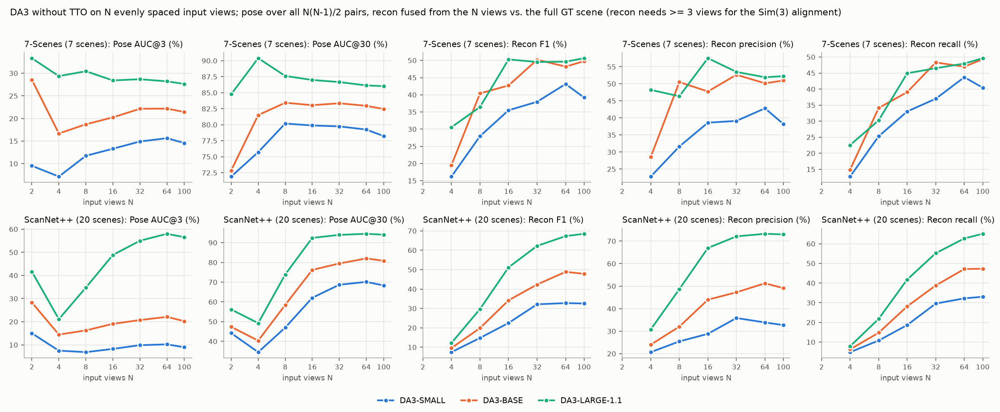
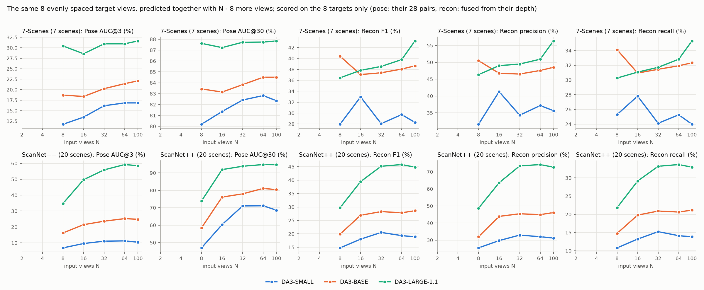
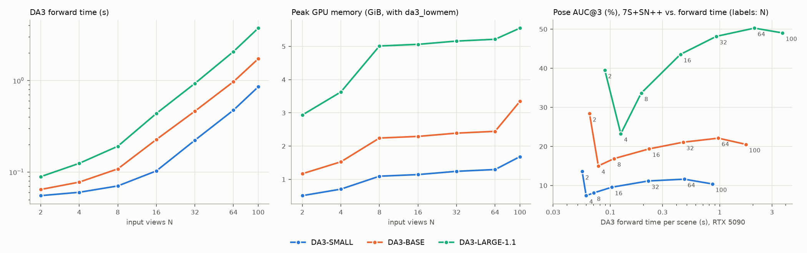

# DA3 quality vs. number of input views (no TTO)

2026-11-01, tum2 (RTX 5090). DA3-SMALL, DA3-BASE and DA3-LARGE-1.1 with N = 2, 4, 8, 16, 32, 64 and all (≤ 100) input
views, scored by the unmodified DA3 evaluator: pose AUC on all five pose datasets, unposed reconstruction (F1, precision,
recall) on HiRoom, 7-Scenes and ScanNet++. Full tables: [views.md](views.md).

## Summary

- **Quality saturates at about 32–64 views.** Pooled over 7-Scenes and ScanNet++ (27 scenes with 100 frames each), going
  from 64 to 100 views changes nothing beyond noise (LARGE AUC@3 50.3 → 49.0, F1 62.7 → 63.9), but it costs 1.8x the
  forward time. Most of the gain comes between 8 and 32 views.
- **Larger models gain much more from extra views.** From 8 to 64 views, AUC@3 rises by +16.7 points for LARGE, +5.2 for
  BASE and +3.5 for SMALL, and F1 by +31.2, +23.5 and +17.3. So the gap between models widens with N: LARGE minus SMALL in
  AUC@3 is 25.5 points at 8 views and 38.7 at 64.
- **The extra views make each view's prediction better, not only the scene coverage.** If the same 8 target views are
  predicted together with 56 more views and only the 8 are scored, LARGE goes from AUC@3 33.6 to 51.9, AUC@30 77.4 to
  93.0 and F1 31.5 to 44.2. All of the gain in recon precision (48.1 → 68.2) comes from this context. Recall then grows
  from fusing more views (coverage): 24.0 with 8 targets, 33.4 with the same 8 targets after context, 58.9 with all 64 views.
- **The effect depends on the dataset.** ScanNet++ (large rooms, median pair rotation 72°) drives the whole trend. On
  7-Scenes, LARGE pose doesn't improve beyond 8 views and recon F1 saturates at 16. DTU64 saturates at 8 views.
- **At matched forward time, the larger model with fewer views wins.** LARGE at 16 views (0.44 s) beats BASE at 100 views
  (1.73 s) and SMALL at 100 views (0.85 s) on pose, F1 and precision (AUC@3 43.6 / 20.5 / 10.4, F1 50.9 / 48.4 /
  34.3). Only its recall is lower than BASE's (42.6 vs. 47.8), because 16 views cover less of the scene.
- **Two views behave differently.** Each pair either comes out nearly exact or fails completely, so AUC@3 at N = 2 is higher
  than at N = 4 for every model. It isn't comparable to the other N (details below).

## Setup

- **Frame selection** (`scripts/run_views.py`). The frames come from the benchmark's own selection per scene, i.e. all
  frames or the evaluator's seeded random sample of 100, kept in capture order. For N ≤ 8 the input is N evenly spaced
  frames, first and last included. For N > 8 it is the same 8 evenly spaced frames plus, repeatedly, the frame in the
  middle of the largest gap. So the inputs are spread over the whole sequence, inputs with N ≥ 8 are nested and share
  the 8 *target* frames, and every input starts with the same reference frame (`ref_view_strategy=first`). With "all", the
  input is exactly the benchmark's: those results match `results/da3_bench` within 0.4 points on every dataset and metric.
- **Fixed-target analysis.** Each prediction with N > 8 is also cut down to the 8 target frames and scored like an 8-view
  prediction (`n<N>_t8`). The scored camera pairs (28) and the fused views are therefore identical for every N, and
  only the amount of context changes.
- **Which N count for a dataset.** A dataset gets a value for N only if all of its scenes have at least N frames:
  7-Scenes and ScanNet++ every N, DTU64 N ≤ 32, HiRoom and ETH3D N ≤ 8. In addition each dataset has "all", which means
  10–23 views on HiRoom, 14–76 on ETH3D and 49/64 on DTU64.
- **Recon datasets.** Recon is scored on HiRoom, 7-Scenes and ScanNet++ only. DTU's fusion ignores the frame subset and
  uses all 49 GT cameras and masks, and ETH3D's fusion needs about 60 GB of RAM. Recon is also skipped for N = 2,
  because the unposed protocol aligns the prediction to GT by a Sim(3) fit to the camera centres, which is degenerate
  with two cameras.
- **Timing.** DA3 forward time and peak memory, measured with `da3_lowmem` after a warm-up call. Values are medians
  over the 7-Scenes and ScanNet++ scenes, which are all 378×504.

## Results (7-Scenes + ScanNet++ pooled, 27 scenes)

| model | N | AUC@3 | AUC@30 | F1 | precision | recall | forward s |
|---|---|---|---|---|---|---|---|
| DA3-SMALL | 2 | 13.6 | 51.4 | - | - | - | 0.06 |
| DA3-SMALL | 4 | 7.4 | 45.2 | 9.7 | 21.2 | 6.9 | 0.06 |
| DA3-SMALL | 8 | 8.1 | 55.6 | 18.2 | 27.1 | 14.5 | 0.07 |
| DA3-SMALL | 16 | 9.6 | 66.7 | 25.9 | 31.3 | 22.4 | 0.10 |
| DA3-SMALL | 32 | 11.2 | 71.5 | 33.7 | 36.7 | 31.5 | 0.22 |
| DA3-SMALL | 64 | 11.6 | 72.5 | 35.5 | 36.2 | 35.2 | 0.47 |
| DA3-SMALL | 100 | 10.4 | 70.9 | 34.3 | 34.1 | 35.0 | 0.85 |
| DA3-BASE | 2 | 28.4 | 54.0 | - | - | - | 0.06 |
| DA3-BASE | 4 | 15.0 | 51.0 | 12.2 | 25.2 | 8.5 | 0.08 |
| DA3-BASE | 8 | 16.9 | 64.9 | 25.2 | 36.8 | 19.8 | 0.11 |
| DA3-BASE | 16 | 19.4 | 78.0 | 36.4 | 44.9 | 31.0 | 0.23 |
| DA3-BASE | 32 | 21.1 | 80.5 | 44.4 | 48.6 | 41.3 | 0.46 |
| DA3-BASE | 64 | 22.1 | 82.3 | 48.7 | 51.0 | 47.1 | 0.97 |
| DA3-BASE | 100 | 20.5 | 81.2 | 48.4 | 49.6 | 47.8 | 1.73 |
| DA3-LARGE-1.1 | 2 | 39.5 | 63.6 | - | - | - | 0.09 |
| DA3-LARGE-1.1 | 4 | 23.3 | 59.9 | 16.9 | 35.3 | 11.7 | 0.12 |
| DA3-LARGE-1.1 | 8 | 33.6 | 77.4 | 31.5 | 48.1 | 24.0 | 0.19 |
| DA3-LARGE-1.1 | 16 | 43.6 | 91.0 | 50.9 | 64.5 | 42.6 | 0.44 |
| DA3-LARGE-1.1 | 32 | 48.2 | 92.1 | 59.0 | 67.3 | 53.0 | 0.93 |
| DA3-LARGE-1.1 | 64 | 50.3 | 92.3 | 62.7 | 67.7 | 58.9 | 2.07 |
| DA3-LARGE-1.1 | 100 | 49.0 | 92.0 | 63.9 | 67.6 | 61.1 | 3.74 |



**Same 8 target views, more context** (pooled; N = 8 is the 8 targets alone):

| model | N | AUC@3 | AUC@30 | F1 | precision | recall |
|---|---|---|---|---|---|---|
| DA3-SMALL | 8 → 64 | 8.1 → 12.7 | 55.6 → 74.2 | 18.2 → 22.0 | 27.1 → 33.3 | 14.5 → 17.0 |
| DA3-BASE | 8 → 64 | 16.9 → 24.3 | 64.9 → 82.0 | 25.2 → 30.5 | 36.8 → 45.6 | 19.8 → 23.6 |
| DA3-LARGE-1.1 | 8 → 64 | 33.6 → 51.9 | 77.4 → 93.0 | 31.5 → 44.2 | 48.1 → 68.2 | 24.0 → 33.4 |



For pose, this fixed-target gain accounts for about all of the standard-metric gain (LARGE AUC@3 at 64 views: 51.9 on
the fixed pairs vs. 50.3 on all pairs). More views therefore improve the cameras themselves; they don't just add pairs
that happen to be easier.



## Details and caveats

- **2 views.** The single pair per scene is the first and last frame of the sequence. These are the hardest pairs by GT
  geometry: the median relative rotation on ScanNet++ is 114° at N = 2 vs. 72° at N = 100. The results are bimodal. For
  LARGE, 12 of the 27 pooled scenes have AUC@3 > 60% (error below about 1–2°), while 7 have AUC@30 < 5% (failed). With 4
  views only 1 scene is that exact and none fails. AUC@3 rewards the exact successes and doesn't penalise the failures
  more than a moderate error, so the N = 2 value isn't comparable to larger N. AUC@30 shows the failures instead (63.6
  at N = 2 vs. 92 at N ≥ 32 for LARGE).
- **4 views** is the worst N on ScanNet++ for all models. Its frames (0, 33, 66, 99 of 100) rarely overlap in large
  rooms, with a median pair rotation of 107°. Recon at N = 4 also rests on a Sim(3) fit to only 4 camera centres.
- **Recall is measured against the full GT scene**, so low N is penalised for missing coverage by design. Precision is
  the cleaner measure of geometric accuracy: for LARGE it saturates at 16–32 views, while recall still grows at 100.
- **7-Scenes is small (7 scenes) and noisy.** The SMALL fixed-target recon there jumps 28 → 33 → 28. The 7-Scenes pose
  plateau (LARGE AUC@3 about 28–31 for every N ≥ 8, also on the fixed targets) may partly come from noisy GT poses
  (KinectFusion); this is a guess and wasn't checked.
- **Other datasets:** HiRoom LARGE AUC@3 is 54.3 at 8 views and 59.7 at all (10–23) views. ETH3D LARGE AUC@3 is 32.9 → 34.9
  and AUC@30 81.7 → 88.0. DTU64 is flat from 8 views on (78.4 at 8, 78.0 at 49/64). See [views.md](views.md).
- **Compute.** Below 8 views the forward time is mostly fixed overhead. Above 16 it is roughly linear in N (LARGE 0.44 /
  0.93 / 2.07 / 3.74 s for 16 / 32 / 64 / 100 views), so in this range the global attention isn't yet the dominant
  cost. With `da3_lowmem`, peak memory is nearly flat in N (LARGE 5.0–5.5 GiB from 8 to 100 views). The step at 8 views is
  the head's 8-frame chunk.
- **What "N views" means here.** N views are spread over the whole sequence, at decreasing density. A contiguous
  window (fixed density, growing coverage) would answer a different question and wasn't run. Posed mode (GT cameras as
  input) wasn't run either.

## What it means for the TTO comparison

- At the benchmark's 100 frames, DA3's own multi-view context is saturated. The forward pass gains nothing from frames
  64–100, so any further improvement must come from somewhere else, such as TTO.
- Small models can hardly use extra views: from 8 to 64 views, SMALL gains +4.6 AUC@3 on the fixed targets, LARGE
  +18.3. TTO that enforces multi-view consistency explicitly (photometric BA) is one way to give a small model the
  multi-view information it can't use itself. That fits session 2, where PBA raised SMALL's full ScanNet++ AUC@3 by a
  larger factor (9.0 → 38.5, polish200) than LARGE's (56.6 → 76.3).
- For matched-compute comparisons, the number of views is another compute knob next to model size and TTO iterations.
  Within DA3 it trades worse than model size: at equal forward time, LARGE with 16–32 views beats BASE and SMALL with
  100 views on pose and F1.

## Reproduce

```sh
# per model: GPU inference (~10 min), then CPU-only scoring (~25-40 min; 2 fusion workers need < 52 GB RAM)
sbatch --gres=gpu:1 jobs/views.sh DA3-LARGE-1.1 infer      # -> workspace/views/DA3-LARGE-1.1/n<N>[_t8]/model_results
sbatch --mem=52G jobs/views.sh DA3-LARGE-1.1 eval workers=2   # -> .../metric_results (unmodified DA3 evaluator)
.venv/bin/python scripts/plot_views.py results/views       # tables (views.md) and figures
```

The raw predictions and fused point clouds are in `workspace/views/` on scratch (about 29 GB for the three models). With 3
fusion workers and 40 GB, the first SMALL scoring job was OOM-killed during 100-view 7-Scenes fusion. The rerun with 2
workers resumed from the finished metric files.
